# Mindoro State University (MinSU) LMS — Academic Administrator Role Workflow System Modeling & Complete Diagram Blueprint

## Objective
To apply system modeling concepts to the **Mindoro State University (MinSU) E-Learn & Networking Academy Learning Management System (LMS)** project proposal by identifying, selecting, and generating all **Structural Diagrams (The Static Blueprint)** and **Behavioral Diagrams (The System in Motion)** required to document the **Academic Administrator (Registrar & Curriculum Governance) Account Workflow**.

---

## Part 1: Core Modeling Framework
Every proposed system must be viewed through two distinct lenses to ensure it can be successfully built:

### 1. Structural Diagrams (The Static Blueprint)
* **What it is:** These diagrams map out the static skeleton of the MinSU LMS Academic Administration subsystem—what parts make up the system architecture, how they are organized, and where they will be hosted.
* **Key Rule:** These components and relationships do not change based on individual user actions. They represent the permanent infrastructure or codebase layout.
* **Core Examples:** System Architecture, Class, Component, and Deployment diagrams *(plus Object, Package, Composite Structure, and Profile diagrams)*.

### 2. Behavioral Diagrams (The System in Motion)
* **What it is:** These diagrams document the dynamic logic of the MinSU LMS Academic Administration subsystem—how data moves, how components interact step-by-step, and how the system responds to registrar and curriculum operations over time.
* **Key Rule:** These change dynamically based on triggers, inputs, time, or external events.
* **Core Examples:** Data Flow Diagrams (DFD), Use Case, Sequence, and Activity diagrams *(plus State Machine, Communication, Interaction Overview, Timing, and Requirement diagrams)*.

---

## Part 2: Diagram Reference Guide

### Section A: Structural Diagrams (Static Blueprint)
* **System Architecture Diagram:** High-level layout of MinSU Registrar/Academic Admin clients, Express API servers, CSV bulk-import processors, and relational databases.
* **Class Diagram:** Maps out academic structure data models (`Department`, `Program`, `AcademicTerm`, `Course`, `ClassSection`, `Enrollment`, `Certificate`), their attributes, and relationships.
* **Component Diagram:** Shows how the Academic Admin React pages (`AcademicAdminPages.jsx`), Express controllers (`academic.controller.js`, `assignment.controller.js`), and Sequelize models depend on each other.
* **Deployment Diagram:** Outlines the physical workstations and Docker containers hosting the MinSU Academic Administration portal.
* **Object Diagram:** Captures a concrete runtime snapshot of Registrar `Clarissa Thorne` provisioning section `BSIT-3A-NET201` for `First Semester AY 2026-2027` and approving final grades.
* **Package Diagram:** Groups academic administration frontend views, validation schemas, backend controllers, and models into higher-level packages.
* **Composite Structure Diagram:** Breaks down the internal structure and ports of the `AcademicOperationsAndRegistrarEngine` classifier.
* **Profile Diagram:** Customizes UML elements with MinSU Registrar stereotypes (`<<AcademicCatalogEntity>>`, `<<SectionCapacityGuard>>`, `<<RegistrarGradeLock>>`).

### Section B: Behavioral Diagrams (The System in Motion)
* **Data Flow Diagram (DFD):** Tracks how department setups, course creations, CSV bulk enrollments, and final grade approvals flow into relational storage.
* **Use Case Diagram:** Defines project scope by mapping the **MinSU Academic Administrator**, **Enrollment & Capacity Engine**, and **Grade Lock & Certificate Issuer** across all registrar goals.
* **Activity Diagram:** A technical flowchart mapping out semester setup, course & section provisioning, instructor/TA assignment, student enrollment, and final grade approval.
* **Sequence Diagram:** Coordinates chronological, step-by-step messages between the Academic Admin UI, backend controllers, and database during Final Grade Approval & Certificate Issuance.
* **State Machine Diagram:** Tracks the lifecycle stages of a MinSU Class Section & Gradebook (`Draft_Section` → `Open_Enrollment` → `Active_Instruction` → `Grades_Submitted_By_Instructor` → `Registrar_Approved_Locked` → `Archived`).
* **Communication Diagram:** Focuses on the object network and numbered messages during CSV Bulk Enrollment Import and section capacity checking.
* **Interaction Overview Diagram:** Combines an Activity workflow with inline Sequence interaction blocks across term setup, section creation, bulk enrollment, and grade locking.
* **Timing Diagram:** Explores exact timing constraints across the MinSU Academic Calendar timeline (Enrollment Window → Active Instruction Period → Grade Submission Window → Registrar Final Approval Lock).
* **Requirement Diagram (SysML):** Maps text-based MinSU Registrar requirements (academic hierarchy, section capacity checks, CSV bulk import, and final grade approval locking) to code components and tests.

---

## Part 3: Completed Blueprinting Exercise

### 1. Project Identification
* **Proposal Title:** **Mindoro State University (MinSU) E-Learn & Networking Academy: A Web-Based Role-Driven Learning Management System Inspired by Cisco NetAcad**
* **System Summary (2–3 Sentences):**
  The Mindoro State University (MinSU) E-Learn & Networking Academy LMS is a centralized, full-stack educational platform designed for MinSU campuses to streamline academic governance, IT/Networking curriculum delivery, automated assessments, and verifiable credentialing across five distinct institutional roles. Within this ecosystem, the **Academic Administrator Workflow** manages the university's academic hierarchy—configuring MinSU colleges/departments, degree programs, academic terms, master courses, class sections, faculty/TA assignments, CSV bulk student enrollments, and final gradebook approvals. Every registrar operation enforces server-side capacity, prerequisite, and grade-locking rules persisted in a relational database.

### 2. Structural Blueprinting
* **Selected Essential Structural Diagram:** **Class Diagram** *(supported below by all 8 Structural Diagrams)*
* **Why This Specific Layout Diagram Is Required:**
  A **Class Diagram** is essential to build the MinSU Academic Administration infrastructure because university scheduling and enrollment depend on strict hierarchical foreign-key relationships in `server/src/models/index.js`: `Department` → `Program` → `Course` → `ClassSection` (linked to `AcademicTerm`, `instructorId`, and `taId`) → `Enrollment` → `Certificate`. Mapping these static associations upfront guarantees that sections cannot be created without valid courses and terms, enrollments respect section capacity limits, and locking final grades accurately transitions student enrollments and certificates.

### 3. Behavioral Blueprinting
* **Selected Critical Behavioral Diagrams:** **Sequence Diagram** and **Activity Diagram** *(supported below by all 9 Behavioral Diagrams)*
* **Specific Scenarios Mapped:**
  1. **Sequence Diagram Scenario — *MinSU Registrar Final Grade Approval, Gradebook Locking & Official Certificate Issuance*:**
     Maps the chronological interaction when a MinSU Academic Administrator reviews instructor-submitted standing grades in `GradeApprovalsPage` (`client/src/pages/AcademicAdminPages.jsx`) and triggers `POST /api/classes/:id/approve-grades`. It traces how `assignment.controller.js` verifies the `grades.approve` permission, locks the section (`gradesApproved = true`), marks passing student enrollments as `completed`, mints verifiable MinSU `Certificate` records, and logs `FINAL_GRADES_APPROVED` in `audit_logs`.
  2. **Activity Diagram Scenario — *End-to-End MinSU Academic Term, Course Offering, Section Provisioning, CSV Bulk Enrollment & Grade Approval Workflow*:**
     Maps the operational workflow and decision gates from configuring an active MinSU semester, publishing master courses, creating class sections with assigned Instructors and TAs, validating seat capacities during student enrollment/CSV import, and locking final section grades at term end.

### 4. Data Blueprinting
* **How Data Flows from an Academic Administrator Input to the System Database:**
  1. **Client Input & Serialization:** The MinSU Academic Administrator submits a form or uploads CSV records in `client/src/pages/AcademicAdminPages.jsx` (e.g., creating a class section, enrolling students, or approving final grades). Axios (`client/src/services/api.js`) serializes the JSON payload and attaches the `Authorization: Bearer <JWT>` token.
  2. **Authentication & RBAC Gatekeeper:** Express routes the request through `authenticate` and `requirePermissions` (`courses.manage`, `classes.manage`, `enrollments.manage`, or `grades.approve` in `server/src/middleware/auth.middleware.js`).
  3. **Validation & Academic Rule Processing:** `academic.controller.js` and `assignment.controller.js` validate section capacities (`enrolledCount < maxCapacity`), term dates, instructor/TA role eligibility, and CSV row formats.
  4. **Relational Persistence & Audit Recording:** Sequelize ORM persists records into `departments`, `programs`, `academic_terms`, `courses`, `class_sections`, `enrollments`, and `certificates`, writes an immutable audit event (`COURSE_CREATED`, `CSV_RECORDS_IMPORTED`, `FINAL_GRADES_APPROVED`) into `audit_logs`, and returns updated JSON data to the React UI.

---

## Section 1: Structural Diagrams (The Static Blueprint) — All 8 Diagrams

These show what components exist in the MinSU LMS Academic Administration architecture and how they are wired together. They do not change based on user actions.

| # | Diagram Name | Primary Purpose | Best Used For (MinSU Academic Admin Context) |
| :--- | :--- | :--- | :--- |
| **A1** | **System Architecture Diagram** | Shows high-level layout of servers, clients, cloud infrastructure, and databases. | Explaining the 4-tier MinSU Registrar, Curriculum, and Enrollment architecture. |
| **A2** | **Class Diagram** | Maps out object-oriented classes, their attributes, methods, and relationships. | Baseline blueprint for `Department`, `Program`, `AcademicTerm`, `Course`, `ClassSection`, and `Enrollment`. |
| **A3** | **Component Diagram** | Shows how software pieces (modules, libraries, services) are bundled and depend on each other. | Managing dependencies between `AcademicAdminPages.jsx`, CSV import parser, and backend controllers. |
| **A4** | **Deployment Diagram** | Maps software components to physical hardware or containerized infrastructure (Docker). | DevOps topology connecting MinSU Registrar workstations to Nginx, Node.js API, and MySQL 8. |
| **A5** | **Object Diagram** | Captures a snapshot of instances of classes at a specific moment in time. | Inspecting runtime links between `deptCCS`, `progBSIT`, `courseNET201`, `sectionBSIT3A`, and `acadAdminClarissa`. |
| **A6** | **Package Diagram** | Groups classes or components into higher-level folders (packages) to show organization. | Organizing the Academic Admin UI pages, validation schemas, routes, controllers, and ORM models. |
| **A7** | **Composite Structure Diagram** | Breaks down the internal structure of a single complex classifier or class. | Designing the internal parts and ports of the `AcademicOperationsAndRegistrarEngine`. |
| **A8** | **Profile Diagram** | Customizes existing UML elements for specific industries, domains, or platforms. | Defining MinSU Registrar stereotypes (`<<AcademicCatalogEntity>>`, `<<CapacityGuardedSection>>`, `<<RegistrarGradeLock>>`). |

---

### A1. System Architecture Diagram (MinSU Academic Administration Infrastructure)

#### Copy-Paste AI Prompt
```text
Create a 4-Tier System Architecture Diagram for the "Academic Administrator (Registrar & Curriculum Governance) Infrastructure" of the "Mindoro State University (MinSU) E-Learn & Networking Academy LMS".

Tier 1: MinSU Academic Admin Presentation Tier (React 18 + Vite)
- Academic Dashboard UI (/academic/dashboard)
- Departments & Degree Programs UI (/academic/structure)
- Academic Terms & Semesters UI (/academic/terms)
- Courses & Offerings Catalog UI (/academic/courses)
- Classes, Sections & Faculty Assignment UI (/academic/classes)
- Enrollment Management & CSV Bulk Import UI (/academic/enrollments)
- Final Grade Approvals & Lock UI (/academic/grade-approvals)

Tier 2: API Gateway & RBAC Middleware Tier (Node.js + Express)
- Express REST Router (/api/academic/*, /api/courses/*, /api/classes/*, /api/enrollments/*)
- JWT Authentication Middleware
- RBAC Permission Guard ('courses.manage', 'classes.manage', 'enrollments.manage', 'grades.approve')

Tier 3: Business Logic & Registrar Service Tier (Controllers & Engines)
- Academic Structure & Term Controller (academic.controller.js)
- Section Capacity & CSV Bulk Import Engine (importCsvRecords)
- Final Grade Approval & Certificate Issuance Engine (assignment.controller.js -> approveSectionGrades)
- Immutable Audit Logger Service (auditLogger.js)

Tier 4: Relational Persistence Tier (Sequelize ORM + MySQL 8 / SQLite)
- Departments & Programs Tables
- AcademicTerms Table
- Courses & ClassSections Tables
- Enrollments & Certificates Tables
- AuditLogs Table
```

#### Mermaid Diagram
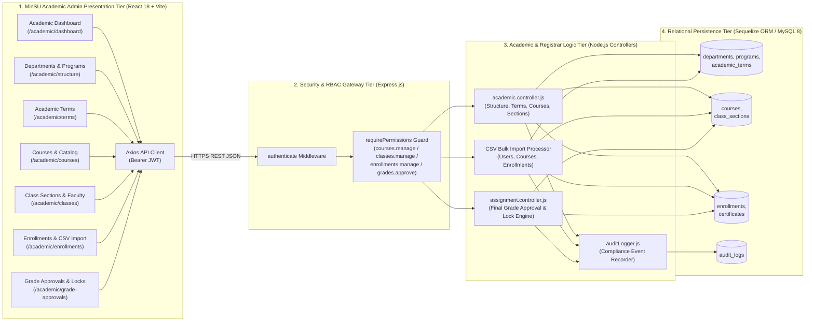

---

### A2. Class Diagram (MinSU Academic Hierarchy, Scheduling & Enrollment Schema)

#### Copy-Paste AI Prompt
```text
Generate a detailed UML Class Diagram for the "Academic Administrator Workflow" of the "Mindoro State University (MinSU) E-Learn & Networking Academy LMS".

Classes:
1. Department (+id: INT PK, +code: STRING, +name: STRING, +headName: STRING, +description: TEXT, +status: ENUM)
2. Program (+id: INT PK, +departmentId: INT FK, +code: STRING, +name: STRING, +degreeType: STRING, +totalCredits: INT, +status: ENUM)
3. AcademicTerm (+id: INT PK, +name: STRING, +academicYear: STRING, +semester: STRING, +startDate: DATE, +endDate: DATE, +isCurrent: BOOLEAN, +status: ENUM)
4. Course (+id: INT PK, +departmentId: INT FK, +programId: INT FK, +code: STRING, +title: STRING, +credits: INT, +level: ENUM, +prerequisiteCode: STRING, +deliveryMode: ENUM, +status: ENUM)
5. ClassSection (+id: INT PK, +courseId: INT FK, +termId: INT FK, +instructorId: INT FK, +taId: INT FK, +sectionCode: STRING, +schedule: STRING, +room: STRING, +maxCapacity: INT, +status: ENUM, +gradesApproved: BOOLEAN, +gradesApprovedAt: DATETIME)
6. Enrollment (+id: INT PK, +classId: INT FK, +studentId: INT FK, +status: ENUM('active', 'completed', 'dropped', 'waitlisted'), +progressPercentage: FLOAT, +finalNumericGrade: FLOAT, +finalLetterGrade: STRING, +completedAt: DATETIME)
7. Certificate (+id: INT PK, +certificateNumber: STRING, +verificationCode: STRING, +studentId: INT FK, +courseId: INT FK, +classId: INT FK, +finalScore: FLOAT, +status: ENUM, +issuedAt: DATETIME)

Relationships:
- Department "1" --> "0..*" Program
- Department "1" --> "0..*" Course
- Program "1" --> "0..*" Course
- AcademicTerm "1" --> "0..*" ClassSection
- Course "1" --> "0..*" ClassSection
- ClassSection "1" --> "0..*" Enrollment
- ClassSection "1" --> "0..*" Certificate
```

#### Mermaid Diagram
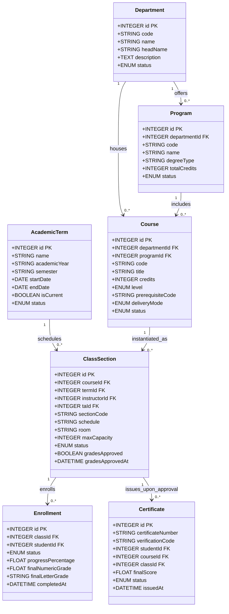

---

### A3. Component Diagram (MinSU Academic Administration Module Dependencies)

#### Copy-Paste AI Prompt
```text
Create a UML Component Diagram showing how the frontend and backend components of the MinSU Academic Administrator subsystem depend on each other.

Frontend Components (client/src):
- [AcademicAdminPages.jsx] (AcademicDashboardPage, DepartmentsAndProgramsPage, TermsManagementPage, CoursesAndOfferingsPage, ClassesAndSectionsPage, EnrollmentManagementPage, GradeApprovalsPage)
- [SharedAnnouncementsPage & SharedReportsPage] (Institutional announcements & CSV analytics export)
- [AppLayout.jsx] (Academic Admin navigation sidebar)
- [api.js] (Axios REST client)

Backend Components (server/src):
- [academic.controller.js] (CRUD for Departments, Programs, Terms, Courses, ClassSections, Enrollments, and CSV Bulk Import)
- [assignment.controller.js] (Section Gradebook Calculation & Registrar Final Grade Approval Lock)
- [auth.middleware.js] (JWT & Academic Admin RBAC permission verifier)
- [models/index.js] (Sequelize ORM models)
```

#### Mermaid Diagram
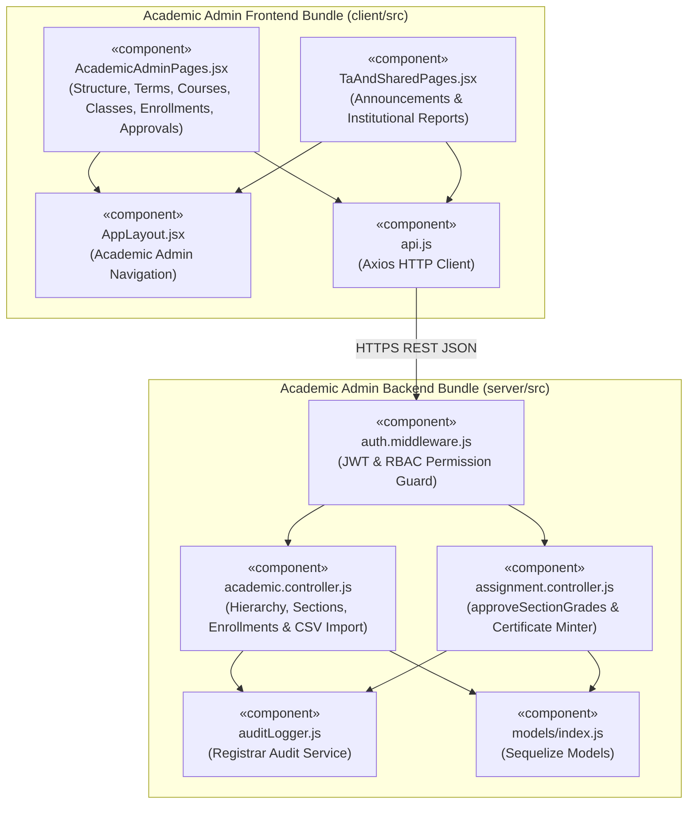

---

### A4. Deployment Diagram (MinSU Registrar & Academic Admin Container Topology)

#### Copy-Paste AI Prompt
```text
Create a UML Deployment Diagram for the "Mindoro State University (MinSU) E-Learn & Networking Academy LMS" showing how the Academic Administrator (Registrar) workstation interacts with the containerized server infrastructure.

Nodes:
1. Node: MinSU Registrar / Academic Admin Workstation
   - Execution Environment: Web Browser (React 18 SPA + CSV Batch Uploader & Transcript Exporter)
2. Node: MinSU Campus / Cloud Server Host (Docker Compose Engine)
   - Container 1: [lms-client (Nginx Alpine :8080)]
   - Container 2: [lms-server (Node.js 20 Alpine :5000)] (AcademicController, CSV Import Engine, Grade Approval Service)
   - Container 3: [lms-mysql (MySQL 8.0 Server :3306)] (Persistent storage for departments, programs, terms, courses, sections, enrollments, certificates)
```

#### Mermaid Diagram
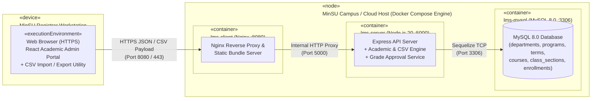

---

### A5. Object Diagram (Runtime Snapshot of Section Provisioning & Final Grade Approval)

#### Copy-Paste AI Prompt
```text
Create a UML Object Diagram capturing a concrete runtime snapshot of the MinSU Academic Administration state after Registrar `Clarissa Thorne` configures `First Semester AY 2026-2027`, provisions section `BSIT-3A-NET201`, and approves final grades.

Objects:
1. registrarClarissa : User (id = 2, name = "Clarissa Thorne", email = "acadadmin@academy.edu", primaryRole = "academic_admin")
2. deptCCS : Department (id = 1, code = "CCS", name = "College of Computer Studies")
3. progBSIT : Program (id = 1, departmentId = 1, code = "BSIT", name = "BS in Information Technology")
4. term1stSem : AcademicTerm (id = 1, name = "First Semester AY 2026-2027", isCurrent = true, status = "active")
5. courseNET201 : Course (id = 1, code = "NET-201", title = "Enterprise Routing, OSPF & Network Programmability", credits = 4)
6. sectionBSIT3A : ClassSection (id = 1, sectionCode = "BSIT-3A-NET201", instructorId = 3, taId = 5, maxCapacity = 40, gradesApproved = true)
```

#### Mermaid Diagram
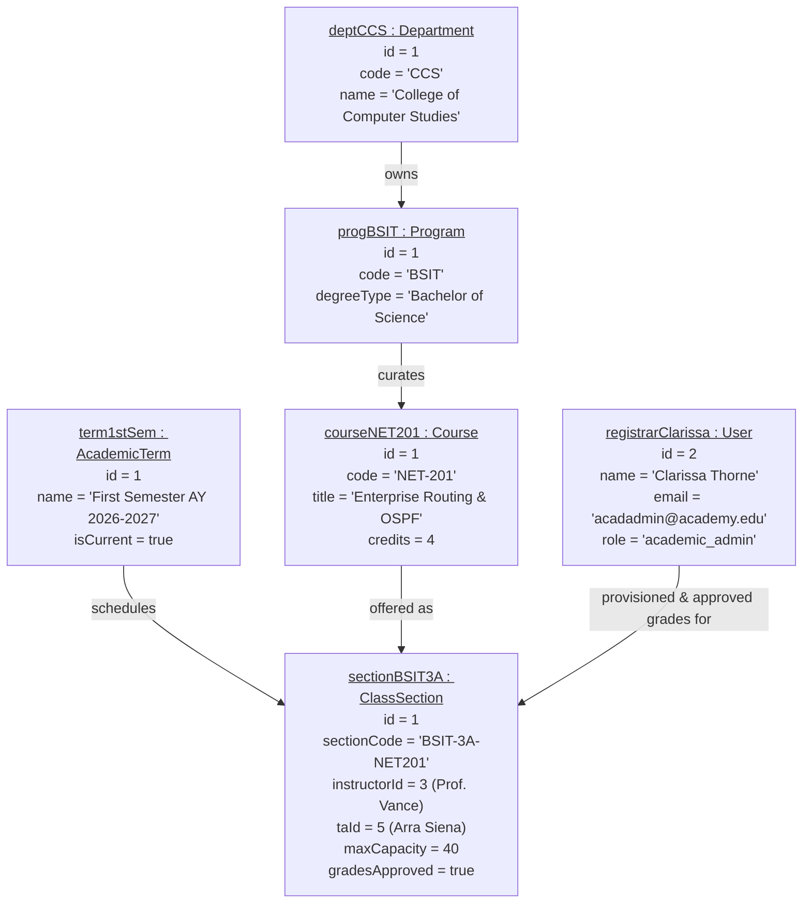

---

### A6. Package Diagram (MinSU Academic Administration Codebase Organization)

#### Copy-Paste AI Prompt
```text
Create a UML Package Diagram showing the package organization of the MinSU Academic Administration subsystem across client and server directories.

Packages:
1. client/src
   - pages/AcademicAdminPages (Dashboard, DepartmentsAndPrograms, TermsManagement, CoursesAndOfferings, ClassesAndSections, EnrollmentManagement, GradeApprovals)
   - layouts/AppLayout (Academic Admin Sidebar)
   - schemas/validation (Course, ClassSection, and Enrollment validation schemas)
   - services/api (Axios API service)

2. server/src
   - routes (academic.routes.js, assignment.routes.js)
   - middleware (auth.middleware.js)
   - controllers (academic.controller.js, assignment.controller.js)
   - models (Department, Program, AcademicTerm, Course, ClassSection, Enrollment, Certificate)
```

#### Mermaid Diagram
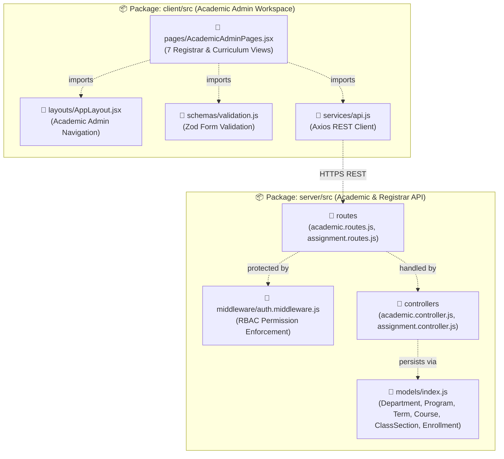

---

### A7. Composite Structure Diagram (Internal Structure of `AcademicOperationsAndRegistrarEngine`)

#### Copy-Paste AI Prompt
```text
Create a UML Composite Structure Diagram breaking down the internal parts, ports, and connectors inside the "AcademicOperationsAndRegistrarEngine" classifier in the MinSU LMS.

Internal Parts:
- [Part 1: Academic Hierarchy Manager] (Manages Departments, Degree Programs, and Active Term exclusivity)
- [Part 2: Master Catalog & Section Scheduler] (Validates Course prerequisites, section schedules, and Instructor/TA assignments)
- [Part 3: Enrollment & Capacity Gatekeeper] (Enforces maxCapacity limits, handles section transfers, and parses CSV bulk imports)
- [Part 4: Final Grade Lock & Credential Issuer] (Locks section gradebooks upon registrar approval and auto-mints Certificates for passing students)
- [Part 5: Compliance Audit Emitter] (Dispatches audit events to audit_logs)
```

#### Mermaid Diagram
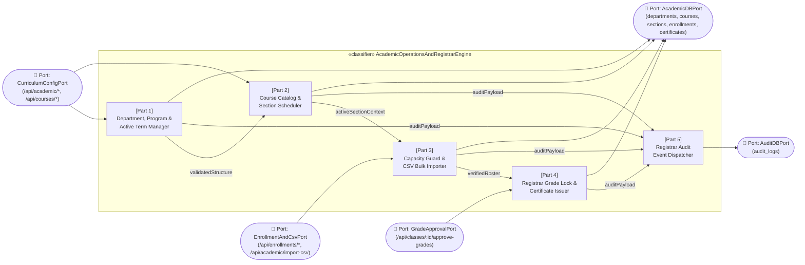

---

### A8. Profile Diagram (MinSU Registrar & Curriculum Governance Stereotypes)

#### Copy-Paste AI Prompt
```text
Create a UML Profile Diagram defining custom stereotypes for the "MinSU Registrar & Curriculum Governance Profile".

Stereotypes:
1. <<SingleCurrentTermRule>> (Extends UML::Class -> Applied to AcademicTerm; tagged values: allowOnlyOneCurrentTerm=true)
2. <<CapacityGuardedSection>> (Extends UML::Class -> Applied to ClassSection; tagged values: defaultMaxCapacity=40, enforceSeatLimit=true)
3. <<BulkImportableEntity>> (Extends UML::Class -> Applied to User, Course, Enrollment; tagged values: supportsCsvImport=true, duplicateStrategy="skip_or_upsert")
4. <<RegistrarGradeLock>> (Extends UML::Operation -> Applied to approveSectionGrades(); tagged values: locksInstructorEdits=true, autoIssuesCertificates=true)
```

#### Mermaid Diagram
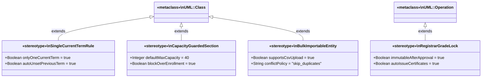

---

## Section 2: Behavioral Diagrams (The System in Motion) — All 9 Diagrams

These show how data moves, how components talk to each other, and how the MinSU LMS changes state over time in response to Academic Administrator triggers, CSV uploads, section assignments, and final grade approvals.

| # | Diagram Name | Primary Purpose | Best Used For (MinSU Academic Admin Context) |
| :--- | :--- | :--- | :--- |
| **B1** | **Data Flow Diagram (DFD)** | Traces how data enters a system, transforms through processes, and gets stored. | Mapping how curriculum configs, CSV bulk records, and grade approvals flow into MySQL. |
| **B2** | **Use Case Diagram** | Highlights relationships between external actors and specific goals (use cases). | Scoping all 11 Academic Administrator / Registrar functions and RBAC rules. |
| **B3** | **Activity Diagram** | A flowchart showing operational workflows, logic gates, and parallel actions step-by-step. | Documenting term creation, section provisioning, capacity-checked enrollment, and grade locking. |
| **B4** | **Sequence Diagram** | Maps chronological interactions between system entities for a single task. | Tracing `POST /api/classes/:id/approve-grades` from Registrar UI through Certificate issuance. |
| **B5** | **State Machine Diagram** | Tracks the lifecycle stages an entity goes through based on events. | Tracking a MinSU Class Section from `Draft` → `Open_Enrollment` → `Active` → `Grades_Approved_Locked`. |
| **B6** | **Communication Diagram** | Focuses on the network structure of collaborating objects and numbered messages. | Showing object collaboration during CSV Bulk Enrollment Import (`POST /api/academic/import-csv`). |
| **B7** | **Interaction Overview Diagram** | Combines an Activity diagram with miniature Sequence interaction blocks. | Mapping the complete semester lifecycle managed by the MinSU Academic Administrator. |
| **B8** | **Timing Diagram** | Explores exact timing constraints and phase changes of objects over an explicit timeline. | Modeling the semester timeline (Term Start → Add/Drop Deadline → Grade Submission → Registrar Lock). |
| **B9** | **Requirement Diagram (SysML)** | Maps text-based system rules and requirements directly to components and tests. | Proving that MinSU Registrar hierarchy, CSV import, capacity limits, and grade locks are verified. |

---

### B1. Data Flow Diagram / DFD Level 1 (MinSU Academic Admin Input-to-Database Pipeline)

#### Copy-Paste AI Prompt
```text
Create a Level 1 Data Flow Diagram (DFD) illustrating how data moves from a MinSU Academic Administrator's inputs to the relational database in the LMS.

External Entity:
- MinSU Academic Administrator (Registrar)

Processes (1.0 to 5.0):
- Process 1.0: Authenticate & Verify Registrar Permissions (Checks JWT & 'courses.manage', 'classes.manage', 'enrollments.manage', 'grades.approve')
- Process 2.0: Configure Academic Structure & Terms (Writes Departments, Programs, and current AcademicTerm to D1)
- Process 3.0: Provision Courses, Sections & Faculty Assignments (Writes published Courses and ClassSections with Instructor/TA IDs to D2)
- Process 4.0: Process Enrollments, Section Transfers & CSV Bulk Import (Checks section capacity in D2; writes student Enrollments to D3)
- Process 5.0: Approve & Lock Final Section Grades (Reads standing grades from D3; locks ClassSection in D2; updates completed Enrollments and issues Certificates in D3; logs audit event in D4)

Data Stores:
- D1: departments, programs & academic_terms
- D2: courses & class_sections
- D3: enrollments, grade_records & certificates
- D4: audit_logs
```

#### Mermaid Diagram
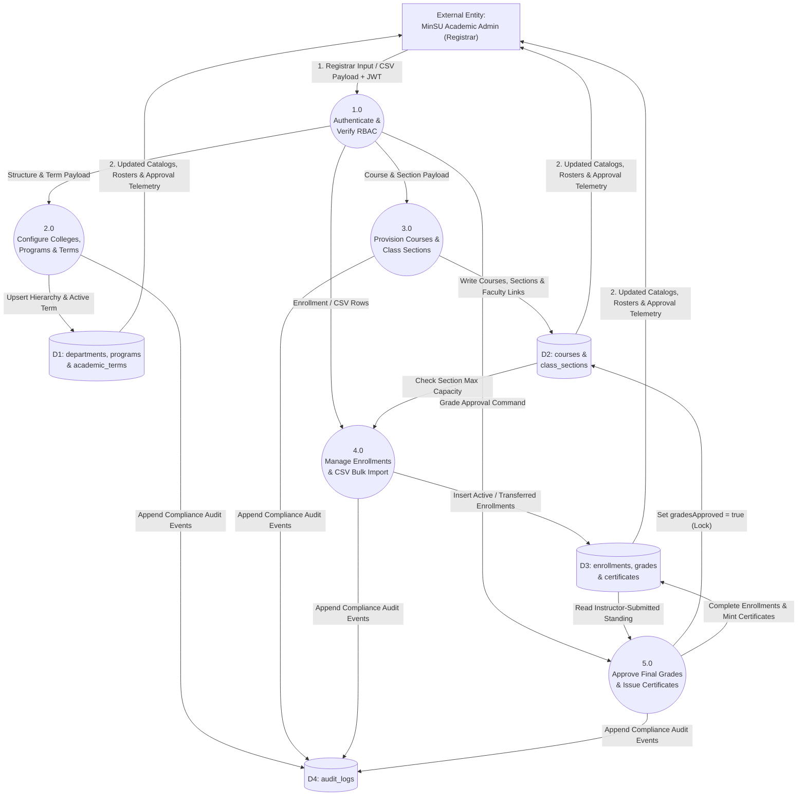

---

### B2. Use Case Diagram (MinSU Academic Administration Scope)

#### Copy-Paste AI Prompt
```text
Create a UML Use Case Diagram for the "Academic Administrator Workflow" in the "Mindoro State University (MinSU) E-Learn & Networking Academy LMS".

Actors:
- Primary Actor: MinSU Academic Administrator (Registrar)
- Secondary Actors: Capacity & CSV Import Engine, Grade Lock & Certificate Issuer

Use Cases:
- UC1: View Academic KPI & Enrollment Telemetry Dashboard
- UC2: Manage MinSU Colleges, Departments & Degree Programs
- UC3: Configure Academic Years, Semesters & Active Term
- UC4: Author & Publish Master Course Catalog Offerings
- UC5: Provision Class Sections, Schedules & Rooms
- UC6: Assign Instructors & Teaching Assistants to Sections
- UC7: Manage Student Enrollments, Waitlists & Section Transfers
- UC8: Execute CSV Bulk Import (Users, Courses, Enrollments)
- UC9: Review, Approve & Lock Final Section Grades
- UC10: Broadcast Institutional Announcements
- UC11: Export Registrar & Enrollment Analytics Reports
```

#### Mermaid Diagram
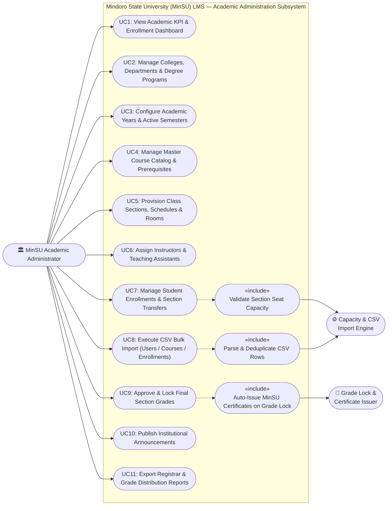

---

### B3. Activity Diagram (MinSU Semester Setup, Section Provisioning, Enrollment & Grade Approval)

#### Copy-Paste AI Prompt
```text
Create a UML Activity Diagram mapping the complete operational workflow of a MinSU Academic Administrator across an academic semester.

Steps:
1. Start -> Academic Admin logs in -> Render Academic Dashboard (/academic/dashboard).
2. Configure Academic Hierarchy (/academic/structure & /academic/terms):
   - Create/Verify MinSU Department (e.g., CCS) & Program (e.g., BSIT).
   - Set Current Active Academic Term (automatically unsets previous active term).
3. Publish Master Course & Provision Class Section (/academic/courses & /academic/classes):
   - Define Course code, credits, level, and prerequisites.
   - Create ClassSection (sectionCode, room, schedule, maxCapacity) and assign Instructor + Teaching Assistant.
4. Enroll Students (/academic/enrollments):
   - Choose Single Enrollment, Section Transfer, or CSV Bulk Import.
   - Decision: Is Enrolled Count < Section maxCapacity?
     * No -> Place on Waitlist or Reject with Capacity Alert.
     * Yes -> Create Active Enrollment record.
5. End-of-Term Final Grade Approval (/academic/grade-approvals):
   - Review Instructor-calculated section standing grades.
   - Decision: Approve & Lock Final Grades?
     * Yes -> Lock ClassSection (gradesApproved = true), transition passing Enrollments to 'completed', auto-issue MinSU Certificates, and write FINAL_GRADES_APPROVED audit log.
6. End.
```

#### Mermaid Diagram
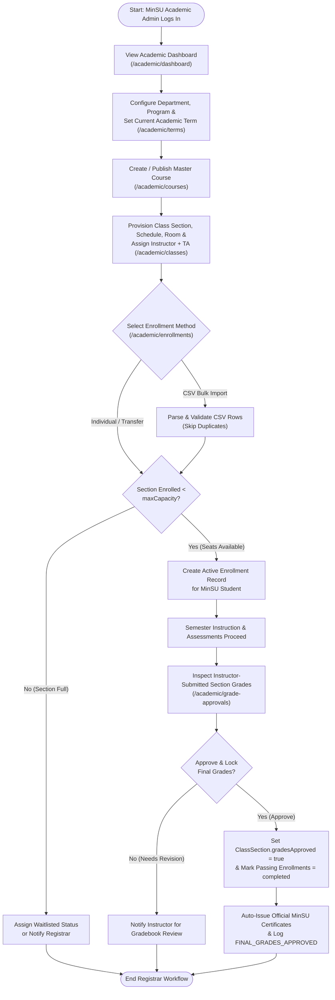

---

### B4. Sequence Diagram (MinSU Registrar Final Grade Approval & Certificate Issuance)

#### Copy-Paste AI Prompt
```text
Create a UML Sequence Diagram for the "MinSU Academic Administrator Final Grade Approval, Gradebook Locking, and Certificate Issuance" workflow.

Participants:
1. MinSU Academic Admin
2. GradeApprovalsPage (React)
3. AuthMiddleware
4. AssignmentController
5. Relational Database (Sequelize)
6. AuditLogService

Chronological Steps:
1. Academic Admin clicks "Approve & Lock Final Grades" for a ClassSection in GradeApprovalsPage.
2. GradeApprovalsPage sends POST /api/classes/:classId/approve-grades with Bearer JWT.
3. AuthMiddleware verifies JWT and checks 'grades.approve' permission.
4. AssignmentController loads ClassSection, Course, and active Enrollments from Database.
5. For each student Enrollment:
   - Calculates finalNumericGrade and finalLetterGrade (if not already finalized).
   - Sets Enrollment status = 'completed', progressPercentage = 100, completedAt = NOW().
   - If passing score (>= 60%), creates or verifies official MinSU Certificate record in certificates table.
6. AssignmentController updates ClassSection (gradesApproved = true, gradesApprovedAt = NOW(), status = 'completed').
7. AssignmentController calls AuditLogService.logAuditEvent('FINAL_GRADES_APPROVED').
8. Returns 200 OK { classSection, issuedCertificatesCount } to GradeApprovalsPage.
```

#### Mermaid Diagram
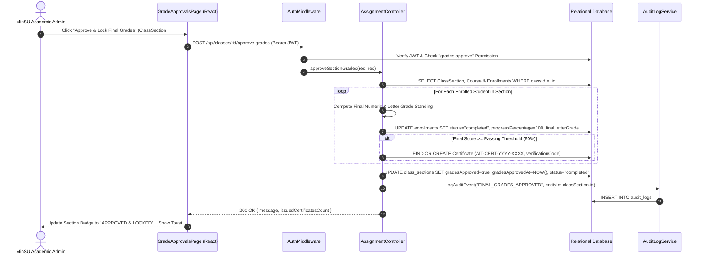

---

### B5. State Machine Diagram (MinSU Class Section & Gradebook Lifecycle States)

#### Copy-Paste AI Prompt
```text
Create a UML State Machine Diagram tracking the lifecycle states of a "MinSU Class Section & Official Gradebook" managed by the Academic Administrator.

States:
- [*] Initial
- Scheduled_Open (Section provisioned; Instructor & TA assigned; open for student enrollment)
- Capacity_Full_Waitlist (Enrolled students == maxCapacity; new requests waitlisted)
- Active_Instruction (Semester in progress; lessons, labs, and quizzes active)
- Awaiting_Grade_Approval (Term ended; Instructor computed standing grades; awaiting Registrar review)
- Grades_Approved_Locked (Academic Admin approved final grades; gradebook locked; Certificates issued)
- Archived_Closed (Historical transcript record)
```

#### Mermaid Diagram
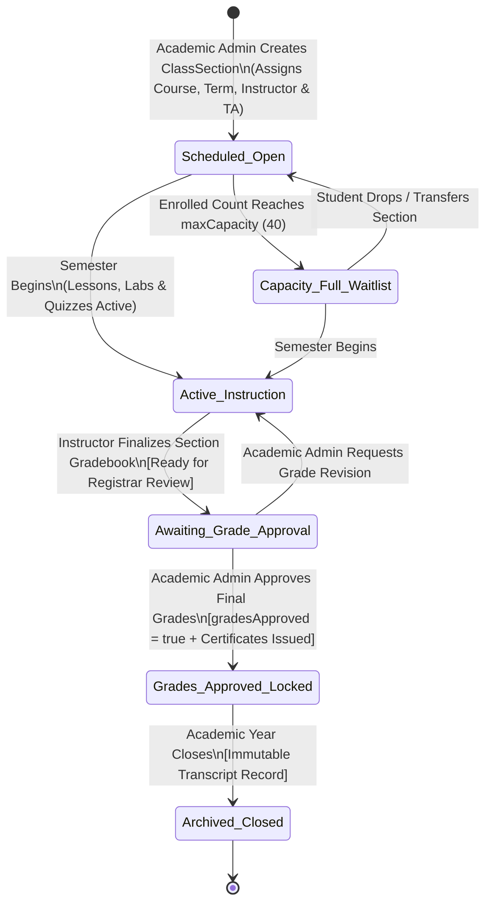

---

### B6. Communication Diagram (Object Collaboration During CSV Bulk Import)

#### Copy-Paste AI Prompt
```text
Create a UML Communication Diagram showing the collaborating objects and numbered messages when a MinSU Academic Administrator executes a CSV Bulk Import (`POST /api/academic/import-csv`).

Objects:
- :MinSUAcademicAdmin (Actor)
- :EnrollmentManagementPage (React UI)
- :AuthMiddleware (RBAC Guard)
- :AcademicController (CSV Import Handler)
- :UserModel (users & user_roles)
- :EnrollmentModel (enrollments & class_sections)
- :AuditLogger (audit_logs)
```

#### Mermaid Diagram
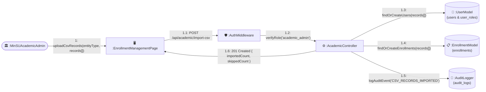

---

### B7. Interaction Overview Diagram (End-to-End MinSU Registrar Semester Lifecycle)

#### Copy-Paste AI Prompt
```text
Create a UML Interaction Overview Diagram combining Activity nodes with inline Sequence frames (`sd`) for the complete MinSU Academic Administrator workflow from Semester Configuration to Final Grade Approval.

Frames (`sd` blocks):
1. sd Configure_Academic_Hierarchy_And_Term (POST /api/academic/departments, /programs, /terms)
2. sd Publish_Courses_And_Provision_Sections (POST /api/courses & POST /api/classes with Instructor/TA assignment)
3. sd Manage_Enrollments_And_CSV_Import (POST /api/enrollments & POST /api/academic/import-csv)
4. sd Approve_Final_Grades_And_Mint_Certificates (POST /api/classes/:id/approve-grades)
```

#### Mermaid Diagram
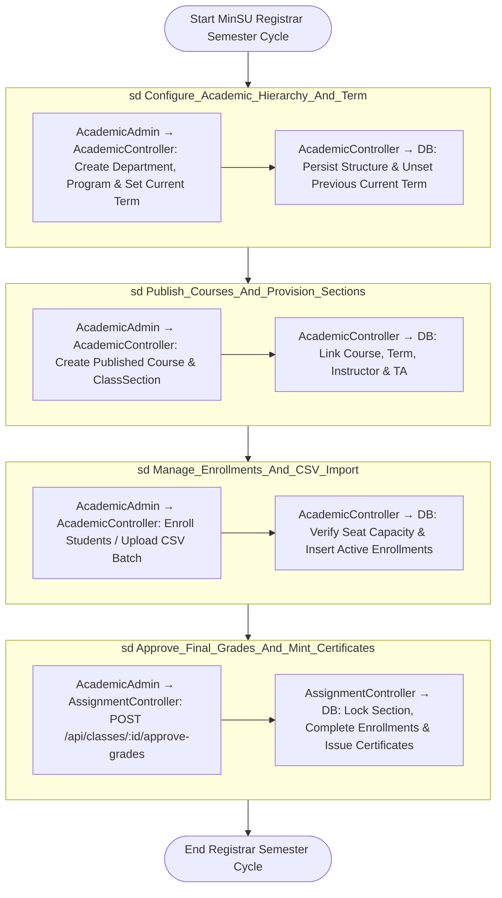

---

### B8. Timing Diagram (MinSU Semester & Grade Approval Governance Timeline)

#### Copy-Paste AI Prompt
```text
Create a UML Timing Diagram showing the phase transitions and timing constraints of an Academic Term, Class Section Enrollment Window, and Gradebook Approval state across a MinSU 18-Week Semester timeline.

Lifelines & Phases:
1. Academic Term State:
   - Week 0: [Upcoming_Setup] -> Week 1 to Week 18: [Current_Active_Term] -> Week 19+: [Completed_Archived_Term].
2. Section Enrollment Window:
   - Week 0 to Week 2: [Open_Enrollment_And_Transfer] -> Week 3 to Week 18: [Roster_Locked_Active_Study].
3. Section Gradebook & Certificate State:
   - Week 1 to Week 16: [Continuous_Assessment] -> Week 17: [Instructor_Final_Standing_Computed] -> Week 18: [Registrar_Approved_Locked & Certificates_Minted].
```

#### Mermaid Diagram
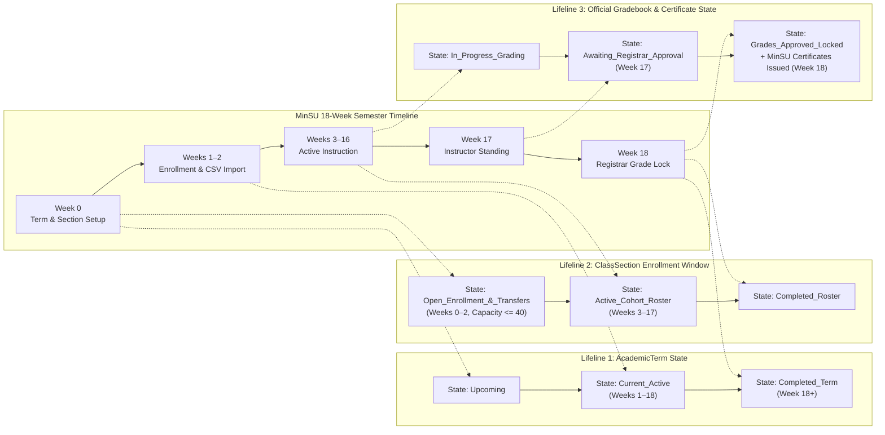

---

### B9. Requirement Diagram (SysML — MinSU Academic Administrator Requirements)

#### Copy-Paste AI Prompt
```text
Create a SysML Requirement Diagram mapping the formal requirements of the MinSU Academic Administrator role to the backend/frontend components that satisfy them and the automated tests that verify them.

Requirements:
- REQ-AA-01 (Academic Hierarchy & Single Active Term): "The system must support managing MinSU departments, degree programs, and academic terms where setting a term as current automatically unsets previous current terms."
- REQ-AA-02 (Course Offerings & Faculty Section Assignment): "Academic Admins must be able to publish master courses, provision class sections, and assign Instructors and Teaching Assistants."
- REQ-AA-03 (Enrollment Management & CSV Bulk Import): "The system must support individual enrollments, section transfers, seat capacity enforcement, and CSV bulk record imports."
- REQ-AA-04 (Final Grade Approval & Certificate Issuance): "Academic Admins must be able to approve and lock final section grades, automatically completing passing enrollments and issuing verifiable certificates."
```

#### Mermaid Diagram
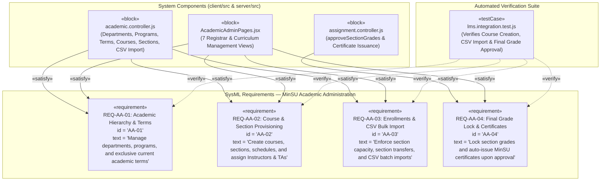

