# System Modeling & Diagram Blueprint: Instructor / Faculty (`instructor`) Account Workflow

---

## Objective
To apply system modeling concepts to the **Mindoro State University (MinSU) E-Learn & Networking Academy — Instructor / Faculty (`instructor`) Account Workflow** by identifying, selecting, and documenting the complete suite of **8 Structural Diagrams (The Static Blueprint)** and **9 Behavioral Diagrams (The System in Motion)** required to architect, implement, and verify the faculty instructional, curriculum authoring, rubric grading, selection-only assessment design, and weighted gradebook sub-system across Mindoro State University's Bongabong, Main (Victoria), and Calapan City campuses.

---

## Part 1: Core Modeling Framework

Every proposed system must be viewed through two distinct lenses to ensure it can be successfully built:

### 1. Structural Diagrams (The Static Blueprint)
- **What it is:** These diagrams map out the static skeleton of your project—what parts make up the system architecture, how they are organized, and where they will be hosted.
- **Key Rule:** These components and relationships do not change based on individual user actions. They represent the permanent infrastructure or codebase layout.
- **Core Examples:** System Architecture, Class, Component, and Deployment diagrams (plus Object, Package, Composite Structure, and Profile diagrams).

### 2. Behavioral Diagrams (The System in Motion)
- **What it is:** These diagrams document the dynamic logic of your project—how data moves, how components interact step-by-step, and how the system responds to users over time.
- **Key Rule:** These change dynamically based on triggers, inputs, time, or external events.
- **Core Examples:** Data Flow Diagrams (DFD), Use Case, Sequence, and Activity diagrams (plus State Machine, Communication, Interaction Overview, Timing, and Requirement diagrams).

---

## Part 2: Diagram Reference Guide

### Section A: Structural Diagrams (Static Blueprint)
- **System Architecture Diagram:** High-level layout of your servers, clients, cloud infrastructure, and databases.
- **Class Diagram:** Maps out data models, object classes, their attributes, and how they connect.
- **Component Diagram:** Shows how different software modules, libraries, or microservices depend on each other.
- **Deployment Diagram:** Outlines the physical hardware or containerized infrastructure hosting your application.
- **Object Diagram:** Captures a snapshot of instances of classes at a specific moment in time.
- **Package Diagram:** Groups classes or components into higher-level folders (packages) to show organization.
- **Composite Structure Diagram:** Breaks down the internal structure of a single complex classifier or class.
- **Profile Diagram:** Customizes existing UML elements for specific industries, domains, or platforms.

### Section B: Behavioral Diagrams (The System in Motion)
- **Data Flow Diagram (DFD):** Tracks exactly how data enters your system, processes through nodes, and hits storage.
- **Use Case Diagram:** Defines project scope by mapping who your users/systems are (actors) and what actions they can take.
- **Activity Diagram:** A technical flowchart mapping out business logic, background processes, or algorithms.
- **Sequence Diagram:** Coordinates chronological, step-by-step messages between system entities for a single feature.
- **State Machine Diagram:** Tracks the lifecycle stages an entity goes through based on events (e.g., an Order going from Pending → Paid → Shipped).
- **Communication Diagram:** Similar to a sequence diagram, but focuses on the freeform network structure of objects rather than time.
- **Interaction Overview Diagram:** Combines an Activity diagram with miniature Sequence diagrams.
- **Timing Diagram:** Explores exact timing constraints and phase changes of objects over an explicit timeline.
- **Requirement Diagram (SysML):** Maps text-based system rules and requirements directly to physical or digital components.

---

## Part 3: Completed Blueprinting Exercise (Instructor / Faculty Workflow)

### 1. Project Identification
- **Proposal Title:** **Mindoro State University (MinSU) E-Learn & Networking Academy: A Web-Based Role-Driven Learning Management System Inspired by Cisco NetAcad** *(Focus Module: Instructor / Faculty Curriculum Authoring, Selection-Only Assessment Design, Rubric Grading & Weighted Section Gradebook Sub-System)*
- **Project Summary (2–3 Sentences):**
  The Mindoro State University (MinSU) E-Learn & Networking Academy is a full-stack, role-based Learning Management System engineered for MinSU's College of Computer Studies across its Bongabong, Main (Victoria), and Calapan City campuses. Within this platform, the **Instructor (`instructor`)** role serves as the primary pedagogical authority responsible for authoring structured course modules and Packet Tracer guided labs in the Course Studio, building timed selection-only checkpoint quizzes and exams (`multiple_choice`, `true_false`, `multiple_select`, `matching`), creating lab assignments with multi-criteria JSON rubrics, grading student submissions alongside Teaching Assistant preliminary notes, and managing the weighted section gradebook with instant CSV export.

### 2. Structural Blueprinting
- **Selected Essential Structural Diagram:** **Class Diagram** (paired with the **System Architecture Diagram**)
- **Why This Specific Layout Diagram Is Required:**
  The **Class Diagram** is essential for the MinSU Instructor sub-system because an Instructor interacts with the deepest relational hierarchy in the entire LMS: an Instructor `User` (`role = 'instructor'`) is assigned to one or more `ClassSection` offerings (`instructorId`), authors hierarchical `Module` and `Lesson` entities inside the parent `Course`, creates `Assignment` records (which automatically provision linked `GradeItem` columns in the section gradebook), builds `Assessment` and `Question` banks strictly constrained to selection-only types, and evaluates student `Submission` records that automatically synchronize numeric scores into `GradeRecord` cells. Without a strict Class Diagram defining these foreign keys, cascade rules, and JSON rubric/question schemas, faculty grading and curriculum authoring would suffer from orphaned grade items and unsynchronized student gradebooks.

### 3. Behavioral Blueprinting
- **Selected Critical Behavioral Diagram 1:** **Use Case Diagram**
  - **Specific Project Scenario Mapped:** Maps the complete pedagogical boundary of the **MinSU Instructor (`instructor`)** actor across 6 core functional clusters:
    1. *Assigned Classes & Section Roster Management* (`/instructor/dashboard`, `/instructor/classes`),
    2. *Course Studio Curriculum & Guided Lab Authoring* (`/instructor/courses`),
    3. *Assignment & JSON Rubric Creation* (`/instructor/assignments`),
    4. *Submission Evaluation & Rubric Grading* (`/instructor/submissions`),
    5. *Selection-Only Assessment & Question Bank Authoring* (`/instructor/assessments`), and
    6. *Weighted Section Gradebook Management & CSV Export* (`/instructor/gradebook`, `/instructor/reports`).
- **Selected Critical Behavioral Diagram 2:** **Sequence Diagram** (supported by the **Activity Diagram** and **DFD**)
  - **Specific Project Scenario Mapped:** Maps the chronological, multi-table transactional handshake for **"Instructor Grading a Student Lab Submission via JSON Rubric & Synchronizing the Section Gradebook"** (`PUT /api/v1/assignments/submissions/:id/grade`). It traces how the Instructor selects rubric criteria tiers in the React UI, sends the payload with a Bearer JWT to Express, passes through `authenticate` and `authorize('super_admin', 'academic_admin', 'instructor')`, updates the `Submission` status to `'graded'`, upserts the corresponding `GradeRecord` for the assignment's `GradeItem`, recalculates the student's weighted course average, and dispatches an in-app `Notification` to the MinSU student.

### 4. Data Blueprinting
- **How Data Flows from Instructor Input to the System Database:**
  1. **Curriculum, Assignment, or Grade Input:** The MinSU Instructor interacts with the React 18 faculty workspace (`InstructorPages.jsx`)—for example, creating a new Packet Tracer lab assignment with a 3-criterion JSON rubric or grading a student's submitted topology report.
  2. **Authenticated REST Request:** The Axios client (`api.js`) attaches `Authorization: Bearer <accessToken>` and dispatches an HTTP request (`POST /api/v1/assignments` or `PUT /api/v1/assignments/submissions/:id/grade`) to the Express.js API gateway.
  3. **JWT & RBAC Verification:** `authenticate` verifies the JWT signature and checks `User.status === 'active'`, while `authorize('super_admin', 'academic_admin', 'instructor')` confirms the caller holds faculty privileges (preventing Teaching Assistants or Students from publishing official final grades).
  4. **Controller Validation & Multi-Table Persistence:** Inside `assignment.controller.js`, Sequelize ORM executes atomic database writes in SQLite3/PostgreSQL: creating an `Assignment` also creates a linked `GradeItem` (`category = 'assignment'`, `weight = 0.30`), and grading a `Submission` updates `submissions.numeric_score`, `submissions.rubric_Breakdown`, `submissions.status = 'graded'`, and upserts `grade_records.score`, immediately reflecting in both the Instructor Gradebook Matrix and the Student's Gradebook view.

---

# Section 1: Structural Diagrams (The Static Blueprint) — All 8 Diagrams

| # | Diagram Name | Primary Purpose | Best Used For (MinSU Instructor Context) |
| :--- | :--- | :--- | :--- |
| **A1** | **System Architecture Diagram** | Shows high-level layout of servers, clients, cloud infrastructure, and databases. | Explaining the 3-tier MinSU Faculty Course Studio, Assessment Builder, and Gradebook architecture. |
| **A2** | **Class Diagram** | Maps out object-oriented classes, their attributes, methods, and relationships. | Baseline blueprint for `ClassSection`, `Module`, `Lesson`, `Assignment`, `Submission`, `Assessment`, `Question`, `GradeItem`, and `GradeRecord`. |
| **A3** | **Component Diagram** | Shows how software pieces (modules, libraries, microservices) are bundled and depend on each other. | Mapping dependencies between `InstructorPages.jsx`, `academic.controller.js`, `assignment.controller.js`, and `assessment.controller.js`. |
| **A4** | **Deployment Diagram** | Maps software components to physical hardware or cloud infrastructure. | DevOps layout across MinSU Faculty Workstations, Nginx Reverse Proxy, Node.js API Container, and SQL Database. |
| **A5** | **Object Diagram** | Captures a snapshot of instances of classes at a specific moment in time. | Concrete runtime snapshot of `inst_santos` teaching `BSIT-2A-NET101` and grading `stud_calapan_01`'s OSPF Lab. |
| **A6** | **Package Diagram** | Groups classes or components into higher-level folders (packages) to show organization. | Organizing the Monorepo into Faculty UI Views, Express Instructional Controllers, RBAC Middleware, and Sequelize Models. |
| **A7** | **Composite Structure Diagram** | Breaks down the internal structure of a single complex classifier or class. | Internal ports, parts, and connectors of the `InstructorGradingAndAssessmentEngine` composite component. |
| **A8** | **Profile Diagram** | Customizes existing UML elements for specific industries, domains, or platforms. | Defining custom UML stereotypes (`<<MinSUFacultyAction>>`, `<<SelectionOnlyRule>>`, `<<GradebookSync>>`) for MinSU CCS. |

---

## A1. System Architecture Diagram (Instructor Workflow)

### Copy-Paste AI Prompt
```text
Create a high-resolution System Architecture Diagram for the "Mindoro State University (MinSU) E-Learn & Networking Academy — Instructor / Faculty Sub-System".
Organize the architecture into 4 distinct horizontal tiers:
1. Client Tier (MinSU Faculty Workstation / Browser):
   - React 18 + Vite + Tailwind CSS SPA
   - Instructor Modules: Faculty Dashboard (`/instructor/dashboard`), Assigned Classes & Roster (`/instructor/classes`), Course Studio Module/Lesson Builder (`/instructor/courses`), Assignment & Rubric Builder (`/instructor/assignments`), Submission Grading Queue (`/instructor/submissions`), Selection-Only Assessment & Question Bank Studio (`/instructor/assessments`), Weighted Section Gradebook & CSV Exporter (`/instructor/gradebook`, `/instructor/reports`).
2. API Gateway & Security Middleware Tier (Node.js + Express):
   - Helmet, CORS, Morgan Logger, Express JSON Parser
   - JWT Auth Filter (`authenticate`) + Faculty Role Guard (`authorize('super_admin', 'academic_admin', 'instructor')`)
3. Instructional Business Logic Tier (Express Controllers):
   - `academic.controller.js` (Course Studio Modules, Lessons, Guided Labs, Class Rosters, Announcements)
   - `assignment.controller.js` (Assignment Creation, Auto-GradeItem Provisioning, Rubric Grading, GradeRecord Upsert)
   - `assessment.controller.js` (Selection-Only Quiz/Exam Authoring, Question Bank Validation, Weighted Gradebook Calculation)
4. Persistence Tier (Sequelize ORM + Relational Database):
   - SQLite3 (Dev/Test) / PostgreSQL 16 (MinSU Production)
   - Tables: `users`, `courses`, `class_sections`, `enrollments`, `modules`, `lessons`, `assignments`, `submissions`, `assessments`, `questions`, `assessment_attempts`, `grade_items`, `grade_records`, `announcements`, `notifications`.
Use clean directional arrows labeled with HTTPS REST/JSON and Sequelize SQL queries.
```

### Mermaid Diagram
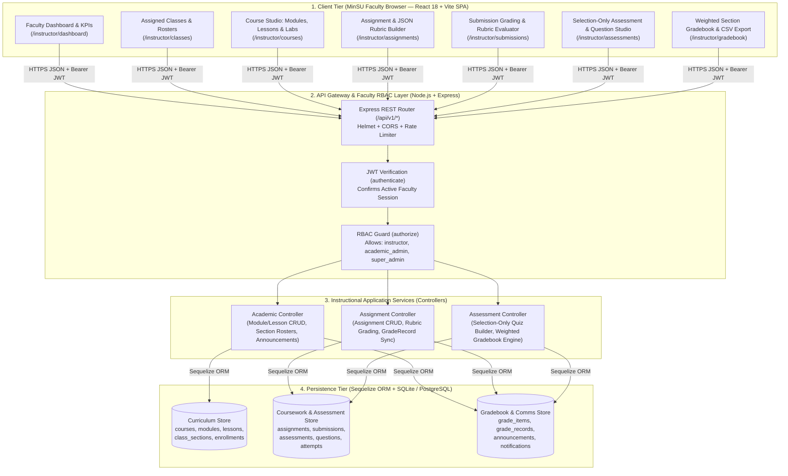

---

## A2. Class Diagram (Instructor Domain Model)

### Copy-Paste AI Prompt
```text
Generate a UML Class Diagram for the Instructor / Faculty domain of the Mindoro State University (MinSU) E-Learn & Networking Academy.
Include the following classes with their attributes, data types, methods, and multiplicities:
1. `User` (Instructor): `id: Integer`, `firstName: String`, `lastName: String`, `email: String`, `role: Enum('instructor')`, `department: String`, `status: Enum`. Methods: `+getAssignedSections()`, `+createModule()`, `+gradeSubmission()`.
2. `Course`: `id: Integer`, `code: String`, `title: String`, `level: Enum`, `status: Enum`, `createdById: Integer`.
3. `ClassSection`: `id: Integer`, `courseId: Integer`, `termId: Integer`, `instructorId: Integer`, `assistantId: Integer`, `sectionCode: String`, `room: String`, `schedule: String`, `status: Enum`.
4. `Module`: `id: Integer`, `courseId: Integer`, `title: String`, `description: Text`, `orderIndex: Integer`, `isPublished: Boolean`.
5. `Lesson`: `id: Integer`, `moduleId: Integer`, `title: String`, `contentType: Enum('reading','lab','video','resource')`, `contentBody: Text`, `labInstructions: Text`, `estimatedMinutes: Integer`, `orderIndex: Integer`.
6. `Assignment`: `id: Integer`, `courseId: Integer`, `moduleId: Integer`, `title: String`, `instructions: Text`, `dueDate: DateTime`, `maxScore: Float`, `submissionType: Enum`, `rubric: JSON`, `isPublished: Boolean`.
7. `Submission`: `id: Integer`, `assignmentId: Integer`, `studentId: Integer`, `status: Enum('draft','submitted','late','graded','returned')`, `numericScore: Float`, `feedback: Text`, `rubricBreakdown: JSON`, `gradedById: Integer`.
8. `Assessment`: `id: Integer`, `courseId: Integer`, `moduleId: Integer`, `title: String`, `type: Enum('quiz','module_exam','final_exam','practice')`, `timeLimitMinutes: Integer`, `maxAttempts: Integer`, `passingScorePct: Float`, `isPublished: Boolean`.
9. `Question`: `id: Integer`, `assessmentId: Integer`, `type: Enum('multiple_choice','true_false','multiple_select','matching')`, `prompt: Text`, `options: JSON`, `correctAnswer: JSON`, `points: Float`, `explanation: Text`.
10. `GradeItem`: `id: Integer`, `courseId: Integer`, `title: String`, `category: Enum('assignment','quiz','exam','lab','participation')`, `weight: Float`, `maxScore: Float`, `sourceType: String`, `sourceId: Integer`.
11. `GradeRecord`: `id: Integer`, `gradeItemId: Integer`, `studentId: Integer`, `score: Float`, `feedback: Text`, `gradedById: Integer`.
Show relationships: User (Instructor) `1 --> 0..*` ClassSection (`instructorId`), Course `1 *-- 0..*` Module, Module `1 *-- 0..*` Lesson, Course `1 *-- 0..*` Assignment, Assignment `1 --> 0..*` Submission, Course `1 *-- 0..*` Assessment, Assessment `1 *-- 1..*` Question, Assignment/Assessment `1 --> 1` GradeItem, GradeItem `1 --> 0..*` GradeRecord, User (Instructor) `1 --> 0..*` Submission (`gradedById`).
```

### Mermaid Diagram
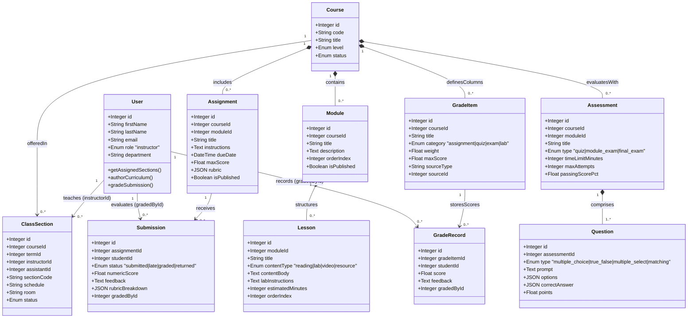

---

## A3. Component Diagram (Instructor Sub-System)

### Copy-Paste AI Prompt
```text
Create a UML Component Diagram for the Instructor / Faculty Sub-System of the Mindoro State University (MinSU) E-Learn & Networking Academy.
Show how the frontend components in `client/src/pages/InstructorPages.jsx` wire into the backend Express routes and controllers:
Frontend Components:
- `InstructorDashboardComponent` (`/instructor/dashboard`)
- `InstructorClassesRosterComponent` (`/instructor/classes`)
- `CourseStudioAuthoringComponent` (`/instructor/courses`)
- `AssignmentRubricBuilderComponent` (`/instructor/assignments`)
- `SubmissionRubricGraderComponent` (`/instructor/submissions`)
- `SelectionOnlyAssessmentStudioComponent` (`/instructor/assessments`)
- `SectionGradebookExporterComponent` (`/instructor/gradebook`)
Backend Components:
- `AuthAndRoleMiddleware` (`auth.middleware.js`)
- `AcademicServiceController` (`academic.controller.js`)
- `AssignmentGradingController` (`assignment.controller.js`)
- `AssessmentGradebookController` (`assessment.controller.js`)
- `SequelizeModelLayer` (`server/src/models/index.js`)
Show provided and required interfaces connecting the React components through `api.js` to the Express controllers and Sequelize database models.
```

### Mermaid Diagram
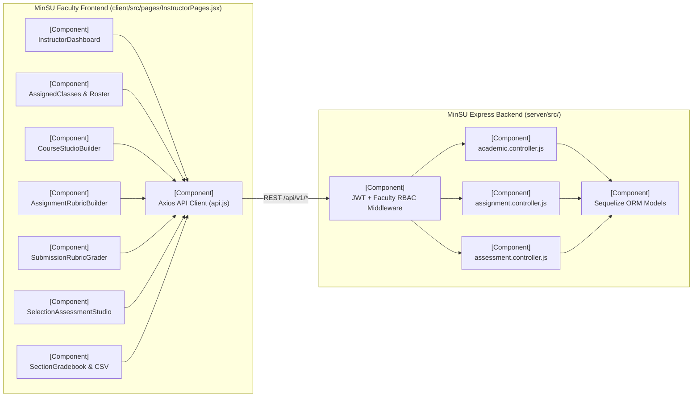

---

## A4. Deployment Diagram (Instructor Infrastructure)

### Copy-Paste AI Prompt
```text
Create a UML Deployment Diagram for the Mindoro State University (MinSU) E-Learn & Networking Academy focusing on the Instructor / Faculty operational environment.
Include the following physical/virtual nodes and deployed artifacts:
1. Node: `MinSU Faculty Workstation / Lab Instructor PC (Bongabong / Victoria / Calapan Campus)`
   - Execution Environment: Modern Web Browser (Chrome / Edge)
   - Artifacts: React 18 Faculty SPA Bundle (`InstructorPages.jsx`), Blob CSV Exporter (`gradebook_export.csv`).
2. Node: `MinSU Cloud / On-Premise Application Server (Ubuntu 24.04 LTS / Docker Host)`
   - Container 1: `Nginx Reverse Proxy & TLS Termination (Port 443)`
   - Container 2: `Node.js 20 LTS Express API Server (Port 5000)` hosting `academic.controller.js`, `assignment.controller.js`, `assessment.controller.js`.
3. Node: `MinSU Database & File Storage Server`
   - Container 3: `PostgreSQL 16 / SQLite3 Database Engine` storing curriculum, rubrics, question banks, submissions, and gradebook tables.
   - Volume: `Encrypted Backup & Static Lab Resource Volume`.
Label communication paths with protocols (`HTTPS / TLS 1.3`, `Internal Docker Bridge TCP:5000`, `TCP:5432 / SQLite File I/O`).
```

### Mermaid Diagram
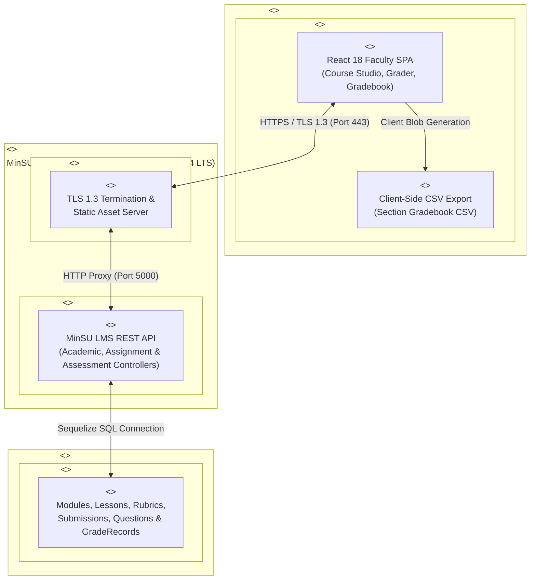

---

## A5. Object Diagram (Runtime Snapshot of Instructor Grading & Course Authoring)

### Copy-Paste AI Prompt
```text
Create a UML Object Diagram capturing a concrete runtime snapshot of the Mindoro State University (MinSU) E-Learn & Networking Academy during an active Instructor grading session in the 1st Semester A.Y. 2026-2027.
Include the following linked object instances with their exact slot values:
- `instSantos : User` (`id = 3`, `firstName = "Prof. Elena"`, `lastName = "Santos"`, `email = "instructor@netacad.edu"`, `role = "instructor"`, `department = "College of Computer Studies - Bongabong"`)
- `secBsit2A : ClassSection` (`id = 1`, `sectionCode = "BSIT-2A-NET101"`, `instructorId = 3`, `schedule = "MWF 09:00-11:00"`, `room = "Cisco Lab 101"`)
- `assignVlanLab : Assignment` (`id = 1`, `courseId = 1`, `title = "Packet Tracer Lab: Multi-Campus VLAN Trunking"`, `maxScore = 100`, `submissionType = "both"`)
- `subCalapan01 : Submission` (`id = 14`, `assignmentId = 1`, `studentId = 5`, `status = "graded"`, `numericScore = 96.0`, `gradedById = 3`, `feedback = "Excellent 802.1Q trunk configuration across MinSU routers."`)
- `giVlanLab : GradeItem` (`id = 1`, `courseId = 1`, `title = "Packet Tracer Lab: Multi-Campus VLAN Trunking"`, `category = "assignment"`, `weight = 0.30`, `maxScore = 100`, `sourceType = "assignment"`, `sourceId = 1`)
- `grCalapan01 : GradeRecord` (`id = 28`, `gradeItemId = 1`, `studentId = 5`, `score = 96.0`, `gradedById = 3`)
Show links connecting `instSantos` to `secBsit2A`, `subCalapan01`, and `grCalapan01`, and connecting `assignVlanLab` to `subCalapan01` and `giVlanLab`.
```

### Mermaid Diagram
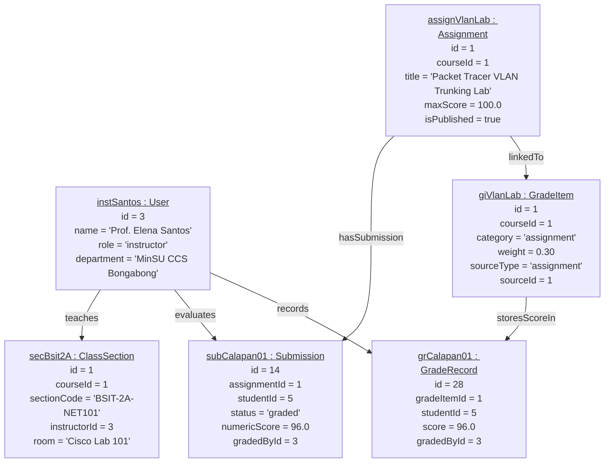

---

## A6. Package Diagram (Instructor Codebase Organization)

### Copy-Paste AI Prompt
```text
Create a UML Package Diagram illustrating the modular organization of the Instructor / Faculty codebase within the Mindoro State University (MinSU) E-Learn & Networking Academy monorepo.
Show the following packages and their dependencies:
1. Package `client.src.pages.instructor` (`InstructorPages.jsx`):
   - Sub-modules: `DashboardView`, `ClassesRosterView`, `CourseStudioView`, `AssignmentsRubricsView`, `SubmissionsGraderView`, `AssessmentsBuilderView`, `GradebookAnalyticsView`.
2. Package `client.src.layouts` (`AppLayout.jsx` — Faculty Sidebar & Role Switcher).
3. Package `client.src.services` (`api.js`, `AuthContext.jsx`).
4. Package `server.src.routes` (`academic.routes.js`, `assignment.routes.js`, `assessment.routes.js`).
5. Package `server.src.middleware` (`auth.middleware.js` — `authenticate`, `authorize`).
6. Package `server.src.controllers` (`academic.controller.js`, `assignment.controller.js`, `assessment.controller.js`).
7. Package `server.src.models` (`Course`, `ClassSection`, `Module`, `Lesson`, `Assignment`, `Submission`, `Assessment`, `Question`, `GradeItem`, `GradeRecord`).
Draw dashed dependency arrows (`<<import>>` / `<<use>>`) between packages.
```

### Mermaid Diagram
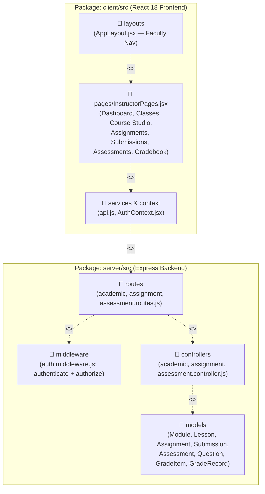

---

## A7. Composite Structure Diagram (`InstructorGradingAndAssessmentEngine`)

### Copy-Paste AI Prompt
```text
Create a UML Composite Structure Diagram breaking down the internal structure of the `InstructorGradingAndAssessmentEngine` classifier in the Mindoro State University (MinSU) E-Learn & Networking Academy.
Show the external ports and internal parts:
External Ports:
- `pFacultyInput` (Receives rubric evaluations, assignment specs, and quiz questions from Instructor UI)
- `pDatabasePersistence` (Connects to Sequelize ORM persistence engine)
- `pStudentNotification` (Emits grade release alerts to students)
Internal Parts:
- `partSelectionValidator : SelectionOnlyQuestionValidator` (Enforces `ALLOWED_QUESTION_TYPES = ['multiple_choice', 'true_false', 'multiple_select', 'matching']` and rejects `fill_in_the_blank` or `essay`)
- `partRubricAggregator : RubricScoreCalculator` (Sums criterion points from `rubricBreakdown` JSON into `numericScore`)
- `partGradebookSynchronizer : GradeRecordUpsertService` (Matches `Assignment.id` or `Assessment.id` to `GradeItem.sourceId` and upserts `GradeRecord`)
- `partWeightedCalculator : CourseWeightedAverageEngine` (Computes category weights: Assignments 30%, Quizzes 30%, Exams 40%)
Show internal connectors linking the ports and parts.
```

### Mermaid Diagram
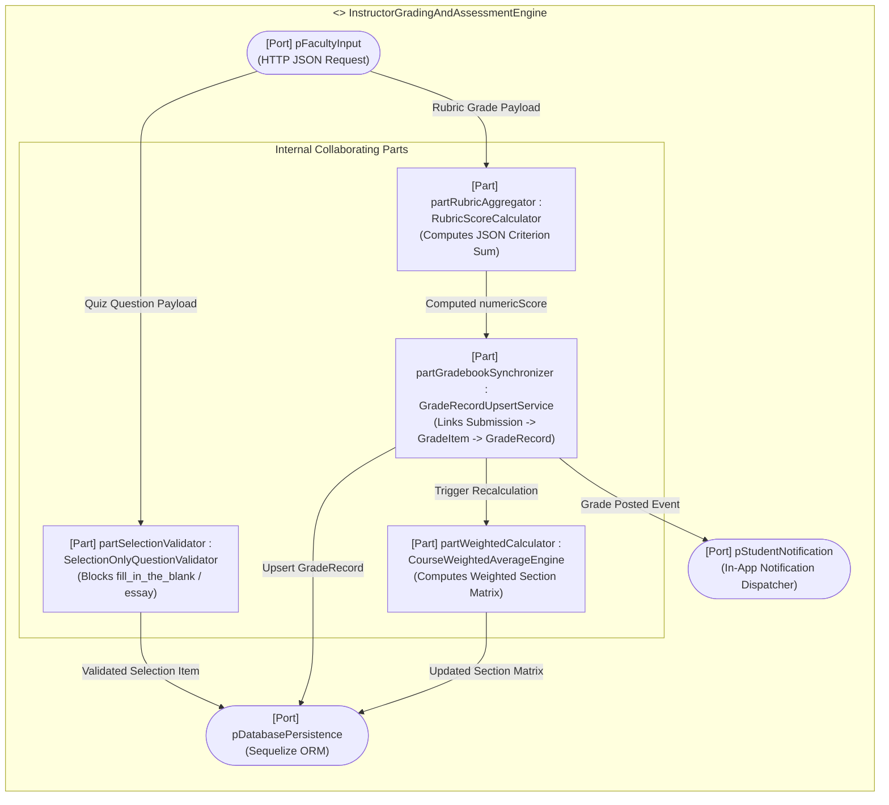

---

## A8. Profile Diagram (MinSU Faculty Instructional UML Profile)

### Copy-Paste AI Prompt
```text
Create a UML Profile Diagram defining custom stereotypes and tagged values for the Mindoro State University (MinSU) E-Learn & Networking Academy — Instructor / Faculty Sub-System.
Show the following Metaclasses (`<<metaclass>> Class`, `<<metaclass>> Operation`, `<<metaclass>> Property`) extended by custom stereotypes:
1. `<<stereotype>> MinSUFacultyEndpoint` (extends `Operation`):
   - Tagged Values: `allowedRoles = ['super_admin', 'academic_admin', 'instructor']`, `campusScope = 'assigned_sections'`.
2. `<<stereotype>> SelectionOnlyQuestionRule` (extends `Class`):
   - Tagged Values: `permittedTypes = ['multiple_choice', 'true_false', 'multiple_select', 'matching']`, `prohibitedTypes = ['fill_in_the_blank', 'short_answer', 'essay']`.
3. `<<stereotype>> AutoGradebookSync` (extends `Operation`):
   - Tagged Values: `createsGradeItem = true`, `upsertsGradeRecord = true`, `emitsStudentNotification = true`.
4. `<<stereotype>> GuidedNetworkingLab` (extends `Property`):
   - Tagged Values: `simulatorTool = 'Cisco Packet Tracer'`, `includesTopologyChecklist = true`.
```

### Mermaid Diagram
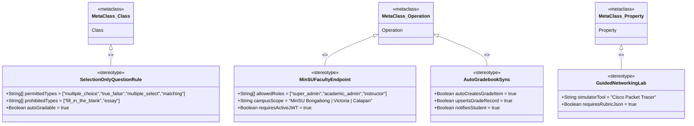

---

# Section 2: Behavioral Diagrams (The System in Motion) — All 9 Diagrams

| # | Diagram Name | Primary Purpose | Best Used For (MinSU Instructor Context) |
| :--- | :--- | :--- | :--- |
| **B1** | **Data Flow Diagram (DFD)** | Traces how data enters a system, transforms through processes, and gets stored. | Mapping data pipelines from Instructor Course Studio, Assessment Builder, and Rubric Grader into SQL stores. |
| **B2** | **Use Case Diagram** | Highlights relationships between external actors and specific goals. | Scoping all 6 instructional capability clusters of the MinSU Instructor (`instructor`) role. |
| **B3** | **Activity Diagram** | Flowchart showing operational workflows, logic gates, and parallel actions. | Documenting end-to-end logic for authoring a course module, validating selection-only questions, and grading rubrics. |
| **B4** | **Sequence Diagram** | Maps chronological interactions between system entities for a single task. | Tracing `PUT /api/v1/assignments/submissions/:id/grade` across UI, Express, Sequelize, and Gradebook sync. |
| **B5** | **State Machine Diagram** | Tracks the lifecycle stages an entity goes through based on events. | Tracking a Student `Submission` & Course `Assignment` lifecycle (`Draft` → `Published` → `Submitted` → `Graded` → `Returned`). |
| **B6** | **Communication Diagram** | Focuses on the numbered network structure of collaborating objects. | Highlighting message pathways between `:InstructorUI`, `:AssignmentController`, `:SubmissionModel`, and `:GradeRecordModel`. |
| **B7** | **Interaction Overview Diagram** | Combines an Activity diagram with miniature Sequence diagrams. | High-level semester orchestration of an Instructor's workflow from Module Setup to Final Grade CSV Export. |
| **B8** | **Timing Diagram** | Explores exact timing constraints and phase changes over an explicit timeline. | Measuring SLA response windows for Selection-Only Quiz Creation, Rubric Grading Sync, and CSV Generation. |
| **B9** | **Requirement Diagram (SysML)** | Maps text-based system rules and requirements directly to components. | Proving traceability for Selection-Only Quiz Constraints, Auto-GradeRecord Sync, and Faculty RBAC rules. |

---

## B1. Data Flow Diagram (DFD — Level 1: Instructor Sub-System)

### Copy-Paste AI Prompt
```text
Create a Level 1 Data Flow Diagram (DFD) for the Instructor / Faculty (`instructor`) workflow in the Mindoro State University (MinSU) E-Learn & Networking Academy.
Include:
External Entities:
- `E1: MinSU Instructor / Faculty`
- `E2: MinSU Student / Learner`
- `E3: Teaching Assistant (TA)`
Processes:
- `P1.0: Author Course Modules, Lessons & Guided Labs` (`POST /api/v1/courses/:courseId/modules`, `POST /api/v1/modules/:moduleId/lessons`)
- `P2.0: Create Assignments, Rubrics & Auto-Provision GradeItems` (`POST /api/v1/assignments`)
- `P3.0: Build Selection-Only Assessments & Question Bank` (`POST /api/v1/assessments`, `POST /api/v1/assessments/:id/questions`)
- `P4.0: Evaluate Submissions via Rubric & Synchronize GradeRecords` (`PUT /api/v1/assignments/submissions/:id/grade`)
- `P5.0: Compute Weighted Section Gradebook & Export CSV` (`GET /api/v1/courses/:courseId/gradebook`)
Data Stores:
- `D1: Curriculum Store (courses, modules, lessons)`
- `D2: Assignment & Submission Store (assignments, submissions)`
- `D3: Assessment & Question Store (assessments, questions, assessment_attempts)`
- `D4: Gradebook & Notification Store (grade_items, grade_records, notifications)`
Label all data flows clearly.
```

### Mermaid Diagram
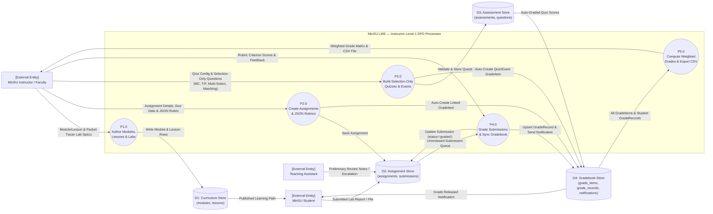

---

## B2. Use Case Diagram (Instructor / Faculty Role)

### Copy-Paste AI Prompt
```text
Create a UML Use Case Diagram for the Instructor / Faculty (`instructor`) role in the Mindoro State University (MinSU) E-Learn & Networking Academy.
Actors:
- Primary Actor: `MinSU Instructor / Faculty` (left side)
- Secondary Actors: `Teaching Assistant (TA)` and `MinSU Student` (right side)
System Boundary: `MinSU E-Learn & Networking Academy — Faculty Instructional Sub-System`
Include the following Use Cases grouped into 6 clusters:
1. Class & Roster Management:
   - `UC1: View Assigned Class Sections & Teaching Schedule`
   - `UC2: Inspect Enrolled Student Roster & Progress %`
   - `UC3: Post Course & Section Announcements`
2. Course Studio Curriculum Authoring:
   - `UC4: Create & Reorder Course Modules`
   - `UC5: Author Lessons & Guided Packet Tracer Labs`
3. Assignment & Rubric Management:
   - `UC6: Create Lab Assignment & Multi-Criteria JSON Rubric`
   - `UC7: Auto-Provision Assignment Gradebook Column` (`<<include>>` from UC6)
4. Submission Evaluation & Grading:
   - `UC8: Review Student Submissions & TA Preliminary Notes`
   - `UC9: Grade Submission via Interactive Rubric & Feedback`
   - `UC10: Synchronize Score to Student GradeRecord` (`<<include>>` from UC9)
5. Selection-Only Assessment & Question Bank Studio:
   - `UC11: Create Timed Checkpoint Quiz or Final Exam`
   - `UC12: Author Selection-Only Questions (MC, T/F, Multi-Select, Matching)`
   - `UC13: Enforce Selection-Only Question Validation` (`<<include>>` from UC12)
6. Gradebook & Academic Reporting:
   - `UC14: Manage Weighted Section Gradebook Matrix`
   - `UC15: Export Section Gradebook to CSV` (`<<extend>>` from UC14)
```

### Mermaid Diagram
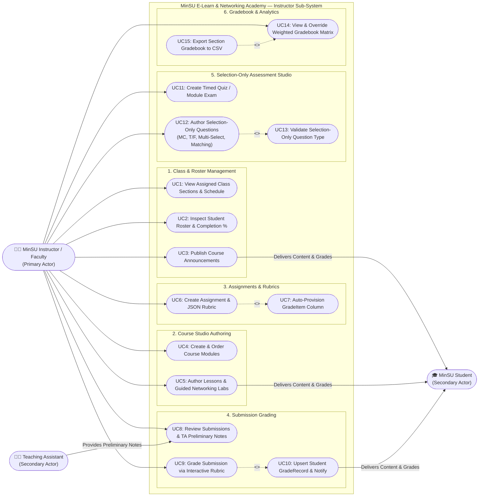

---

## B3. Activity Diagram (Curriculum Authoring, Selection-Only Quiz Creation & Rubric Grading)

### Copy-Paste AI Prompt
```text
Create a UML Activity Diagram with swimlanes for the Mindoro State University (MinSU) Instructor workflow covering Selection-Only Quiz Authoring and Rubric-Based Submission Grading.
Swimlanes:
1. `MinSU Instructor (React Faculty UI)`
2. `Express API & RBAC Guard`
3. `Sequelize ORM & Database`
Workflow Steps:
- Start -> Instructor logs in and opens Faculty Workspace (`/instructor/dashboard`)
- Decision Fork: Choose Instructional Action:
  - Branch A (Author Selection-Only Quiz Question):
    - Instructor selects Assessment and submits Question (`type`, `prompt`, `options`, `correctAnswer`, `points`).
    - Express API checks JWT + Faculty Role, then checks if `type` is in `['multiple_choice', 'true_false', 'multiple_select', 'matching']`.
    - If invalid (e.g., `fill_in_the_blank` or `essay`): Return `400 Bad Request` error banner.
    - If valid: Insert `Question` row in DB and return `201 Created`.
  - Branch B (Grade Student Submission with Rubric):
    - Instructor opens `/instructor/submissions`, selects a Student Submission, clicks Rubric Criterion tiers, and enters feedback.
    - Express API verifies `authorize('super_admin', 'academic_admin', 'instructor')`.
    - Controller updates `Submission` (`numericScore`, `rubricBreakdown`, `status = 'graded'`, `gradedById`).
    - Controller locates linked `GradeItem` (`sourceType = 'assignment'`, `sourceId = assignment.id`) and upserts `GradeRecord`.
    - Controller creates in-app `Notification` for the student.
    - Instructor exports updated section gradebook as CSV -> End.
```

### Mermaid Diagram
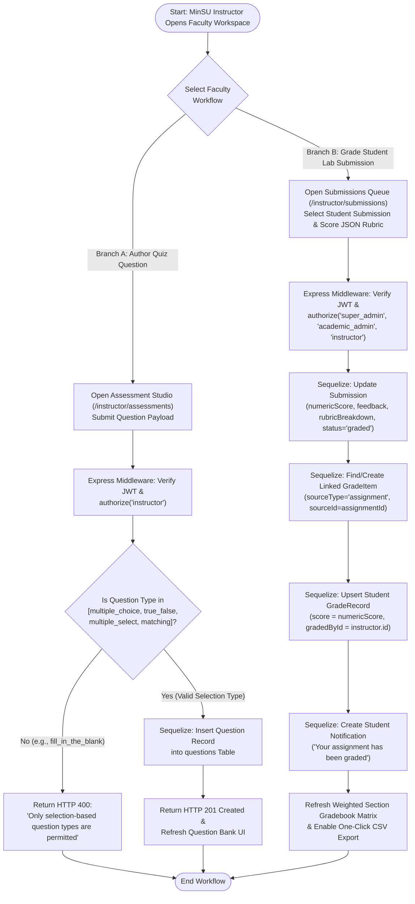

---

## B4. Sequence Diagram (Rubric Grading & Automatic Gradebook Synchronization)

### Copy-Paste AI Prompt
```text
Create a detailed UML Sequence Diagram for the scenario: "MinSU Instructor Grades a Student Lab Submission via Interactive Rubric and Synchronizes the Section Gradebook" (`PUT /api/v1/assignments/submissions/:id/grade`).
Lifelines:
1. `Instructor : MinSU Faculty`
2. `FacultyUI : InstructorPages.jsx`
3. `AuthMW : auth.middleware.js`
4. `AssignCtrl : assignment.controller.js`
5. `DB : Sequelize SQLite/PostgreSQL`
6. `StudentNotif : Notification Table`
Chronological Steps:
1. `Instructor` selects a student's submission in `FacultyUI`, clicks rubric criterion levels (e.g., VLAN Config: 40/40, Trunking: 35/35, Documentation: 21/25 -> Total: 96/100), enters feedback, and clicks "Save Grade".
2. `FacultyUI` sends `PUT /api/v1/assignments/submissions/14/grade` with `{ numericScore: 96, feedback, rubricBreakdown }` and Bearer JWT.
3. `AuthMW` validates JWT and verifies `req.user.role === 'instructor'`.
4. `AssignCtrl` queries `Submission.findByPk(14, { include: [Assignment] })` from `DB`.
5. `AssignCtrl` updates `Submission` (`numericScore = 96`, `feedback`, `rubricBreakdown`, `status = 'graded'`, `gradedById = req.user.id`, `gradedAt = new Date()`).
6. `AssignCtrl` queries `GradeItem.findOne({ where: { courseId, sourceType: 'assignment', sourceId: assignment.id } })`.
7. `AssignCtrl` upserts `GradeRecord` (`gradeItemId`, `studentId`, `score = 96`, `feedback`, `gradedById = req.user.id`).
8. `AssignCtrl` creates a `Notification` record for `studentId` ("Assignment Graded: 96/100").
9. `AssignCtrl` returns `200 OK` with updated `Submission` and synced `GradeRecord` to `FacultyUI`.
10. `FacultyUI` updates the submission status badge to `graded` and refreshes the gradebook matrix.
```

### Mermaid Diagram
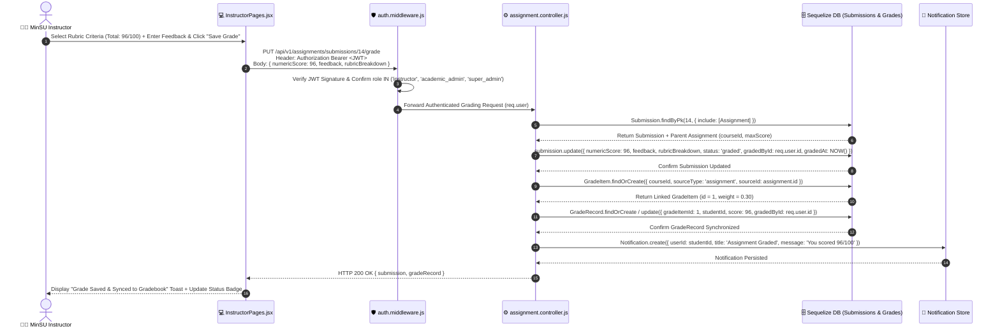

---

## B5. State Machine Diagram (Assignment & Student Submission Grading Lifecycle)

### Copy-Paste AI Prompt
```text
Create a UML State Machine Diagram tracking the lifecycle of an Assignment and its Student Submission within the Instructor workflow of the Mindoro State University (MinSU) E-Learn & Networking Academy.
States:
1. `AssignmentDraft` (Instructor creates assignment with `isPublished = false`)
2. `AssignmentPublished` (Instructor publishes assignment; `GradeItem` column provisioned; awaiting student work)
3. `SubmissionReceived_OnTime` (`status = 'submitted'` before `dueDate`)
4. `SubmissionReceived_Late` (`status = 'late'` after `dueDate`)
5. `UnderTAReview` (Optional: Teaching Assistant attaches preliminary rubric notes or flags issue)
6. `ReturnedForRevision` (`status = 'returned'`; Instructor or TA returns submission to student for correction)
7. `OfficiallyGraded` (`status = 'graded'`; Instructor assigns `numericScore` and `rubricBreakdown`)
8. `SynchronizedInGradebook` (`GradeRecord` updated and included in weighted course average & CSV export)
Show transitions, triggers, and guard conditions clearly.
```

### Mermaid Diagram
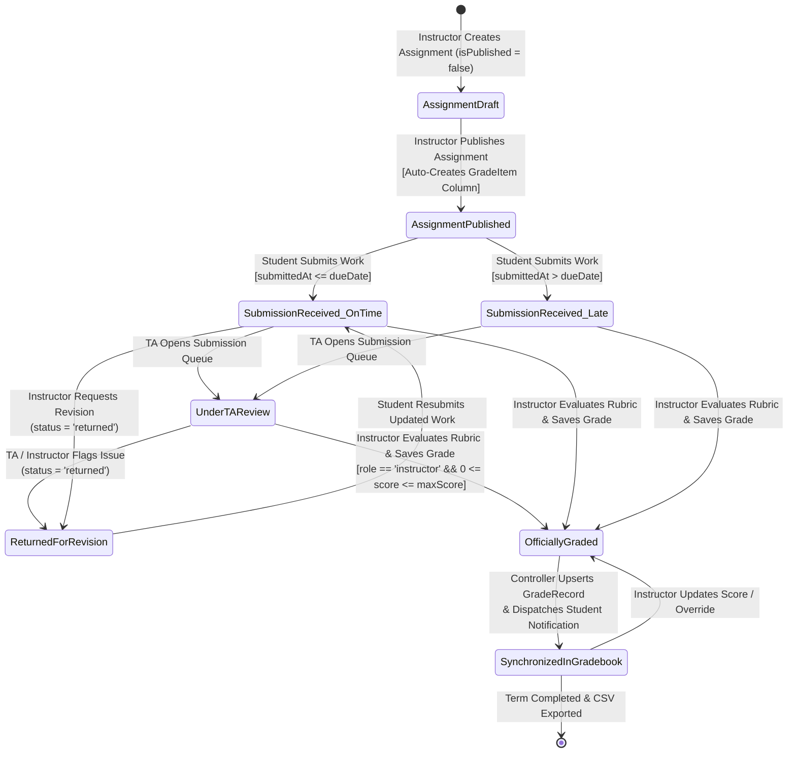

---

## B6. Communication Diagram (Instructor Object Collaboration Network)

### Copy-Paste AI Prompt
```text
Create a UML Communication Diagram showing the numbered message collaboration between system objects when a MinSU Instructor authors a new Lab Assignment and subsequently grades a Student Submission.
Participating Objects:
- `:MinSUInstructor` (Actor)
- `:InstructorPagesUI` (Frontend View)
- `:AssignmentController` (Backend Controller)
- `:AssignmentModel` (Sequelize Model)
- `:SubmissionModel` (Sequelize Model)
- `:GradeItemModel` (Sequelize Model)
- `:GradeRecordModel` (Sequelize Model)
- `:NotificationModel` (Sequelize Model)
Numbered Messages:
- `1: createAssignment(courseId, title, maxScore, rubricJson)`
- `1.1: POST /api/v1/assignments`
- `1.2: create(assignmentData)` -> `:AssignmentModel`
- `1.3: create({ sourceType: 'assignment', sourceId })` -> `:GradeItemModel`
- `2: gradeSubmission(submissionId, numericScore, rubricBreakdown, feedback)`
- `2.1: PUT /api/v1/assignments/submissions/:id/grade`
- `2.2: update({ status: 'graded', numericScore, rubricBreakdown })` -> `:SubmissionModel`
- `2.3: findOne({ sourceType: 'assignment', sourceId })` -> `:GradeItemModel`
- `2.4: upsert({ gradeItemId, studentId, score })` -> `:GradeRecordModel`
- `2.5: create({ userId: studentId, title: 'Assignment Graded' })` -> `:NotificationModel`
```

### Mermaid Diagram
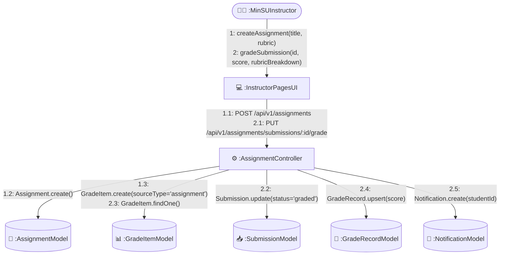

---

## B7. Interaction Overview Diagram (End-to-End Semester Instructional Lifecycle)

### Copy-Paste AI Prompt
```text
Create a UML Interaction Overview Diagram combining high-level Activity control flow with inline Sequence interactions (`sd`) for a MinSU Instructor's complete semester workflow.
Nodes:
1. Initial Node -> `sdVerifyAssignedSections`: Instructor logs in -> `GET /api/v1/sections` -> loads assigned MinSU classes & student rosters.
2. Fork Node into 3 Parallel Instructional Preparation Streams:
   - Stream 1 (`sdAuthorCurriculum`): Instructor creates Course Modules & Guided Packet Tracer Labs (`POST /api/v1/courses/:id/modules`, `POST /api/v1/modules/:id/lessons`).
   - Stream 2 (`sdBuildSelectionAssessments`): Instructor creates Timed Quizzes & Selection-Only Questions (`POST /api/v1/assessments`, `POST /api/v1/assessments/:id/questions`).
   - Stream 3 (`sdCreateRubricAssignments`): Instructor creates Lab Assignments & JSON Rubrics (`POST /api/v1/assignments` -> auto-provisions `GradeItem`).
3. Join Node -> `sdEvaluateCoursework`: Students submit labs & take quizzes -> Instructor grades submissions via rubric (`PUT /api/v1/assignments/submissions/:id/grade`) -> syncs `GradeRecord`.
4. Decision Node (`All Coursework Graded?`): Loop back if pending submissions remain; otherwise proceed to `sdExportSectionGradebook` (`GET /api/v1/courses/:id/gradebook` -> Download CSV) -> Final Node.
```

### Mermaid Diagram


---

## B8. Timing Diagram (Assessment Authoring, Rubric Grading & Gradebook Sync SLAs)

### Copy-Paste AI Prompt
```text
Create a UML Timing Diagram showing the state transitions and strict response time constraints (in milliseconds) across 4 lifelines during an Instructor's Rubric Grading and Gradebook Synchronization transaction (`T = 0ms` to `T = 250ms`):
Lifelines:
1. `FacultyBrowserUI` (States: `EditingRubric`, `AwaitingAPIResponse`, `RenderingUpdatedGradebook`)
2. `ExpressAuthAndRoleGuard` (States: `Idle`, `VerifyingJWTAndFacultyRole`, `Authorized`)
3. `AssignmentGradingController` (States: `Idle`, `UpdatingSubmission`, `UpsertingGradeRecord`, `DispatchingNotification`)
4. `DatabaseStorage` (States: `Idle`, `WritingSubmissionRow`, `WritingGradeRecordRow`, `Committed`)
Timeline Milestones:
- `T = 0ms`: Instructor clicks "Save Rubric Grade" (`PUT /api/v1/assignments/submissions/:id/grade`).
- `T = 0ms..20ms`: `ExpressAuthAndRoleGuard` verifies JWT and confirms `role === 'instructor'`.
- `T = 20ms..95ms`: `AssignmentGradingController` & `DatabaseStorage` update `Submission` row (`status = 'graded'`, `numericScore`, `rubricBreakdown`).
- `T = 95ms..165ms`: `AssignmentGradingController` & `DatabaseStorage` locate `GradeItem` and upsert `GradeRecord`.
- `T = 165ms..200ms`: `Notification` inserted for student; HTTP `200 OK` returned.
- `T = 200ms..250ms`: `FacultyBrowserUI` updates submission badge and recalculates section gradebook matrix (`SLA < 300ms`).
```

### Mermaid Diagram
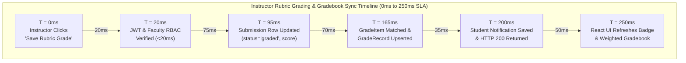

---

## B9. Requirement Diagram — SysML (Instructor Sub-System Requirements Traceability)

### Copy-Paste AI Prompt
```text
Create a SysML Requirement Diagram mapping the core functional and security requirements of the Mindoro State University (MinSU) Instructor / Faculty Sub-System to the code modules and test cases that satisfy and verify them.
Requirements:
- `REQ-INST-01: Selection-Only Question Enforcement`: The system must permit Instructors to author only `multiple_choice`, `true_false`, `multiple_select`, and `matching` questions, rejecting `fill_in_the_blank` and `essay` types with HTTP 400.
- `REQ-INST-02: Course Studio Curriculum & Lab Authoring`: Instructors must be able to create ordered `Module` and `Lesson` records including guided Packet Tracer lab instructions.
- `REQ-INST-03: Automatic GradeItem Provisioning`: Creating an `Assignment` or `Assessment` must automatically provision a corresponding `GradeItem` column in the course gradebook.
- `REQ-INST-04: Rubric Grading & GradeRecord Synchronization`: Grading a student `Submission` must persist `rubricBreakdown` JSON and automatically upsert the student's `GradeRecord`.
- `REQ-INST-05: Faculty RBAC Boundary`: Only `instructor`, `academic_admin`, and `super_admin` roles may publish final submission grades or author assessments (Teaching Assistants and Students are blocked).
- `REQ-INST-06: Weighted Section Gradebook & CSV Export`: Instructors must be able to view weighted category averages (Assignments 30%, Quizzes 30%, Exams 40%) and export the section gradebook to CSV.
Show `<<satisfy>>` links from implementation files (`assessment.controller.js`, `academic.controller.js`, `assignment.controller.js`, `auth.middleware.js`, `InstructorPages.jsx`) and `<<verify>>` links from automated tests (`server/tests/api.test.js`).
```

### Mermaid Diagram
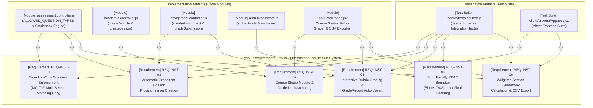

