# System Modeling & Diagram Blueprint: Instructor / Faculty (`instructor`) Account Workflow

---

## Objective

To apply system modeling concepts to the **Mindoro State University (MinSU) E-Learn & Networking Academy — Instructor / Faculty (`instructor`) Account Workflow** by identifying, selecting, and documenting the complete suite of **8 Structural Diagrams (The Static Blueprint)** and **9 Behavioral Diagrams (The System in Motion)** required to architect, implement, and verify the faculty instructional, curriculum authoring, rubric grading, selection-only assessment design, and weighted gradebook sub-system across Mindoro State University's Bongabong, Main (Victoria), and Calapan City campuses.

---

## Part 1: Core Modeling Framework

Every proposed system must be viewed through two distinct lenses to ensure it can be successfully built:

### 1. Structural Diagrams (The Static Blueprint)
- **What it is:** These diagrams map out the static skeleton of your project—what parts make up the system architecture, how they are organized, and where they will be hosted.
- **Key Rule:** These components and relationships do not change based on individual user actions. They represent the permanent infrastructure or codebase layout.
- **Core Examples:** System Architecture, Class, Component, and Deployment diagrams (plus Object, Package, Composite Structure, and Profile diagrams).

### 2. Behavioral Diagrams (The System in Motion)
- **What it is:** These diagrams document the dynamic logic of your project—how data moves, how components interact step-by-step, and how the system responds to users over time.
- **Key Rule:** These change dynamically based on triggers, inputs, time, or external events.
- **Core Examples:** Data Flow Diagrams (DFD), Use Case, Sequence, and Activity diagrams (plus State Machine, Communication, Interaction Overview, Timing, and Requirement diagrams).

---

## Part 2: Diagram Reference Guide

### Section A: Structural Diagrams (Static Blueprint)
- **System Architecture Diagram:** High-level layout of your servers, clients, cloud infrastructure, and databases.
- **Class Diagram:** Maps out data models, object classes, their attributes, and how they connect.
- **Component Diagram:** Shows how different software modules, libraries, or microservices depend on each other.
- **Deployment Diagram:** Outlines the physical hardware or containerized infrastructure hosting your application.
- **Object Diagram:** Captures a snapshot of instances of classes at a specific moment in time.
- **Package Diagram:** Groups classes or components into higher-level folders (packages) to show organization.
- **Composite Structure Diagram:** Breaks down the internal structure of a single complex classifier or class.
- **Profile Diagram:** Customizes existing UML elements for specific industries, domains, or platforms.

### Section B: Behavioral Diagrams (The System in Motion)
- **Data Flow Diagram (DFD):** Tracks exactly how data enters your system, processes through nodes, and hits storage.
- **Use Case Diagram:** Defines project scope by mapping who your users/systems are (actors) and what actions they can take.
- **Activity Diagram:** A technical flowchart mapping out business logic, background processes, or algorithms.
- **Sequence Diagram:** Coordinates chronological, step-by-step messages between system entities for a single feature.
- **State Machine Diagram:** Tracks the lifecycle stages an entity goes through based on events (e.g., an Order going from Pending → Paid → Shipped).
- **Communication Diagram:** Similar to a sequence diagram, but focuses on the freeform network structure of objects rather than time.
- **Interaction Overview Diagram:** Combines an Activity diagram with miniature Sequence diagrams.
- **Timing Diagram:** Explores exact timing constraints and phase changes of objects over an explicit timeline.
- **Requirement Diagram (SysML):** Maps text-based system rules and requirements directly to physical or digital components.

---

## Part 3: Completed Blueprinting Exercise (Instructor / Faculty Workflow)

### 1. Project Identification
- **Proposal Title:** **Mindoro State University (MinSU) E-Learn & Networking Academy: A Web-Based Role-Driven Learning Management System Inspired by Cisco NetAcad** *(Focus Module: Instructor / Faculty Curriculum Authoring, Selection-Only Assessment Design, Rubric Grading & Weighted Section Gradebook Sub-System)*
- **Project Summary (2–3 Sentences):**
  The Mindoro State University (MinSU) E-Learn & Networking Academy is a full-stack, role-based Learning Management System engineered for MinSU's College of Computer Studies across its Bongabong, Main (Victoria), and Calapan City campuses. Within this platform, the **Instructor (`instructor`)** role serves as the primary pedagogical authority responsible for authoring structured course modules and Packet Tracer guided labs in the Course Studio, building timed selection-only checkpoint quizzes and exams (`multiple_choice`, `true_false`, `multiple_select`, `matching`), creating lab assignments with multi-criteria JSON rubrics, grading student submissions alongside Teaching Assistant preliminary notes, and managing the weighted section gradebook with instant CSV export.

### 2. Structural Blueprinting
- **Selected Essential Structural Diagram:** **Class Diagram** (paired with the **System Architecture Diagram**)
- **Why This Specific Layout Diagram Is Required:**
  The **Class Diagram** is essential for the MinSU Instructor sub-system because an Instructor interacts with the deepest relational hierarchy in the entire LMS: an Instructor `User` (`role = 'instructor'`) is assigned to one or more `ClassSection` offerings (`instructorId`), authors hierarchical `Module` and `Lesson` entities inside the parent `Course`, creates `Assignment` records (which automatically provision linked `GradeItem` columns in the section gradebook), builds `Assessment` and `Question` banks strictly constrained to selection-only types, and evaluates student `Submission` records that automatically synchronize numeric scores into `GradeRecord` cells. Without a strict Class Diagram defining these foreign keys, cascade rules, and JSON rubric/question schemas, faculty grading and curriculum authoring would suffer from orphaned grade items and unsynchronized student gradebooks.

### 3. Behavioral Blueprinting
- **Selected Critical Behavioral Diagram 1:** **Use Case Diagram**
  - **Specific Project Scenario Mapped:** Maps the complete pedagogical boundary of the **MinSU Instructor (`instructor`)** actor across 6 core functional clusters:
    1. *Assigned Classes & Section Roster Management* (`/instructor/dashboard`, `/instructor/classes`),
    2. *Course Studio Curriculum & Guided Lab Authoring* (`/instructor/courses`),
    3. *Assignment & JSON Rubric Creation* (`/instructor/assignments`),
    4. *Submission Evaluation & Rubric Grading* (`/instructor/submissions`),
    5. *Selection-Only Assessment & Question Bank Authoring* (`/instructor/assessments`), and
    6. *Weighted Section Gradebook Management & CSV Export* (`/instructor/gradebook`, `/instructor/reports`).
- **Selected Critical Behavioral Diagram 2:** **Sequence Diagram** (supported by the **Activity Diagram** and **DFD**)
  - **Specific Project Scenario Mapped:** Maps the chronological, multi-table transactional handshake for **"Instructor Grading a Student Lab Submission via JSON Rubric & Synchronizing the Section Gradebook"** (`PUT /api/v1/assignments/submissions/:id/grade`). It traces how the Instructor selects rubric criteria tiers in the React UI, sends the payload with a Bearer JWT to Express, passes through `authenticate` and `authorize('super_admin', 'academic_admin', 'instructor')`, updates the `Submission` status to `'graded'`, upserts the corresponding `GradeRecord` for the assignment's `GradeItem`, recalculates the student's weighted course average, and dispatches an in-app `Notification` to the MinSU student.

### 4. Data Blueprinting
- **How Data Flows from Instructor Input to the System Database:**
  1. **Curriculum, Assignment, or Grade Input:** The MinSU Instructor interacts with the React 18 faculty workspace (`InstructorPages.jsx`)—for example, creating a new Packet Tracer lab assignment with a 3-criterion JSON rubric or grading a student's submitted topology report.
  2. **Authenticated REST Request:** The Axios client (`api.js`) attaches `Authorization: Bearer <accessToken>` and dispatches an HTTP request (`POST /api/v1/assignments` or `PUT /api/v1/assignments/submissions/:id/grade`) to the Express.js API gateway.
  3. **JWT & RBAC Verification:** `authenticate` verifies the JWT signature and checks `User.status === 'active'`, while `authorize('super_admin', 'academic_admin', 'instructor')` confirms the caller holds faculty privileges (preventing Teaching Assistants or Students from publishing official final grades).
  4. **Controller Validation & Multi-Table Persistence:** Inside `assignment.controller.js`, Sequelize ORM executes atomic database writes in SQLite3/PostgreSQL: creating an `Assignment` also creates a linked `GradeItem` (`category = 'assignment'`, `weight = 0.30`), and grading a `Submission` updates `submissions.numeric_score`, `submissions.rubric_Breakdown`, `submissions.status = 'graded'`, and upserts `grade_records.score`, immediately reflecting in both the Instructor Gradebook Matrix and the Student's Gradebook view.

---

# Section 1: Structural Diagrams (The Static Blueprint) — All 8 Diagrams

| # | Diagram Name | Primary Purpose | Best Used For (MinSU Instructor Context) |
| :--- | :--- | :--- | :--- |
| **A1** | **System Architecture Diagram** | Shows high-level layout of servers, clients, cloud infrastructure, and databases. | Explaining the 3-tier MinSU Faculty Course Studio, Assessment Builder, and Gradebook architecture. |
| **A2** | **Class Diagram** | Maps out object-oriented classes, their attributes, methods, and relationships. | Baseline blueprint for `ClassSection`, `Module`, `Lesson`, `Assignment`, `Submission`, `Assessment`, `Question`, `GradeItem`, and `GradeRecord`. |
| **A3** | **Component Diagram** | Shows how software pieces (modules, libraries, microservices) are bundled and depend on each other. | Mapping dependencies between `InstructorPages.jsx`, `academic.controller.js`, `assignment.controller.js`, and `assessment.controller.js`. |
| **A4** | **Deployment Diagram** | Maps software components to physical hardware or cloud infrastructure. | DevOps layout across MinSU Faculty Workstations, Nginx Reverse Proxy, Node.js API Container, and SQL Database. |
| **A5** | **Object Diagram** | Captures a snapshot of instances of classes at a specific moment in time. | Concrete runtime snapshot of `inst_santos` teaching `BSIT-2A-NET101` and grading `stud_calapan_01`'s OSPF Lab. |
| **A6** | **Package Diagram** | Groups classes or components into higher-level folders (packages) to show organization. | Organizing the Monorepo into Faculty UI Views, Express Instructional Controllers, RBAC Middleware, and Sequelize Models. |
| **A7** | **Composite Structure Diagram** | Breaks down the internal structure of a single complex classifier or class. | Internal ports, parts, and connectors of the `InstructorGradingAndAssessmentEngine` composite component. |
| **A8** | **Profile Diagram** | Customizes existing UML elements for specific industries, domains, or platforms. | Defining custom UML stereotypes (`<<MinSUFacultyAction>>`, `<<SelectionOnlyRule>>`, `<<GradebookSync>>`) for MinSU CCS. |

---

## A1. System Architecture Diagram (Instructor Workflow)

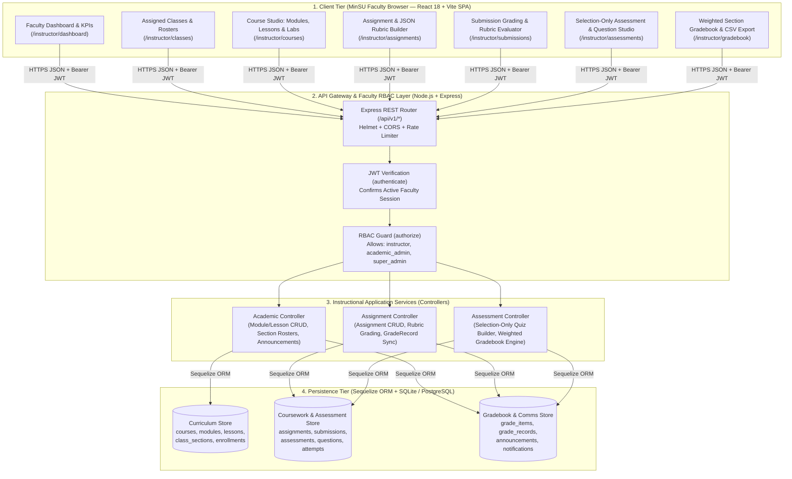

---

## A2. Class Diagram (Instructor Domain Model)

---

## A3. Component Diagram (Instructor Sub-System)

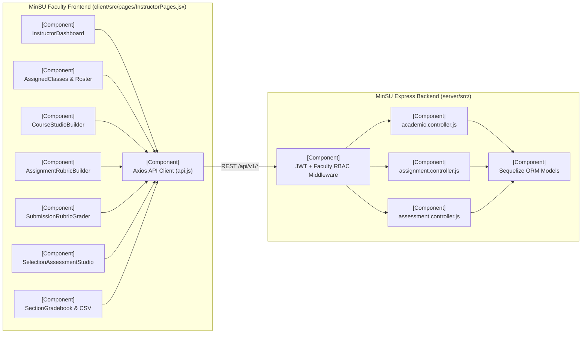

---

## A4. Deployment Diagram (Instructor Infrastructure)

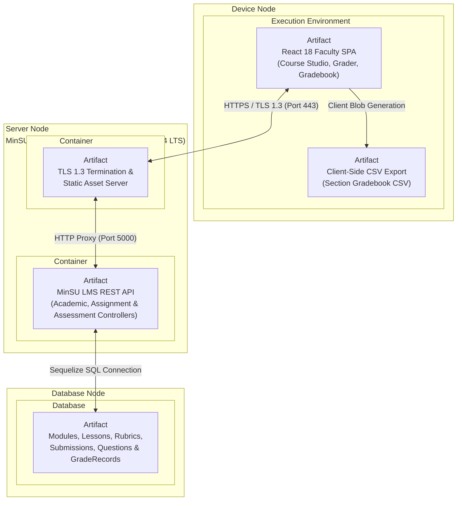

---

## A5. Object Diagram (Runtime Snapshot — Instructor Grading Session)

---

## A6. Package Diagram (Instructor Codebase Organization)

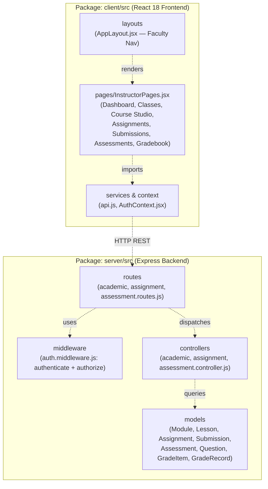

---

## A7. Composite Structure Diagram (`InstructorGradingAndAssessmentEngine`)

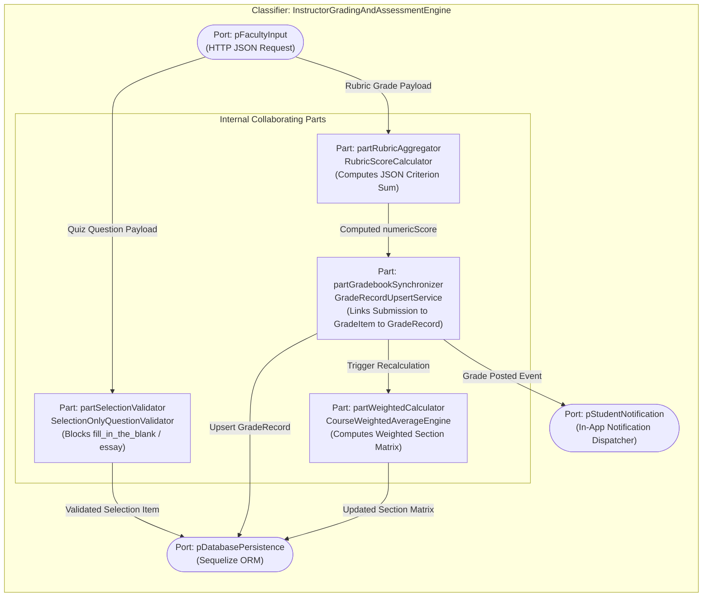

---

## A8. Profile Diagram (MinSU Faculty Instructional UML Profile)

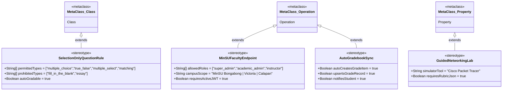

---

# Section 2: Behavioral Diagrams (The System in Motion) — All 9 Diagrams

| # | Diagram Name | Primary Purpose | Best Used For (MinSU Instructor Context) |
| :--- | :--- | :--- | :--- |
| **B1** | **Data Flow Diagram (DFD)** | Traces how data enters a system, transforms through processes, and gets stored. | Mapping data pipelines from Instructor Course Studio, Assessment Builder, and Rubric Grader into SQL stores. |
| **B2** | **Use Case Diagram** | Highlights relationships between external actors and specific goals. | Scoping all 6 instructional capability clusters of the MinSU Instructor (`instructor`) role. |
| **B3** | **Activity Diagram** | Flowchart showing operational workflows, logic gates, and parallel actions. | Documenting end-to-end logic for authoring a course module, validating selection-only questions, and grading rubrics. |
| **B4** | **Sequence Diagram** | Maps chronological interactions between system entities for a single task. | Tracing `PUT /api/v1/assignments/submissions/:id/grade` across UI, Express, Sequelize, and Gradebook sync. |
| **B5** | **State Machine Diagram** | Tracks the lifecycle stages an entity goes through based on events. | Tracking a Student `Submission` & Course `Assignment` lifecycle (`Draft` → `Published` → `Submitted` → `Graded` → `Returned`). |
| **B6** | **Communication Diagram** | Focuses on the numbered network structure of collaborating objects. | Highlighting message pathways between `:InstructorUI`, `:AssignmentController`, `:SubmissionModel`, and `:GradeRecordModel`. |
| **B7** | **Interaction Overview Diagram** | Combines an Activity diagram with miniature Sequence diagrams. | High-level semester orchestration of an Instructor's workflow from Module Setup to Final Grade CSV Export. |
| **B8** | **Timing Diagram** | Explores exact timing constraints and phase changes over an explicit timeline. | Measuring SLA response windows for Selection-Only Quiz Creation, Rubric Grading Sync, and CSV Generation. |
| **B9** | **Requirement Diagram (SysML)** | Maps text-based system rules and requirements directly to components. | Proving traceability for Selection-Only Quiz Constraints, Auto-GradeRecord Sync, and Faculty RBAC rules. |

---

## B1. Data Flow Diagram (DFD — Level 1: Instructor Sub-System)

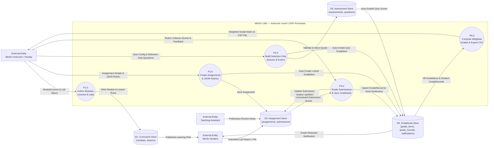

---

## B2. Use Case Diagram (Instructor / Faculty Role)

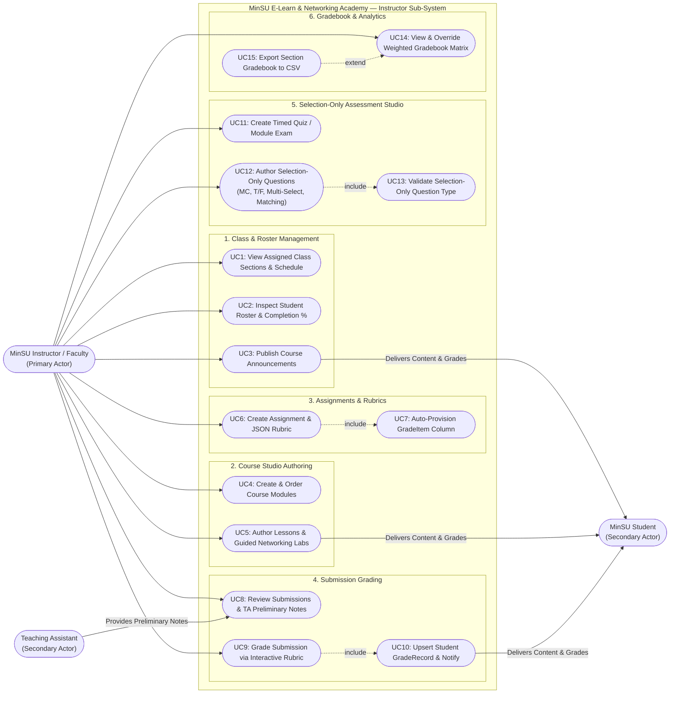

---

## B3. Activity Diagram (Curriculum Authoring, Selection-Only Quiz Creation & Rubric Grading)

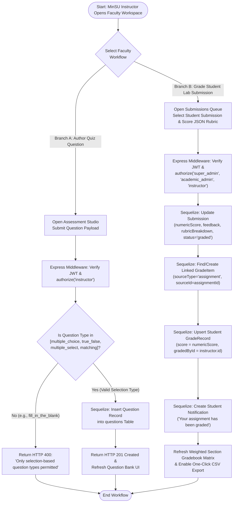

---

## B4. Sequence Diagram (Rubric Grading & Automatic Gradebook Synchronization)

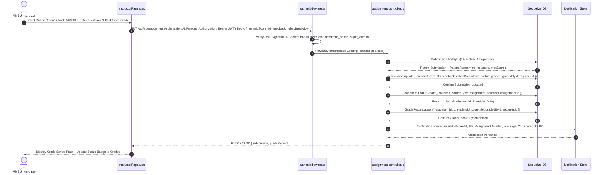

---

## B5. State Machine Diagram (Assignment & Student Submission Grading Lifecycle)

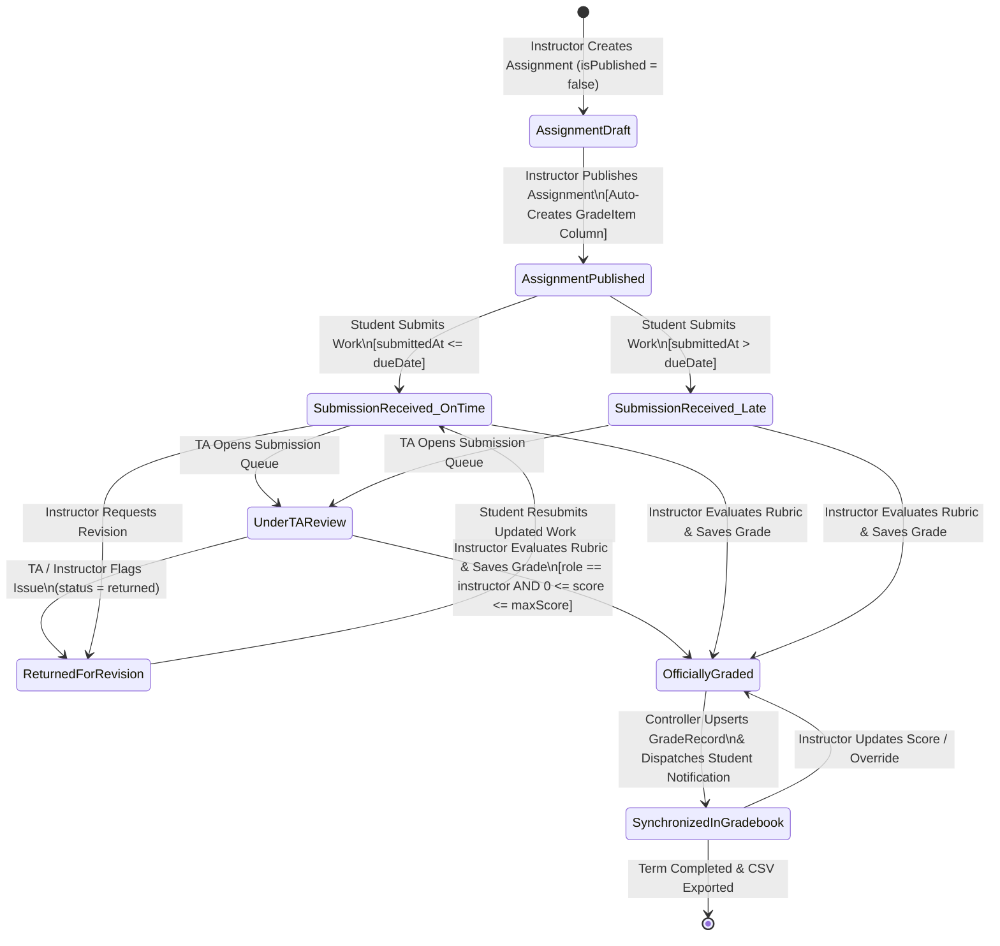

---

## B6. Communication Diagram (Instructor Object Collaboration Network)

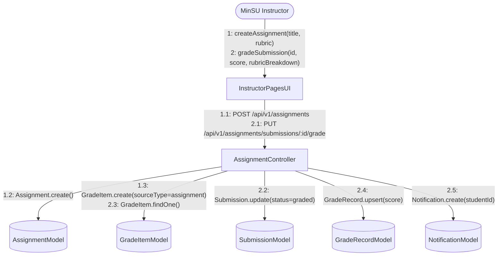

---

## B7. Interaction Overview Diagram (End-to-End Semester Instructional Lifecycle)

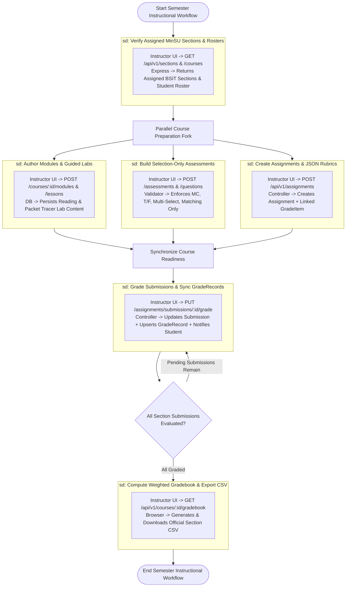

---

## B8. Timing Diagram (Assessment Authoring, Rubric Grading & Gradebook Sync SLAs)

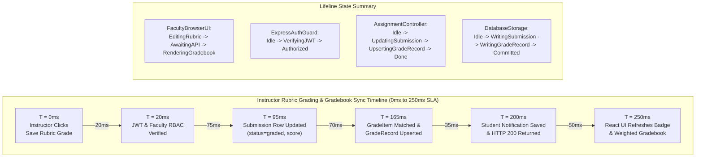

---

## B9. Requirement Diagram — SysML (Instructor Sub-System Requirements Traceability)

```mermaid
flowchart TB
    subgraph Requirements["SysML Requirements — MinSU Instructor / Faculty Sub-System"]
        R1["Requirement REQ-INST-01\nSelection-Only Question Enforcement\n(MC, T/F, Multi-Select, Matching Only)"]
        R2["Requirement REQ-INST-02\nCourse Studio Module &\nGuided Lab Authoring"]
        R3["Requirement REQ-INST-03\nAutomatic GradeItem Column\nProvisioning on Creation"]
        R4["Requirement REQ-INST-04\nInteractive Rubric Grading &\nGradeRecord Auto-Upsert"]
        R5["Requirement REQ-INST-05\nStrict Faculty RBAC Boundary\n(Blocks TA/Student Final Grading)"]
        R6["Requirement REQ-INST-06\nWeighted Section Gradebook\nCalculation & CSV Export"]
    end

    subgraph Implementation["Implementation Artifacts (Code Modules)"]
        C_Assess["Module: assessment.controller.js\n(ALLOWED_QUESTION_TYPES & Gradebook Engine)"]
        C_Acad["Module: academic.controller.js\n(createModule & createLesson)"]
        C_Assign["Module: assignment.controller.js\n(createAssignment & gradeSubmission)"]
        C_Auth["Module: auth.middleware.js\n(authenticate & authorize)"]
        C_UI["Module: InstructorPages.jsx\n(Course Studio, Rubric Grader & CSV Exporter)"]
    end

    subgraph Verification["Verification Artifacts (Test Suites)"]
        T_API["Test Suite: server/tests/api.test.js\n(Jest + Supertest Integration Tests)"]
        T_UI["Test Suite: client/src/test/App.test.jsx\n(Vitest Frontend Suite)"]
    end

    C_Assess -->|"satisfy"| R1 & R3 & R6
    C_Acad -->|"satisfy"| R2
    C_Assign -->|"satisfy"| R3 & R4
    C_Auth -->|"satisfy"| R5
    C_UI -->|"satisfy"| R2 & R4 & R6

    T_API -->|"verify"| R1 & R3 & R4 & R5 & R6
    T_UI -->|"verify"| R2 & R6
```

---

*Document prepared for: Mindoro State University (MinSU) — College of Computer Studies*
*System: MinSU E-Learn & Networking Academy — Instructor / Faculty Sub-System*
*Campuses: Bongabong | Main (Victoria) | Calapan City*
