# Mindoro State University (MinSU) E-Learn & Networking Academy
## Comprehensive System Modeling & Complete 17-Diagram Architectural Blueprint
### Unified Reference for All User Roles: Super Administrator, Academic Administrator, Instructor, Teaching Assistant, and Student

---

## Objective
To apply comprehensive system modeling concepts to the **Mindoro State University (MinSU) E-Learn & Networking Academy** by identifying, selecting, and documenting the complete suite of **8 Structural Diagrams (The Static Blueprint)** and **9 Behavioral Diagrams (The System in Motion)**. This blueprint provides a unified, production-grade architectural specification covering all five user roles—**Super Administrator (`super_admin`)**, **Academic Administrator (`academic_admin`)**, **Instructor / Faculty (`instructor`)**, **Teaching Assistant (`teaching_assistant`)**, and **Student / Learner (`student`)**—across Mindoro State University's Bongabong, Main (Victoria), and Calapan City campuses.

---

## Part 1: Core Modeling Framework

Every proposed software system must be viewed through two distinct lenses to ensure it can be successfully engineered, audited, and maintained:

### 1. Structural Diagrams (The Static Blueprint)
- **What it is:** These diagrams map out the static skeleton of your project—what parts make up the system architecture, how they are organized, and where they will be hosted.
- **Key Rule:** These components and relationships do not change based on individual user actions. They represent the permanent infrastructure, domain classes, components, or codebase layout.
- **Core Examples:** System Architecture, Class, Component, Deployment, Object, Package, Composite Structure, and Profile diagrams.

### 2. Behavioral Diagrams (The System in Motion)
- **What it is:** These diagrams document the dynamic logic of your project—how data moves, how components interact step-by-step, and how the system responds to users over time.
- **Key Rule:** These change dynamically based on triggers, inputs, time, or external events.
- **Core Examples:** Data Flow Diagrams (DFD), Use Case, Activity, Sequence, State Machine, Communication, Interaction Overview, Timing, and Requirement (SysML) diagrams.

---

## Part 2: Diagram Reference Guide

### Section A: Structural Diagrams (The Static Blueprint)
| Diagram Name | Primary Purpose | Best Used For (MinSU LMS Context) |
| :--- | :--- | :--- |
| **System Architecture Diagram** | High-level layout of clients, application servers, security gateways, and databases. | Explaining the end-to-end 3-tier system architecture supporting all 5 roles across MinSU campuses. |
| **Class Diagram** | Maps object-oriented models, attributes, methods, relationships, and multiplicities. | The baseline database and ORM schema for users, roles, courses, sections, modules, labs, grades, and logs. |
| **Component Diagram** | Shows software pieces (modules, libraries, microservices) and dependencies. | Wiring React SPA page components, Express controllers, RBAC filters, and Sequelize models. |
| **Deployment Diagram** | Maps software artifacts to physical hardware, virtualization, or cloud containers. | DevOps deployment across MinSU campus client workstations, Nginx proxy, Node.js API, and PostgreSQL. |
| **Object Diagram** | Captures a concrete snapshot of class instances at an exact moment in time. | Troubleshooting real-world runtime states involving active admins, faculty, TAs, students, and lab submissions. |
| **Package Diagram** | Groups classes or components into higher-level logical directories/packages. | Managing the monorepo directory layout between client, server, routes, controllers, and models. |
| **Composite Structure Diagram** | Breaks down internal structure, ports, and parts of a single complex classifier. | Detailing the inner processing pipelines of the MinSU Academy Core Application Engine. |
| **Profile Diagram** | Customizes UML elements with domain-specific stereotypes and tagged values. | Defining institutional stereotypes (`<<MinSURoleGuard>>`, `<<SelectionOnlyRule>>`, `<<AuditLogged>>`). |

### Section B: Behavioral Diagrams (The System in Motion)
| Diagram Name | Primary Purpose | Best Used For (MinSU LMS Context) |
| :--- | :--- | :--- |
| **Data Flow Diagram (DFD)** | Traces how data enters, transforms through processes, and hits storage. | Mapping data movement from all 5 user inputs through validation to database stores. |
| **Use Case Diagram** | Maps external actors (roles) to functional system use cases and boundaries. | Defining the full institutional functional scope for SuperAdmin, AcademicAdmin, Instructor, TA, and Student. |
| **Activity Diagram** | Flowchart showing operational workflows, logic gates, and parallel actions. | Documenting end-to-end workflows (e.g., student lab submission, quiz grading, and certificate generation). |
| **Sequence Diagram** | Coordinates chronological, step-by-step messages between system entities. | Debugging multi-table transactions (e.g., instructor rubric grading auto-syncing into student gradebook). |
| **State Machine Diagram** | Tracks lifecycle stages an entity undergoes based on events and triggers. | Modeling the lifecycle of Courses, Assignments, Submissions, Quizzes, and Student Certifications. |
| **Communication Diagram** | Explores freeform object network structure and numbered message exchanges. | Visualizing collaboration between UI components, auth guards, controllers, and database models. |
| **Interaction Overview Diagram** | Combines high-level activity nodes with embedded sequence diagrams. | Orchestrating the complete academic semester lifecycle from term setup to final grade archiving. |
| **Timing Diagram** | Explores exact timing constraints and state changes over an explicit timeline. | Verifying real-time SLA deadlines (JWT verification, quiz auto-scoring, and grade sync under 250ms). |
| **Requirement Diagram (SysML)**| Maps formal textual requirements to software components and automated tests. | Ensuring strict traceability for RBAC, selection-only quizzes, rubric grading, and certificate validation. |

---

## Part 3: Completed Blueprinting Exercise (All 5 MinSU User Roles)

### 1. Project Identification
- **Proposal Title:** **Mindoro State University (MinSU) E-Learn & Networking Academy: A Web-Based Role-Driven Learning Management System Inspired by Cisco NetAcad**
- **System Summary (2–3 Sentences):**
  The Mindoro State University (MinSU) E-Learn & Networking Academy is an enterprise-grade, role-driven Learning Management System designed specifically for MinSU's College of Computer Studies across its Bongabong, Main (Victoria), and Calapan City campuses. The platform establishes five distinct, secure user workspaces—Super Administrator, Academic Administrator, Instructor/Faculty, Teaching Assistant, and Student/Learner—enabling end-to-end management of academic terms, hands-on Cisco Packet Tracer networking labs, strict selection-only checkpoint assessments, rubric-based submission grading, weighted gradebooks, and instant HTML5 badge and certificate generation.

### 2. Structural Blueprinting
- **Selected Essential Structural Diagram:** **Class Diagram (A2)** paired with **System Architecture Diagram (A1)**.
- **Why Required:**
  The Class Diagram establishes the foundational relational schema connecting all 5 roles: `User` (`role: super_admin | academic_admin | instructor | teaching_assistant | student`), `AcademicTerm`, `Course`, `ClassSection`, `Enrollment`, `Module`, `Lesson`, `Assignment`, `Submission`, `Assessment`, `Question`, `GradeItem`, `GradeRecord`, and `AuditLog`. It guarantees relational integrity, foreign key constraints, cascade rules, and JSON schemas (rubrics, selection-only questions), ensuring data consistency across all campus operations.

### 3. Behavioral Blueprinting
- **Selected Critical Behavioral Diagram 1:** **Use Case Diagram (B2)**.
  - **Specific Project Scenario Mapped:** Defines the complete functional boundaries and permission matrix for all five actors: SuperAdmin (system config, user management, audit logs), AcademicAdmin (course offerings, class section scheduling, faculty assignments), Instructor (curriculum authoring, selection-only quiz builder, rubric grading, section gradebook), Teaching Assistant (section monitoring, preliminary submission notes, discussion moderation), and Student (enrolled courses, lab execution, timed selection quizzes with instant score %, badge/certificate downloads).
- **Selected Critical Behavioral Diagram 2:** **Sequence Diagram (B4)**.
  - **Specific Project Scenario Mapped:** Details the end-to-end coursework submission and evaluation loop: a Student submits a Packet Tracer lab, a Teaching Assistant reviews and attaches preliminary notes, the Instructor applies an interactive JSON rubric (`PUT /api/v1/assignments/submissions/:id/grade`), the system updates the `Submission`, upserts the student's `GradeRecord`, recalculates the weighted course average, and issues an automated in-app notification.

### 4. Data Blueprinting
- **How Data Flows from User Input to the System Database:**
  1. **User Interaction:** A user on any of the 5 roles interacts with the React 18 SPA (e.g., Student submits quiz answers; Instructor grades a submission; SuperAdmin updates system settings).
  2. **API Dispatch:** The centralized Axios client (`api.js`) attaches `Authorization: Bearer <JWT>` and dispatches an HTTP REST request to the Express API.
  3. **Security Gate:** Express middleware checks token validity (`authenticate`) and role authorization (`authorize(...)`).
  4. **Controller & ORM Logic:** The specialized controller validates inputs, executes business logic, and coordinates transactions via Sequelize ORM into PostgreSQL/SQLite3.
  5. **Persistence & Side Effects:** Changes are committed to relational tables, grade records are synchronized, notifications are generated, and security audit logs are recorded.

---

# SECTION 1: ALL 8 STRUCTURAL DIAGRAMS (THE STATIC BLUEPRINT)

---

## A1. System Architecture Diagram (Unified Multi-Role Architecture)

### Copy-Paste AI Prompt
```text
Create a high-level System Architecture Diagram for the "Mindoro State University (MinSU) E-Learn & Networking Academy" supporting 5 distinct user roles (Super Administrator, Academic Administrator, Instructor, Teaching Assistant, and Student).
Divide the architecture into 4 clean horizontal layers:
1. Client Layer (React 18 + Vite + Tailwind CSS SPA):
   - SuperAdmin Workspace (`/admin/*`: Users, Audit Logs, Terms, Settings)
   - AcademicAdmin Workspace (`/academic/*`: Departments, Programs, Course Offerings, Sections)
   - Instructor Workspace (`/instructor/*`: Course Studio, Assignments, Rubric Grader, Quizzes, Gradebook)
   - Teaching Assistant Workspace (`/ta/*`: Section Rosters, Submission Reviews, Discussions)
   - Student Workspace (`/student/*`: Enrolled Courses, Modules, Guided Labs, Timed Quizzes, Badges & Certificates)
2. Security & API Gateway Layer (Express.js):
   - Reverse Proxy & SSL Termination (Nginx)
   - Security Middleware: Helmet, CORS, Rate Limiting, Request Logging (Morgan)
   - Authentication & RBAC Guard: JWT Validator (`authenticate`), Role Dispatcher (`authorize`)
3. Business Application Layer (Express REST Controllers):
   - Auth Controller, Academic Controller, Course Controller, Assignment & Rubric Controller, Assessment & Selection Quiz Controller, Gradebook Controller, User & Audit Controller
4. Persistence & Storage Layer:
   - Sequelize ORM Layer
   - Relational Database (PostgreSQL 16 / SQLite3)
   - Static Asset & Packet Tracer Lab Storage
Connect all layers with directional arrows showing HTTPS/JSON and SQL database queries.
```

### Mermaid Diagram
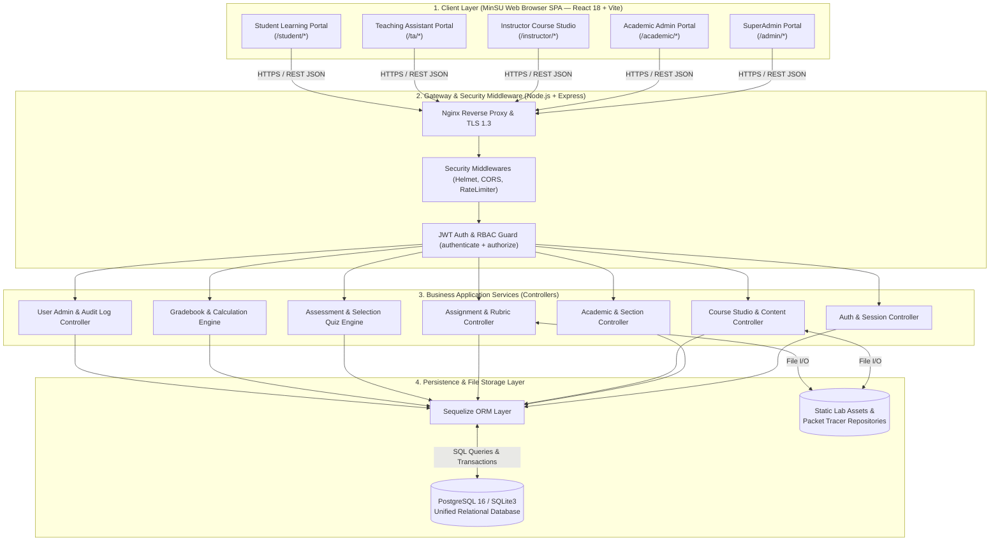

---

## A2. Class Diagram (Complete Unified Domain Model)

### Copy-Paste AI Prompt
```text
Generate a comprehensive UML Class Diagram for the Mindoro State University (MinSU) E-Learn & Networking Academy incorporating all five user roles and core entities.
Classes to include with attributes and relationships:
1. `User`: `id: Integer`, `username: String`, `email: String`, `role: Enum('super_admin','academic_admin','instructor','teaching_assistant','student')`, `campus: Enum('Bongabong','Victoria','Calapan')`, `status: Enum('active','suspended')`.
2. `AcademicTerm`: `id: Integer`, `name: String`, `startDate: Date`, `endDate: Date`, `isCurrent: Boolean`.
3. `Course`: `id: Integer`, `code: String`, `title: String`, `description: Text`, `level: Enum('beginner','intermediate','advanced')`, `status: Enum('draft','published')`.
4. `ClassSection`: `id: Integer`, `courseId: Integer`, `termId: Integer`, `instructorId: Integer`, `taId: Integer`, `sectionCode: String`, `capacity: Integer`.
5. `Enrollment`: `id: Integer`, `classSectionId: Integer`, `studentId: Integer`, `status: Enum('enrolled','dropped','completed')`, `progressPct: Float`.
6. `Module`: `id: Integer`, `courseId: Integer`, `title: String`, `orderIndex: Integer`.
7. `Lesson`: `id: Integer`, `moduleId: Integer`, `title: String`, `contentType: Enum('reading','lab','video')`, `labInstructions: Text`.
8. `Assignment`: `id: Integer`, `courseId: Integer`, `title: String`, `dueDate: DateTime`, `maxScore: Float`, `rubric: JSON`.
9. `Submission`: `id: Integer`, `assignmentId: Integer`, `studentId: Integer`, `status: Enum('submitted','late','graded','returned')`, `numericScore: Float`, `rubricBreakdown: JSON`, `gradedById: Integer`.
10. `Assessment`: `id: Integer`, `courseId: Integer`, `title: String`, `timeLimitMinutes: Integer`, `passingScorePct: Float`.
11. `Question`: `id: Integer`, `assessmentId: Integer`, `type: Enum('multiple_choice','true_false','multiple_select','matching')`, `prompt: Text`, `options: JSON`, `correctAnswer: JSON`, `points: Float`.
12. `AssessmentAttempt`: `id: Integer`, `assessmentId: Integer`, `studentId: Integer`, `score: Float`, `percentage: Float`, `passed: Boolean`.
13. `GradeItem`: `id: Integer`, `courseId: Integer`, `title: String`, `category: Enum('assignment','quiz','exam','lab')`, `weight: Float`.
14. `GradeRecord`: `id: Integer`, `gradeItemId: Integer`, `studentId: Integer`, `score: Float`.
15. `AuditLog`: `id: Integer`, `userId: Integer`, `action: String`, `resource: String`, `details: JSON`, `ipAddress: String`.
Connect all classes with appropriate associations, aggregations, compositions, and foreign key notes.
```

### Mermaid Diagram
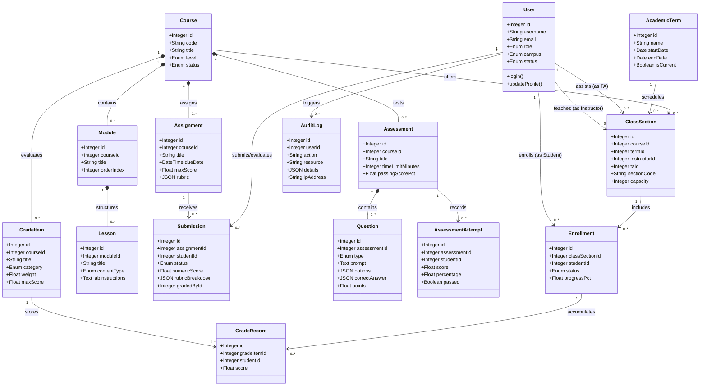

---

## A3. Component Diagram (Software Architecture & Modules)

### Copy-Paste AI Prompt
```text
Create a UML Component Diagram showing the major front-end and back-end software components of the Mindoro State University (MinSU) E-Learn & Networking Academy.
Show dependencies between:
1. Frontend Components (`client/src`):
   - `AppLayout` (Navigation, Campus Header, Dynamic Role-Based Sidebar)
   - Role Page Containers: `SuperAdminPages`, `AcademicAdminPages`, `InstructorPages`, `TaAndSharedPages`, `StudentPages`
   - UI Modules: `CourseStudio`, `RubricGrader`, `SelectionAssessmentStudio`, `CertificateDownloader`
   - Core API Client: `api.js` (Axios with Bearer Interceptor)
2. Backend Components (`server/src`):
   - `AuthenticationMiddleware` (`authenticate`, `authorize`)
   - `AuditLogMiddleware` (Captures mutations)
   - Specialized Controllers: `academic.controller`, `course.controller`, `assignment.controller`, `assessment.controller`, `admin.controller`
   - Model Layer: `SequelizeDatabaseEngine` (SQLite3 / PostgreSQL)
Link components using standard UML interface connectors and dependency arrows.
```

### Mermaid Diagram
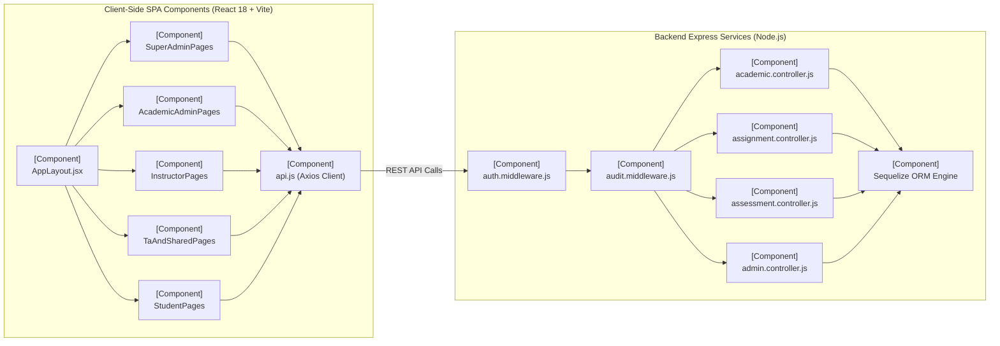

---

## A4. Deployment Diagram (Physical & Containerized Infrastructure)

### Copy-Paste AI Prompt
```text
Create a UML Deployment Diagram for the Mindoro State University (MinSU) E-Learn & Networking Academy.
Illustrate the deployment across 3 physical/virtual tiers:
1. Client Device Nodes (MinSU Campuses: Bongabong, Victoria, Calapan):
   - Admin Workstations, Faculty Laptops, Student Lab PCs running Modern Browsers (Chrome/Edge/Firefox)
2. Application Server Node (Ubuntu 24.04 LTS Host running Docker):
   - Docker Container 1: `nginx:alpine` (Reverse Proxy, SSL Termination, Static Asset Serving on Port 443)
   - Docker Container 2: `minsu-lms-backend:latest` (Node.js 20 LTS Runtime running Express API on Port 5000)
3. Database & Storage Server Node:
   - Docker Container 3: `postgres:16-alpine` (Relational database with persistent volume `/var/lib/postgresql/data`)
   - Persistent File Storage Volume (`/app/storage/labs` for guided Packet Tracer labs, student attachments, and backup dumps)
Show connection protocols: HTTPS/TLS 1.3 between clients and Nginx, TCP Port 5000 internally, and TCP Port 5432 for DB connections.
```

### Mermaid Diagram
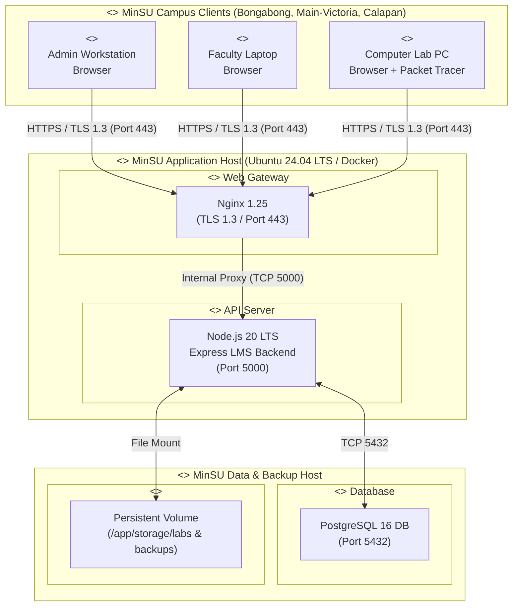

---

## A5. Object Diagram (Concrete Runtime System Snapshot)

### Copy-Paste AI Prompt
```text
Create a UML Object Diagram illustrating a concrete runtime snapshot of the Mindoro State University (MinSU) E-Learn & Networking Academy during the 1st Semester A.Y. 2026-2027.
Show specific object instances representing all 5 roles and active entities:
- `adminUser : User` (`id = 1`, `username = "superadmin"`, `role = "super_admin"`, `campus = "Main (Victoria)"`)
- `acadDean : User` (`id = 2`, `username = "dean_ccs"`, `role = "academic_admin"`, `campus = "Bongabong"`)
- `profSantos : User` (`id = 3`, `username = "prof_santos"`, `role = "instructor"`, `campus = "Bongabong"`)
- `taReyes : User` (`id = 4`, `username = "ta_reyes"`, `role = "teaching_assistant"`, `campus = "Bongabong"`)
- `studDelaCruz : User` (`id = 5`, `username = "stud_delacruz"`, `role = "student"`, `campus = "Bongabong"`)
- `term2026 : AcademicTerm` (`id = 1`, `name = "1st Semester A.Y. 2026-2027"`, `isCurrent = true`)
- `courseNet101 : Course` (`id = 1`, `code = "NET-101"`, `title = "Introduction to Networking & Packet Tracer"`)
- `secBsit2A : ClassSection` (`id = 1`, `sectionCode = "BSIT-2A-NET101"`, `instructorId = 3`, `taId = 4`)
- `assignVlan : Assignment` (`id = 10`, `title = "Packet Tracer Lab: VLAN Trunking"`, `maxScore = 100`)
- `subStudent : Submission` (`id = 25`, `studentId = 5`, `numericScore = 95.0`, `status = "graded"`, `gradedById = 3`)
- `grRecord : GradeRecord` (`id = 42`, `studentId = 5`, `score = 95.0`)
Connect instances showing exact associations and runtime links.
```

### Mermaid Diagram
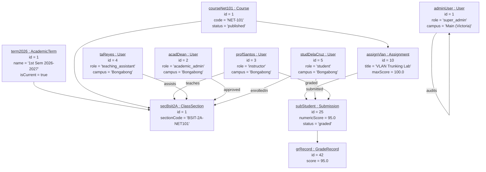

---

## A6. Package Diagram (Monorepo Codebase Organization)

### Copy-Paste AI Prompt
```text
Create a UML Package Diagram representing the architectural directory and package organization of the MinSU LMS monorepo.
Packages to include:
1. `client` (Frontend Application):
   - `client.layouts` (`AppLayout.jsx`)
   - `client.pages` (`SuperAdminPages`, `AcademicAdminPages`, `InstructorPages`, `TaAndSharedPages`, `StudentPages`, `PublicPages`)
   - `client.services` (`api.js`, `AuthContext.jsx`)
2. `server` (Backend Application):
   - `server.routes` (`academic.routes`, `assignment.routes`, `assessment.routes`, `admin.routes`)
   - `server.middleware` (`auth.middleware`, `audit.middleware`)
   - `server.controllers` (`academic.controller`, `assignment.controller`, `assessment.controller`, `admin.controller`)
   - `server.models` (`User`, `Course`, `ClassSection`, `Module`, `Lesson`, `Assignment`, `Submission`, `Assessment`, `Question`, `GradeItem`, `GradeRecord`, `AuditLog`)
Show dependency arrows (`<<import>>`, `<<use>>`, `<<call>>`) connecting these packages.
```

### Mermaid Diagram
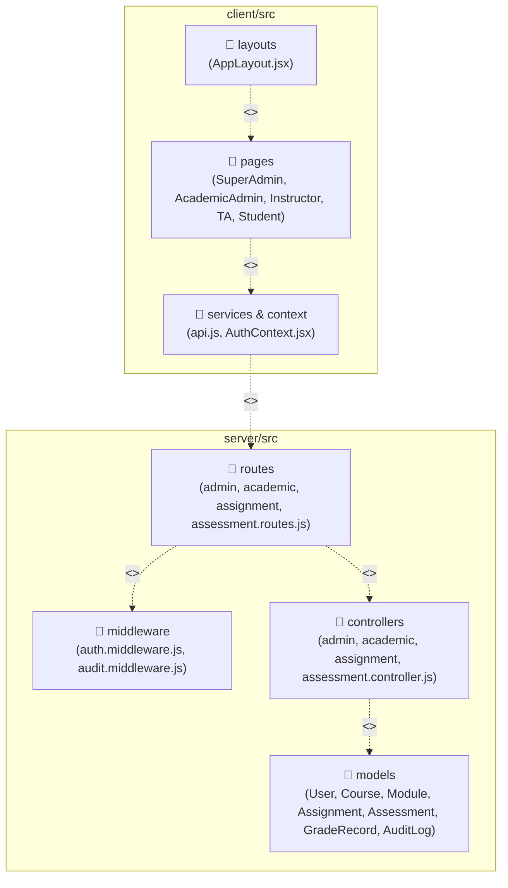

---

## A7. Composite Structure Diagram (MinSU Core Application Engine)

### Copy-Paste AI Prompt
```text
Create a UML Composite Structure Diagram for the `MinSUCoreApplicationEngine` showing external ports and internal collaborating parts.
External Ports:
- `pClientREST`: Handles incoming requests from all 5 user roles
- `pDatabaseBridge`: Connects to Sequelize ORM for persistence
- `pNotificationPort`: Dispatches in-app alerts and grading notices
Internal Parts:
- `partRBACValidator`: Enforces role-based permissions (`super_admin`, `academic_admin`, `instructor`, `teaching_assistant`, `student`)
- `partCurriculumManager`: Manages course studio modules and Packet Tracer lessons
- `partSelectionAssessmentEngine`: Validates selection-only questions (`multiple_choice`, `true_false`, `multiple_select`, `matching`) and auto-grades quizzes
- `partRubricGradingSync`: Aggregates multi-criterion rubrics and upserts `GradeRecord`
- `partAuditLogger`: Writes immutable audit logs for administrative operations
Show internal wiring and connectors between ports and parts.
```

### Mermaid Diagram
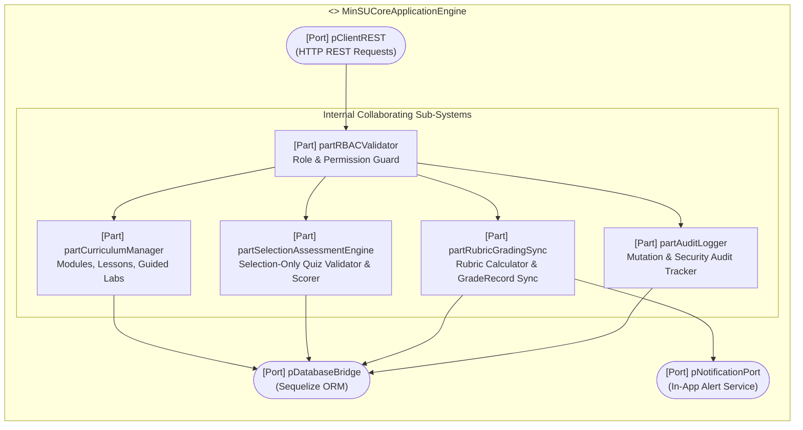

---

## A8. Profile Diagram (MinSU LMS UML Stereotype Profile)

### Copy-Paste AI Prompt
```text
Create a UML Profile Diagram defining institutional custom stereotypes for the Mindoro State University (MinSU) E-Learn & Networking Academy.
Metaclasses: `<<metaclass>> Class`, `<<metaclass>> Operation`, `<<metaclass>> Property`.
Stereotypes:
1. `<<stereotype>> MinSURoleGuard` (extends `Operation`): Tagged values `requiredRole = ['super_admin','academic_admin','instructor','teaching_assistant','student']`, `campus = ['Bongabong','Victoria','Calapan']`.
2. `<<stereotype>> SelectionOnlyQuestionRule` (extends `Class`): Tagged values `permittedTypes = ['multiple_choice','true_false','multiple_select','matching']`, `prohibitedTypes = ['fill_in_the_blank','essay']`.
3. `<<stereotype>> AutoGradeSync` (extends `Operation`): Tagged values `syncsGradeRecord = true`, `dispatchesNotification = true`.
4. `<<stereotype>> AuditLogged` (extends `Operation`): Tagged values `logsAction = true`, `immutable = true`.
```

### Mermaid Diagram
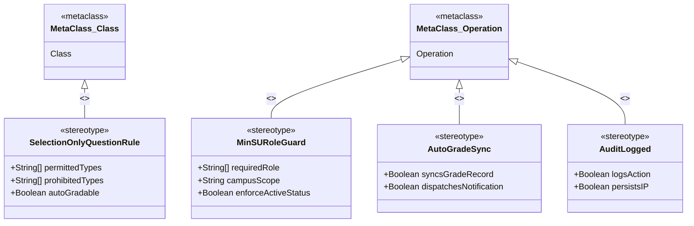

---

# SECTION 2: ALL 9 BEHAVIORAL DIAGRAMS (THE SYSTEM IN MOTION)

---

## B1. Data Flow Diagram (DFD — Level 1: Unified Multi-Role DFD)

### Copy-Paste AI Prompt
```text
Create a Level 1 Data Flow Diagram (DFD) for the Mindoro State University (MinSU) E-Learn & Networking Academy showing data flows for all 5 roles.
External Entities:
- `E1: Super Administrator`
- `E2: Academic Administrator`
- `E3: Instructor / Faculty`
- `E4: Teaching Assistant`
- `E5: Student / Learner`
Processes:
- `P1.0: User Management & System Audit`
- `P2.0: Academic Term & Section Scheduling`
- `P3.0: Course Studio & Selection Assessment Authoring`
- `P4.0: Learning, Lab Execution & Quiz Taking`
- `P5.0: Rubric Grading, Gradebook Sync & Certification`
Data Stores:
- `D1: Users & System Logs Store`
- `D2: Academic Offerings & Sections Store`
- `D3: Curriculum & Assessment Store`
- `D4: Student Submissions & Quiz Attempts Store`
- `D5: Gradebook & Certification Store`
Show clear, labeled bidirectional data flows between entities, processes, and data stores.
```

### Mermaid Diagram
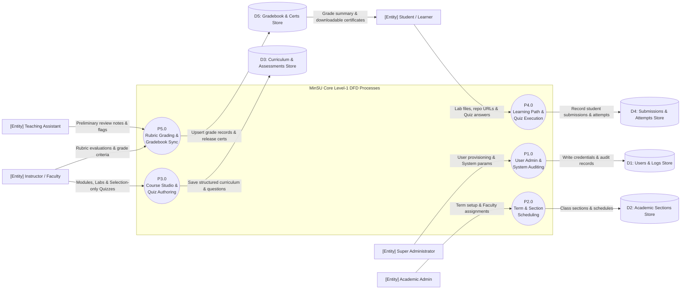

---

## B2. Use Case Diagram (Unified All-5-Roles Use Case Map)

### Copy-Paste AI Prompt
```text
Create a unified UML Use Case Diagram for the Mindoro State University (MinSU) E-Learn & Networking Academy mapping all 5 user roles as distinct actors.
Actors:
- `Super Administrator`
- `Academic Administrator`
- `Instructor / Faculty`
- `Teaching Assistant`
- `Student / Learner`
Use Cases grouped by domain:
- System & User Management: Manage Users & Roles, View Audit Logs, Configure System Settings
- Academic Management: Manage Academic Terms, Assign Instructors & TAs to Sections, Manage Enrollments
- Course & Assessment Studio: Author Modules & Lessons, Build Selection-Only Quizzes (MC, T/F, Multi-Select, Matching), Create Assignments & Rubrics
- Grading & Evaluation: Grade Lab Submissions via Rubric, Review Preliminary TA Notes, Manage Section Gradebook, Export Gradebook CSV
- Student Learning & Certification: View Lessons & Guided Labs, Submit Lab Work, Take Timed Quizzes, Download Badge & Certificate PNG, View Completed Courses
Connect actors to relevant use cases with include/extend relationships.
```

### Mermaid Diagram
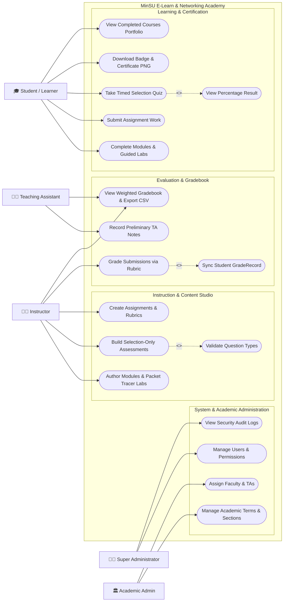

---

## B3. Activity Diagram (End-to-End Coursework, Assessment & Certification Workflow)

### Copy-Paste AI Prompt
```text
Create a UML Activity Diagram with swimlanes mapping the complete coursework, assessment, and certificate generation lifecycle in the MinSU LMS.
Swimlanes:
1. `Student / Learner`
2. `Instructor / TA`
3. `MinSU LMS System Engine`
Steps:
- Student completes learning module reading and Packet Tracer lab instructions.
- Student submits lab files and opens Checkpoint Quiz.
- Student takes timed selection-only quiz.
- System validates answers, computes score percentage, and updates progress.
- TA inspects lab submission and leaves preliminary rubric feedback.
- Instructor applies final rubric scoring and clicks "Save Grade".
- System marks submission graded, updates `GradeRecord`, and recalculates course completion percentage.
- Decision: Has course completion reached 100% and passing grade achieved?
  - If Yes: System issues Course Completion Badge and triggers dynamic HTML5 canvas certificate generation; Student downloads Certificate PNG.
  - If No: System displays updated grade in Student Gradebook.
- End.
```

### Mermaid Diagram
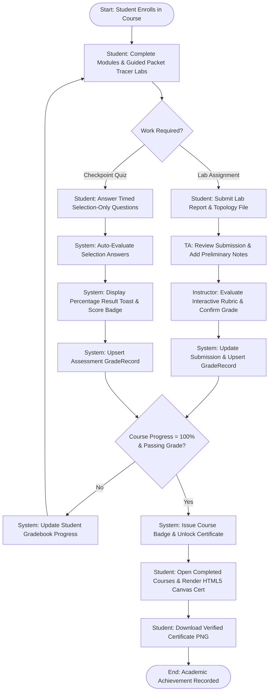

---

## B4. Sequence Diagram (Multi-Role Lab Submission, TA Review, Faculty Grading & Gradebook Sync)

### Copy-Paste AI Prompt
```text
Create a detailed UML Sequence Diagram showing the multi-role collaboration for lab submission and grading:
Participants:
- `Student`
- `TeachingAssistant`
- `Instructor`
- `ReactClient` (`client/src`)
- `ExpressAPI` (`server/src`)
- `Database` (Sequelize ORM)
Chronological Messages:
1. `Student` submits assignment (`POST /api/v1/assignments/1/submissions` with file / repo URL).
2. `ExpressAPI` verifies student JWT, creates `Submission` record with `status = 'submitted'`, and notifies TA.
3. `TeachingAssistant` accesses `/ta/submissions`, inspects the work, and adds preliminary notes (`PUT /api/v1/assignments/submissions/10/feedback`).
4. `Instructor` opens `/instructor/submissions`, reviews TA notes, selects rubric criteria (score: 95/100), and confirms grade (`PUT /api/v1/assignments/submissions/10/grade`).
5. `ExpressAPI` verifies Instructor role, updates `Submission` status to `'graded'`, upserts linked `GradeRecord`, and dispatches notification to Student.
6. `Student` views updated grade and percentage score on `/student/gradebook`.
```

### Mermaid Diagram
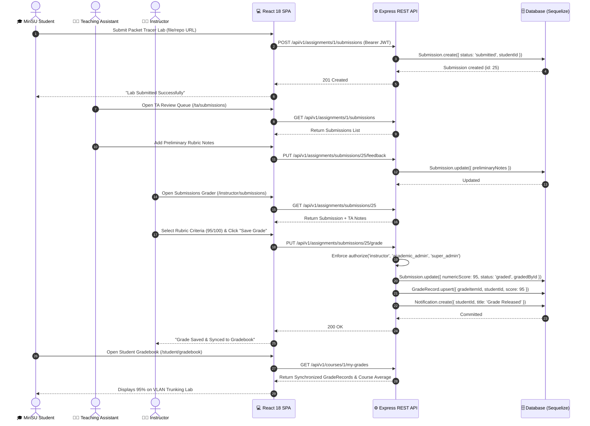

---

## B5. State Machine Diagram (Unified Entity Lifecycles)

### Copy-Paste AI Prompt
```text
Create a UML State Machine Diagram showing the lifecycle of:
1. An `Assignment Submission`: `Draft` -> `Submitted (On Time / Late)` -> `Under TA Review` -> `Returned for Revision` -> `Graded` -> `Gradebook Synchronized`.
2. A `Student Course Enrollment`: `Enrolled` -> `In Progress` -> `Completed` -> `Certified`.
Show transitions, events, guards, and actions.
```

### Mermaid Diagram
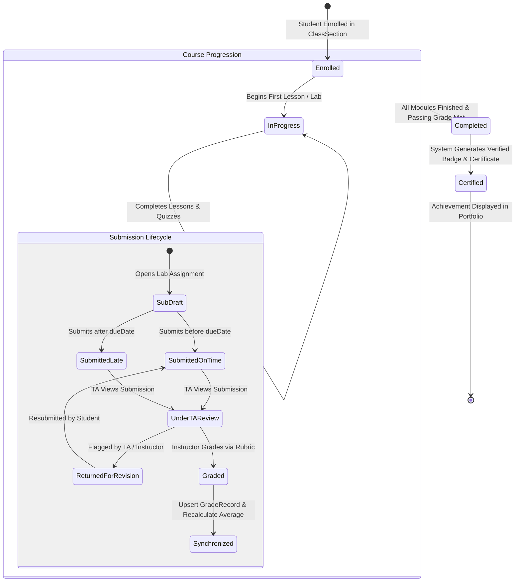

---

## B6. Communication Diagram (Object Collaboration Network)

### Copy-Paste AI Prompt
```text
Create a UML Communication Diagram representing the network of interacting objects when a student takes a timed selection-only assessment, receives an instant score percentage, and syncs the gradebook.
Objects:
- `:StudentUser`
- `:QuizTakingUI`
- `:AssessmentController`
- `:SelectionValidator`
- `:AssessmentAttemptModel`
- `:GradeRecordModel`
- `:NotificationModel`
Include numbered messages showing execution order.
```

### Mermaid Diagram
```mermaid
flowchart TB
    Stu(["🎓 :StudentUser"])
    UI["💻 :QuizTakingUI"]
    Ctrl["⚙️ :AssessmentController"]
    Val["🛡️ :SelectionValidator"]
    AttM[("📝 :AssessmentAttemptModel")]
    GRM[("🏅 :GradeRecordModel")]
    NotifM[("🔔 :NotificationModel")]

    Stu -->|"1: submitQuizAnswers(attemptData)"| UI
    UI -->|"1.1: POST /api/v1/assessments/:id/submit"| Ctrl
    Ctrl -->|"1.2: validateQuestionResponses()"| Val
    Val -->|"1.3: confirmSelectionTypes(MC, T/F, Multi, Match)"| Ctrl
    Ctrl -->|"1.4: computePercentageScore()"| Ctrl
    Ctrl -->|"1.5: create(attemptRecord)"| AttM
    Ctrl -->|"1.6: upsert(gradeRecord)"| GRM
    Ctrl -->|"1.7: create(studentNotification)"| NotifM
    Ctrl -->>|"1.8: return { score, percentage, passed }"| UI
    UI -->>|"1.9: renderResultBadgeAndScoreToast()"| Stu
```

---

## B7. Interaction Overview Diagram (Full Semester Academic Lifecycle)

### Copy-Paste AI Prompt
```text
Create a UML Interaction Overview Diagram showing the high-level control flow of a complete academic semester across MinSU campuses, integrating sequence interaction frames (`sd`).
Interaction Frames:
- `sdSetupAcademicTerm`: SuperAdmin & AcademicAdmin configure terms, course catalog, and class sections.
- `sdAuthorCurriculum`: Instructors author modules, lessons, Packet Tracer labs, and selection-only quizzes.
- `sdEnrollStudents`: Academic Admin / Students complete section enrollments.
- `sdExecuteCoursework`: Students study, submit labs, and take timed checkpoint assessments.
- `sdEvaluateAndGrade`: TAs review work, Instructors apply rubrics, and grades sync to gradebooks.
- `sdIssueCertificates`: System verifies 100% completion and issues verified Badges and Certificates.
- `sdArchiveSemester`: SuperAdmin audits system and exports academic records.
```

### Mermaid Diagram
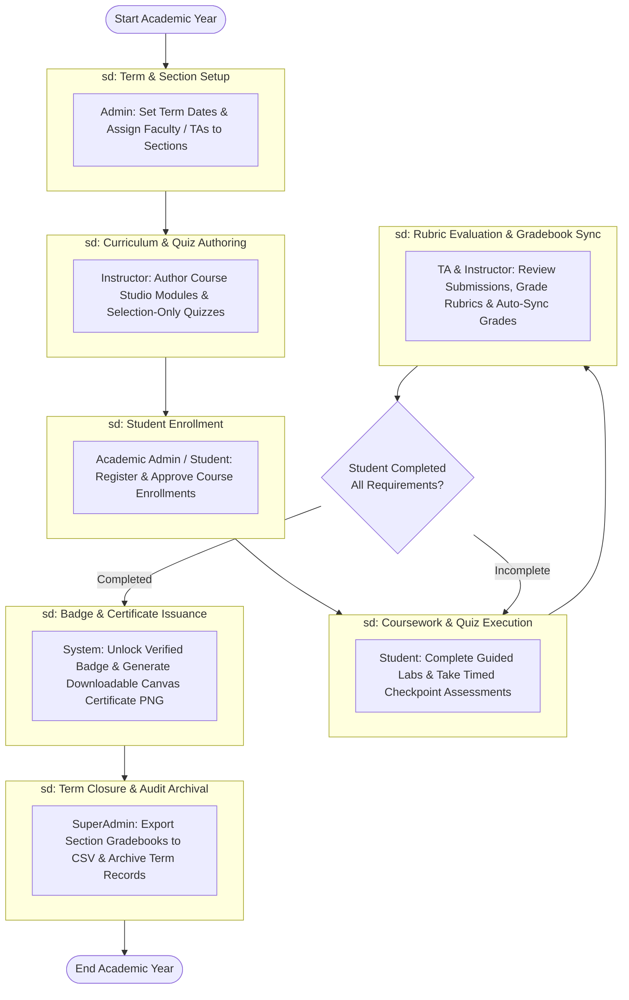

---

## B8. Timing Diagram (Real-Time Performance SLAs & Transaction Latencies)

### Copy-Paste AI Prompt
```text
Create a UML Timing Diagram illustrating state changes and maximum allowable response latencies (in milliseconds) across 4 lifelines during a Student Quiz Submission and Instant Result Calculation transaction (`T = 0ms` to `T = 250ms`).
Lifelines:
1. `StudentBrowserUI` (States: `SubmittingAnswers`, `AwaitingResponse`, `RenderingScorePercentage`)
2. `APIAuthAndRateLimiter` (States: `Idle`, `ValidatingJWT`, `Authorized`)
3. `AssessmentEngine` (States: `Idle`, `ScoringSelectionQuestions`, `CalculatingPercentage`, `UpsertingGradeRecord`)
4. `RelationalDatabase` (States: `Idle`, `WritingAttempt`, `WritingGradeRecord`, `Committed`)
Show exact milestones:
- T = 0ms: Submit clicked
- T = 20ms: Auth validated (<20ms SLA)
- T = 90ms: Questions scored and attempt persisted
- T = 160ms: GradeRecord upserted and average computed
- T = 200ms: HTTP 200 returned with percentage score
- T = 240ms: UI renders result modal and progress ring (<250ms total SLA)
```

### Mermaid Diagram
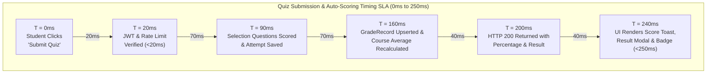

---

## B9. Requirement Diagram — SysML (Comprehensive System Traceability)

### Copy-Paste AI Prompt
```text
Create a SysML Requirement Diagram establishing complete requirement traceability for the Mindoro State University (MinSU) E-Learn & Networking Academy.
Requirements:
1. `REQ-RBAC-01`: Multi-Role Access Control (SuperAdmin, AcademicAdmin, Instructor, TA, Student)
2. `REQ-QUIZ-02`: Selection-Only Question Enforcement (Blocks fill_in_the_blank/essay; permits MC, T/F, Multi-Select, Matching)
3. `REQ-RUBRIC-03`: Interactive JSON Rubric Grading & Automatic GradeRecord Synchronization
4. `REQ-CERT-04`: Dynamic Canvas Badge & Certificate Generation upon 100% course completion
5. `REQ-AUDIT-05`: Immutable Administrative Audit Logging
Link requirements via `<<satisfy>>` to code components (`auth.middleware.js`, `assessment.controller.js`, `assignment.controller.js`, `StudentPages.jsx`, `audit.middleware.js`) and via `<<verify>>` to automated test suites (`server/tests/api.test.js`, `client/src/test/App.test.jsx`).
```

### Mermaid Diagram
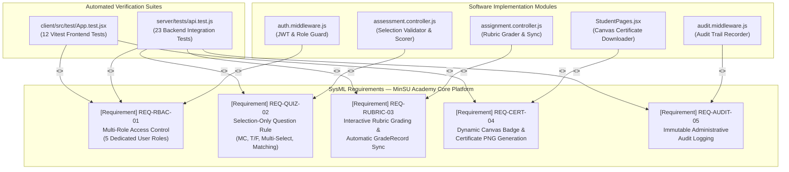

