# Mindoro State University (MinSU) LMS — Student Role Workflow System Modeling & Complete Diagram Blueprint

## Objective
To apply system modeling concepts to the **Mindoro State University (MinSU) E-Learn & Networking Academy Learning Management System (LMS)** project proposal by identifying, selecting, and generating all **Structural Diagrams (The Static Blueprint)** and **Behavioral Diagrams (The System in Motion)** required to document the **Student Account, Learning, Assessment, and Credentialing Workflow**.

---

## Part 1: Core Modeling Framework
Every proposed system must be viewed through two distinct lenses to ensure it can be successfully built:

### 1. Structural Diagrams (The Static Blueprint)
* **What it is:** These diagrams map out the static skeleton of the MinSU LMS Student Portal—what parts make up the system architecture, how they are organized, and where they will be hosted.
* **Key Rule:** These components and relationships do not change based on individual user actions. They represent the permanent infrastructure or codebase layout.
* **Core Examples:** System Architecture, Class, Component, and Deployment diagrams *(plus Object, Package, Composite Structure, and Profile diagrams)*.

### 2. Behavioral Diagrams (The System in Motion)
* **What it is:** These diagrams document the dynamic logic of the MinSU LMS Student Portal—how data moves, how components interact step-by-step, and how the system responds to student actions over time.
* **Key Rule:** These change dynamically based on triggers, inputs, time, or external events.
* **Core Examples:** Data Flow Diagrams (DFD), Use Case, Sequence, and Activity diagrams *(plus State Machine, Communication, Interaction Overview, Timing, and Requirement diagrams)*.

---

## Part 2: Diagram Reference Guide

### Section A: Structural Diagrams (Static Blueprint)
* **System Architecture Diagram:** High-level layout of MinSU student clients, Express API servers, auto-grading engines, and databases.
* **Class Diagram:** Maps out student learning data models (`User`, `Enrollment`, `ClassSection`, `Course`, `Module`, `Lesson`, `LessonProgress`, `Assessment`, `AssessmentQuestion`, `AssessmentAttempt`, `Certificate`), their attributes, and relationships.
* **Component Diagram:** Shows how the 13 Student Portal navigation modules, HTML5 Canvas Badge/Certificate generators, Express controllers, and ORM models depend on each other.
* **Deployment Diagram:** Outlines the physical devices and Docker containers hosting the MinSU Student Portal.
* **Object Diagram:** Captures a concrete runtime snapshot of a MinSU student (`Maya Lin`) completing `NET-201`, passing the Checkpoint Quiz (`90%`), and receiving Certificate `AIT-CERT-2026-0001`.
* **Package Diagram:** Groups student frontend views, schemas, controllers, and models into higher-level packages.
* **Composite Structure Diagram:** Breaks down the internal structure and ports of the `StudentAutoCompletionAndGradingEngine` classifier.
* **Profile Diagram:** Customizes UML elements with NetAcad & MinSU domain stereotypes (`<<AutoTrackedLesson>>`, `<<SelectionOnlyQuiz>>`, `<<VerifiableMinSUCredential>>`).

### Section B: Behavioral Diagrams (The System in Motion)
* **Data Flow Diagram (DFD):** Tracks how student lesson views, lab submissions, and quiz selections flow through auto-grading and completion gates into storage.
* **Use Case Diagram:** Defines project scope by mapping the **MinSU Student**, **Auto-Grading & Completion Engine**, and **Credential & Canvas PNG Generator** across all student portal goals.
* **Activity Diagram:** A technical flowchart mapping out automatic lesson progress, selection-only checkpoint quizzes, instant percentage display, and automatic course completion.
* **Sequence Diagram:** Coordinates chronological, step-by-step messages between student UI, backend controllers, and database for automatic completion and credential minting.
* **State Machine Diagram:** Tracks the lifecycle stages a Student Course Enrollment goes through (`Enrolled_Active` → `Lessons_In_Progress` → `Awaiting_Checkpoint_Quiz` → `Quiz_Attempt_In_Progress` → `Course_Completed` → `Credential_Issued`).
* **Communication Diagram:** Focuses on the object network and numbered messages during Checkpoint Quiz auto-grading and gradebook synchronization.
* **Interaction Overview Diagram:** Combines an Activity workflow with inline Sequence interaction blocks across enrollment, lesson reading, quiz execution, and badge download.
* **Timing Diagram:** Explores exact timing constraints of a server-timed Checkpoint Quiz (`t = 0m` start, countdown timer, submission, `< 100ms` auto-grade percentage calculation, and credential unlock).
* **Requirement Diagram (SysML):** Maps text-based NetAcad student requirements (automatic completion, selection-only quiz controls, percentage display, and downloadable `.PNG` badge/certificate) to code components and tests.

---

## Part 3: Completed Blueprinting Exercise

### 1. Project Identification
* **Proposal Title:** **Mindoro State University (MinSU) E-Learn & Networking Academy: A Web-Based Role-Driven Learning Management System Inspired by Cisco NetAcad**
* **System Summary (2–3 Sentences):**
  The Mindoro State University (MinSU) E-Learn & Networking Academy LMS is a centralized, full-stack educational platform that empowers MinSU students to enroll in technical courses, study interactive curriculum modules, submit laboratory assignments, and take server-timed, auto-graded checkpoint quizzes using selection-based controls (radio buttons, checkboxes, and dropdown matching). As a MinSU student views lessons and passes the required course checkpoint quizzes, the system automatically tracks real-time progress, calculates instant quiz result percentages, and transitions the course to a completed state. Upon course completion, the platform automatically awards a verifiable **Official MinSU Certificate** and a downloadable **NetAcad Digital Skill Badge (`.PNG`)**, showcased in the student's **Completed Courses & Badges** portfolio.

### 2. Structural Blueprinting
* **Selected Essential Structural Diagram:** **Class Diagram** *(supported below by all 8 Structural Diagrams)*
* **Why This Specific Layout Diagram Is Required:**
  A **Class Diagram** is essential for building the MinSU Student learning infrastructure because automatic course completion and credential issuance depend on tightly coupled relational entities in `server/src/models/index.js`: `User` (MinSU Student), `Enrollment`, `ClassSection`, `Course`, `Module`, `Lesson`, `LessonProgress`, `Assessment`, `AssessmentQuestion`, `AssessmentAttempt`, `Assignment`, `Submission`, and `Certificate`. Defining these static relationships and foreign-key constraints upfront ensures that viewing a `Lesson` accurately updates `LessonProgress`, submitting an `AssessmentAttempt` links to `GradeRecord`, and satisfying both 100% lesson progress and passed checkpoint quizzes automatically generates a unique `Certificate` record for the MinSU student.

### 3. Behavioral Blueprinting
* **Selected Critical Behavioral Diagrams:** **Sequence Diagram** and **Activity Diagram** *(supported below by all 9 Behavioral Diagrams)*
* **Specific Scenarios Mapped:**
  1. **Sequence Diagram Scenario — *MinSU Student Checkpoint Quiz Submission, Instant Percentage Auto-Grading & Automatic Course Completion with Badge/Certificate Issuance*:**
     Maps the chronological interaction when a MinSU student completes all course lessons and submits a Course Completion Checkpoint Quiz in `StudentCourseLearningPage` or `StudentAssessmentsAndExamRunnerPage` (`client/src/pages/StudentPages.jsx`). It traces how `assessment.controller.js` (`server/src/controllers/assessment.controller.js`) evaluates selection-based answers (`multiple_choice`, `true_false`, `multiple_select`, `matching`), computes the exact `percentage` score, syncs the gradebook, verifies via `evaluateAndCompleteEnrollment()` that all lessons and required quizzes are passed, marks `Enrollment.status = 'completed'`, and issues a verifiable MinSU `Certificate` and downloadable `.PNG` badge.
  2. **Activity Diagram Scenario — *End-to-End MinSU Student Learning, Automatic Lesson Tracking, Quiz Checkpoint Gate & Credential Download Workflow*:**
     Maps the step-by-step MinSU student journey from logging in, enrolling in a course section, automatically marking lessons complete on view, checking the NetAcad completion gate (Are 100% of published lessons viewed AND all checkpoint quizzes passed?), retrying failed quizzes if below `passingScore`, and unlocking the downloadable `.PNG` Digital Skill Badge and Official MinSU Certificate in `/student/certificates`.

### 4. Data Blueprinting
* **How Data Flows from a Student User Input to the System Database:**
  1. **Client Input & Interaction Capture:** When a MinSU student opens a lesson or selects answers in a checkpoint quiz (using radio buttons, checkboxes, or dropdowns in `client/src/pages/StudentPages.jsx`), the React frontend serializes the payload (`classId`, `lessonId` or `attemptId`, and `answers` map) and sends an authenticated HTTP request via Axios (`client/src/services/api.js`) with the student's `Bearer <JWT>` token.
  2. **Authentication & Student Enrollment Verification:** The Express middleware (`server/src/middleware/auth.middleware.js`) validates the JWT session and confirms the authenticated actor holds the `student` role and an active `Enrollment` in the target MinSU `ClassSection`.
  3. **Server-Side Auto-Grading & Completion Evaluation:**
     - For lesson views, `academic.controller.js` upserts a `completed` row in `lesson_progress`.
     - For quiz submissions, `assessment.controller.js` compares the student's submitted selection keys against the server-protected `correctAnswer` key in `assessment_questions`, calculates `score`, `totalPoints`, `percentage`, and `passed` status (`score >= passingScore`), and updates `assessment_attempts` and `grade_records`.
     - Both controllers invoke `evaluateAndCompleteEnrollment(studentId, classId)`, which queries total published lessons vs. completed `lesson_progress` rows and checks whether all published course assessments have a passing `AssessmentAttempt`.
  4. **Relational Persistence & Credential Minting:** Once both conditions are met, Sequelize updates `enrollments` (`progressPercentage = 100`, `status = 'completed'`, `completedAt = NOW()`), creates a verifiable `certificates` row with a unique `certificateNumber` and `verificationCode`, logs an immutable `CERTIFICATE_ISSUED` event in `audit_logs`, and returns the updated payload to the React UI so the MinSU student can immediately view their quiz percentage and download their `.PNG` Badge and Certificate.

---

## Section 1: Structural Diagrams (The Static Blueprint) — All 8 Diagrams

These show what components exist in the MinSU LMS Student Portal architecture and how they are wired together. They do not change based on user actions.

| # | Diagram Name | Primary Purpose | Best Used For (MinSU Student Context) |
| :--- | :--- | :--- | :--- |
| **A1** | **System Architecture Diagram** | Shows high-level layout of servers, clients, cloud infrastructure, and databases. | Explaining the 4-tier MinSU Student Portal, Auto-Grading Engine, and Credential Hub layout. |
| **A2** | **Class Diagram** | Maps out object-oriented classes, their attributes, methods, and relationships. | Baseline blueprint for `Enrollment`, `LessonProgress`, `Assessment`, `AssessmentAttempt`, and `Certificate`. |
| **A3** | **Component Diagram** | Shows how software pieces (modules, libraries, services) are bundled and depend on each other. | Mapping dependencies between `StudentPages.jsx`, HTML5 Canvas PNG exporters, and backend controllers. |
| **A4** | **Deployment Diagram** | Maps software components to physical hardware or containerized infrastructure (Docker). | DevOps topology connecting MinSU student devices (Desktop/Tablet/Mobile) to Nginx, Node.js, and MySQL. |
| **A5** | **Object Diagram** | Captures a snapshot of instances of classes at a specific moment in time. | Inspecting runtime objects when `studentMayaLin` completes `courseNET201` with `attemptPct=90%`. |
| **A6** | **Package Diagram** | Groups classes or components into higher-level folders (packages) to show organization. | Organizing the 13 Student sidebar modules and corresponding backend controller/model packages. |
| **A7** | **Composite Structure Diagram** | Breaks down the internal structure of a single complex classifier or class. | Designing the internal parts and ports of the `StudentAutoCompletionAndGradingEngine`. |
| **A8** | **Profile Diagram** | Customizes existing UML elements for specific industries, domains, or platforms. | Defining NetAcad & MinSU stereotypes (`<<AutoTrackedLesson>>`, `<<SelectionOnlyQuestion>>`, `<<MinSUBadge>>`). |

---

### A1. System Architecture Diagram (MinSU Student Learning & Credential Infrastructure)

#### Copy-Paste AI Prompt
```text
Create a 4-Tier System Architecture Diagram for the "Student Portal & Automatic Course Completion Infrastructure" of the "Mindoro State University (MinSU) E-Learn & Networking Academy LMS".

Tier 1: MinSU Student Client Presentation Tier (React 18 + Vite + Tailwind CSS)
- MinSU Student Dashboard & Analytics UI (/student/dashboard, /student/reports/*)
- My Classes, Rosters & Timetable UI (/student/classes/*, /student/catalog)
- Interactive Course Reader & Auto-Progress Tracker (/student/courses)
- Selection-Only Checkpoint Quiz Runner (/student/assessments - Radio, Checkbox, Dropdown controls)
- Assignment & Lab Submission Studio (/student/assignments/*)
- Completed Courses, HTML5 Canvas Badge (.PNG) & MinSU Certificate Hub (/student/certificates)

Tier 2: API Gateway & Security Middleware Tier (Node.js + Express)
- Express REST API Router (/api/courses, /api/progress, /api/assessments, /api/assignments, /api/enrollments, /api/certificates)
- JWT Authentication Guard (Verifies MinSU Student session token)
- Role & Enrollment Authorization Middleware (Verifies 'student' role & strips 'correctAnswer' fields from quiz payloads)

Tier 3: Business Logic & Evaluation Engine Tier (Controllers & Services)
- Academic & Progress Controller (Auto-marks lessons completed on view; recalculates progressPercentage)
- Assessment Auto-Grading Engine (Grades multiple_choice, true_false, multiple_select, matching; computes percentage & passed status)
- Course Completion Gatekeeper Service (evaluateAndCompleteEnrollment: verifies 100% lessons + all checkpoint quizzes passed)

Tier 4: Relational Persistence Tier (Sequelize ORM + MySQL 8 / SQLite)
- Courses, Modules & Lessons Tables
- Enrollments & LessonProgress Tables
- Assessments, AssessmentQuestions & AssessmentAttempts Tables
- Assignments, Submissions & GradeRecords Tables
- Certificates & AuditLogs Tables
```

#### Mermaid Diagram
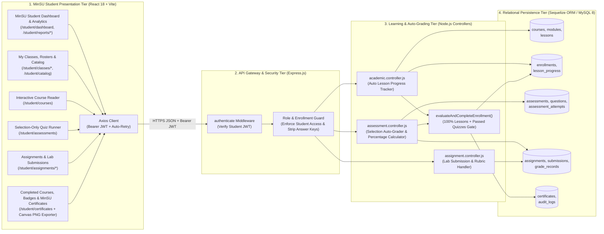

---

### A2. Class Diagram (MinSU Student Learning, Assessment & Credential Schema)

#### Copy-Paste AI Prompt
```text
Generate a detailed UML Class Diagram for the "Student Account & Learning Lifecycle Workflow" of the "Mindoro State University (MinSU) E-Learn & Networking Academy LMS".

Classes:
1. User (+id: INT PK, +studentIdNumber: STRING, +firstName: STRING, +lastName: STRING, +email: STRING, +status: ENUM, +enrollInClass(), +viewLesson(), +submitQuizAttempt())
2. Enrollment (+id: INT PK, +classId: INT FK, +studentId: INT FK, +status: ENUM, +progressPercentage: FLOAT, +finalNumericGrade: FLOAT, +finalLetterGrade: STRING, +completedAt: DATETIME, +evaluateAndCompleteEnrollment())
3. ClassSection (+id: INT PK, +courseId: INT FK, +sectionCode: STRING, +schedule: STRING, +room: STRING)
4. Course (+id: INT PK, +code: STRING, +title: STRING, +level: ENUM, +credits: INT, +status: ENUM)
5. Module (+id: INT PK, +courseId: INT FK, +title: STRING, +sequenceOrder: INT, +isPublished: BOOLEAN)
6. Lesson (+id: INT PK, +moduleId: INT FK, +title: STRING, +contentType: ENUM, +durationMinutes: INT, +isPublished: BOOLEAN)
7. LessonProgress (+id: INT PK, +studentId: INT FK, +classId: INT FK, +lessonId: INT FK, +status: ENUM, +completedAt: DATETIME)
8. Assessment (+id: INT PK, +courseId: INT FK, +classId: INT FK, +title: STRING, +type: ENUM, +timeLimitMinutes: INT, +totalPoints: FLOAT, +passingScore: FLOAT, +maxAttempts: INT)
9. AssessmentQuestion (+id: INT PK, +assessmentId: INT FK, +questionText: TEXT, +questionType: ENUM('multiple_choice', 'true_false', 'multiple_select', 'matching'), +options: JSON, +correctAnswer: JSON, +points: FLOAT)
10. AssessmentAttempt (+id: INT PK, +assessmentId: INT FK, +studentId: INT FK, +attemptNumber: INT, +status: ENUM, +responses: JSON, +score: FLOAT, +percentage: INT, +passed: BOOLEAN, +submittedAt: DATETIME)
11. Certificate (+id: INT PK, +certificateNumber: STRING, +verificationCode: STRING, +studentId: INT FK, +courseId: INT FK, +classId: INT FK, +finalScore: FLOAT, +status: ENUM, +issuedAt: DATETIME, +downloadBadgePng(), +downloadCertificatePng())
```

#### Mermaid Diagram
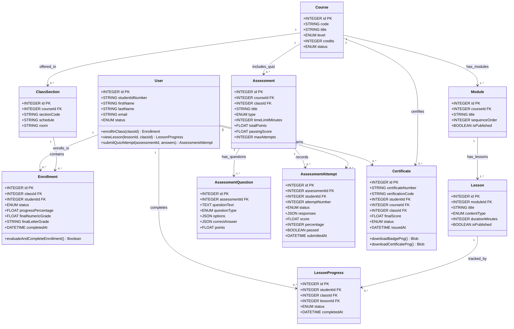

---

### A3. Component Diagram (MinSU Student Portal Module Dependencies)

#### Copy-Paste AI Prompt
```text
Create a UML Component Diagram showing how the frontend and backend software components of the MinSU Student subsystem depend on each other.

Frontend Components (client/src):
- [StudentPages.jsx] (Contains StudentDashboardPage, StudentCourseLearningPage, StudentAssessmentsAndExamRunnerPage, StudentCertificatesPage, and expandable sub-pages for Classes, Assignments, Reports, Students, Communication, Calendar, Settings, Help)
- [CanvasCredentialGenerator] (downloadCourseBadgePng & downloadCertificatePng utilities)
- [AppLayout.jsx] (Expandable 13-group Student sidebar shell)
- [api.js] (Axios client with Bearer JWT & retry interceptor)

Backend Components (server/src):
- [academic.controller.js] (Course reader, lesson progress auto-marking, certificate listing)
- [assessment.controller.js] (Quiz attempt starter, selection auto-grader, percentage calculator, evaluateAndCompleteEnrollment gatekeeper)
- [assignment.controller.js] (Assignment submission & rubric view handler)
- [models/index.js] (Sequelize ORM models)
```

#### Mermaid Diagram
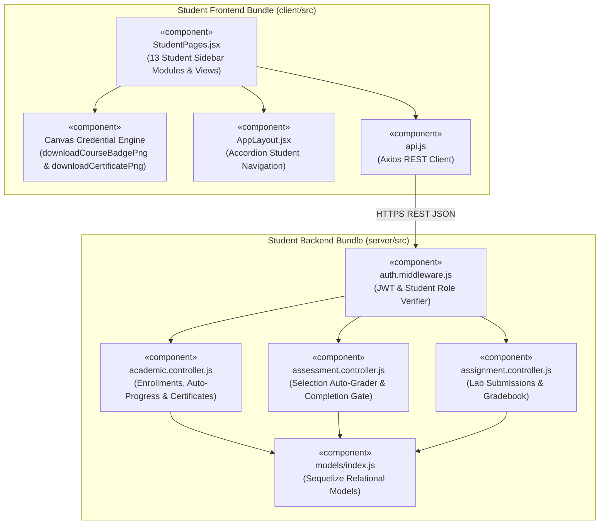

---

### A4. Deployment Diagram (MinSU Student Multi-Device & Container Topology)

#### Copy-Paste AI Prompt
```text
Create a UML Deployment Diagram for the "Mindoro State University (MinSU) E-Learn & Networking Academy LMS" showing how MinSU students access the platform from Desktop, Tablet, and Mobile devices connected to the containerized campus server infrastructure.

Nodes:
1. Node: MinSU Student Client Device (Desktop PC / Laptop / Tablet / Smartphone)
   - Execution Environment: HTML5 Web Browser with Canvas 2D Context
   - Artifact: React 18 Student Portal SPA + Canvas Badge/Certificate PNG Renderer

2. Node: MinSU Campus / Cloud Server Host (Docker Compose Engine)
   - Container 1: [lms-client (Nginx Alpine :8080)]
   - Container 2: [lms-server (Node.js 20 Alpine :5000)] (Runs Auto-Grading & Course Completion Engine + Multer File Upload Storage)
   - Container 3: [lms-mysql (MySQL 8.0 Server :3306)] (Stores courses, lesson_progress, assessment_attempts, certificates)
```

#### Mermaid Diagram
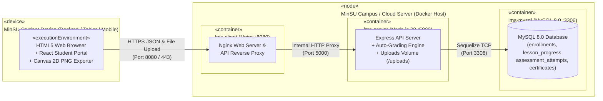

---

### A5. Object Diagram (Runtime Snapshot of Completed Course, Quiz Percentage & Certificate)

#### Copy-Paste AI Prompt
```text
Create a UML Object Diagram capturing a concrete runtime snapshot of a MinSU Student (`Maya Lin`) immediately after passing the Course Completion Checkpoint Quiz and unlocking her Course Badge and Certificate.

Objects:
1. studentMaya : User (id = 6, studentIdNumber = "2026-00101", name = "Maya Lin", email = "student@academy.edu")
2. courseNET201 : Course (id = 1, code = "NET-201", title = "Enterprise Routing, OSPF & Network Programmability")
3. enrollment1 : Enrollment (id = 1, studentId = 6, classId = 1, status = "completed", progressPercentage = 100, finalLetterGrade = "A")
4. attempt1 : AssessmentAttempt (id = 5, assessmentId = 1, studentId = 6, status = "graded", score = 90, percentage = 90, passed = true)
5. cert1 : Certificate (id = 1, certificateNumber = "AIT-CERT-2026-0001", studentId = 6, courseId = 1, finalScore = 90, status = "issued")
```

#### Mermaid Diagram
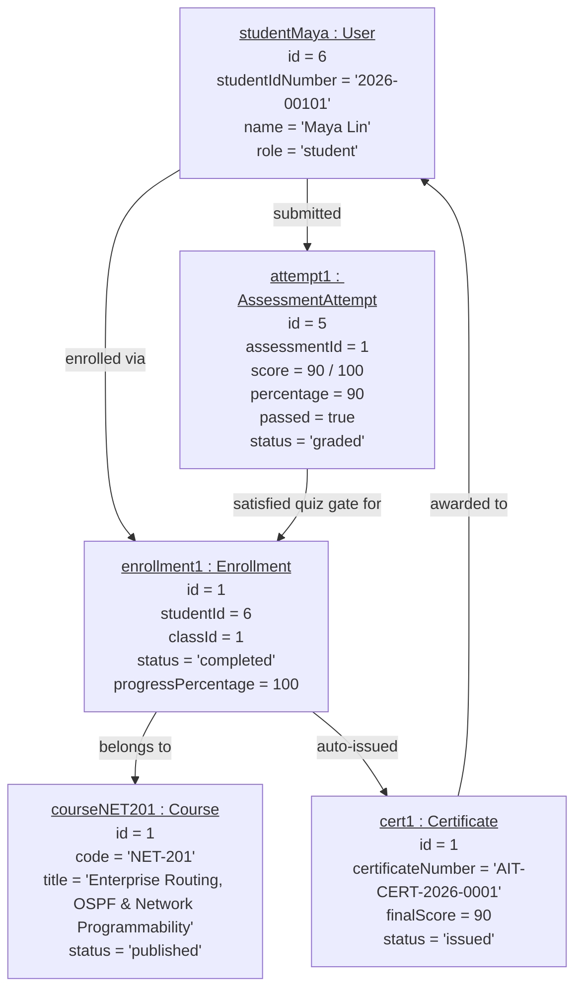

---

### A6. Package Diagram (MinSU Student Portal Codebase Organization)

#### Copy-Paste AI Prompt
```text
Create a UML Package Diagram showing the package organization of the MinSU Student Portal across frontend and backend directories.

Packages:
1. client/src
   - pages/StudentPages (Dashboard, My Classes, Learning Materials, Completed Courses & Badges, Gradebook, Assignments, Quizzes, Analytics, Directory, Communication, Calendar, Settings, Help)
   - layouts/AppLayout (Expandable Student Sidebar)
   - components/ui/SharedComponents (StatCard, StatusBadge, PageHeader, ModalDialog)
   - services/api (Axios client & endpoints)

2. server/src
   - routes (academic.routes, assessment.routes, assignment.routes, communication.routes)
   - controllers (academic.controller, assessment.controller, assignment.controller, communication.controller)
   - models (Enrollment, Course, Module, Lesson, LessonProgress, Assessment, AssessmentQuestion, AssessmentAttempt, Certificate)
```

#### Mermaid Diagram
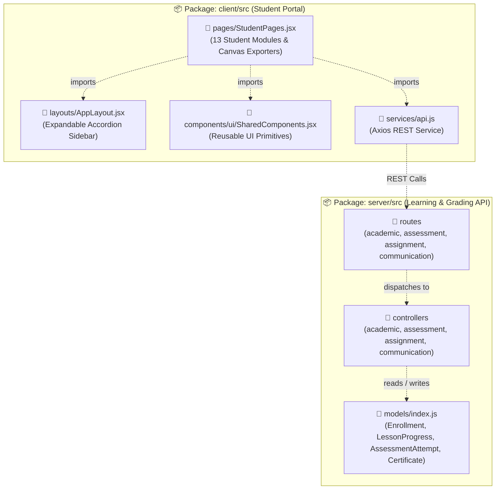

---

### A7. Composite Structure Diagram (Internal Structure of `StudentAutoCompletionAndGradingEngine`)

#### Copy-Paste AI Prompt
```text
Create a UML Composite Structure Diagram breaking down the internal parts, ports, and connectors of the "StudentAutoCompletionAndGradingEngine" classifier in the MinSU LMS.

Internal Parts:
- [Part 1: Automatic Lesson View Tracker] (Upserts 'completed' in lesson_progress when a student opens a lesson)
- [Part 2: Selection Quiz Sanitizer & Validator] (Enforces selection-only question types: multiple_choice, true_false, multiple_select, matching; strips correctAnswer on GET)
- [Part 3: Instant Percentage Auto-Grader] (Compares selections against server answer keys; computes score, percentage = round((score/total)*100), and passed boolean)
- [Part 4: Course Completion Gatekeeper] (Verifies 100% published lessons viewed AND all published course checkpoint quizzes passed)
- [Part 5: Credential & Badge Minter] (Updates Enrollment to 'completed' 100% and generates Certificate with verificationCode)
```

#### Mermaid Diagram
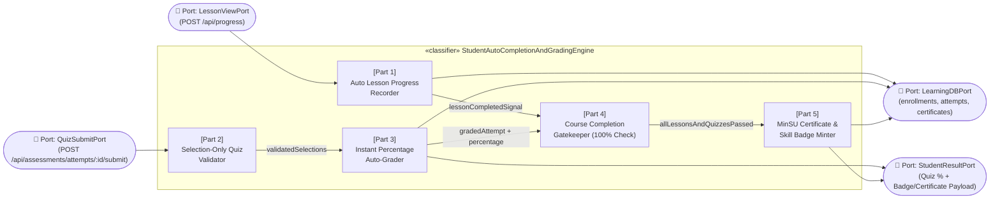

---

### A8. Profile Diagram (MinSU NetAcad Student Learning & Credential Stereotypes)

#### Copy-Paste AI Prompt
```text
Create a UML Profile Diagram defining custom stereotypes for the "MinSU NetAcad Student Learning & Credentialing Profile".

Stereotypes:
1. <<AutoTrackedLesson>> (Extends UML::Class -> Applied to Lesson & LessonProgress; tagged values: markCompleteOnView=true, requiresManualButton=false)
2. <<SelectionOnlyAssessment>> (Extends UML::Class -> Applied to AssessmentQuestion; tagged values: allowedTypes=["multiple_choice", "true_false", "multiple_select", "matching"], disallowFreeTextIdentification=true, disallowFillInTheBlank=true)
3. <<CourseCompletionGate>> (Extends UML::Operation -> Applied to evaluateAndCompleteEnrollment(); tagged values: require100PercentLessons=true, requireAllQuizzesPassed=true)
4. <<VerifiableMinSUCredential>> (Extends UML::Class -> Applied to Certificate; tagged values: exportsBadgePng=true, exportsCertificatePng=true, hashAlgorithm="SHA-256")
```

#### Mermaid Diagram
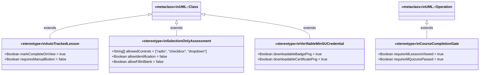

---

## Section 2: Behavioral Diagrams (The System in Motion) — All 9 Diagrams

These show how data moves, how components talk to each other, and how the MinSU LMS changes state over time in response to student triggers, lesson views, quiz submissions, timers, and completion events.

| # | Diagram Name | Primary Purpose | Best Used For (MinSU Student Context) |
| :--- | :--- | :--- | :--- |
| **B1** | **Data Flow Diagram (DFD)** | Traces how data enters a system, transforms through processes, and gets stored. | Mapping how lesson views and quiz selections flow into auto-grading and certificate generation. |
| **B2** | **Use Case Diagram** | Highlights relationships between external actors and specific goals (use cases). | Scoping all 11 Student Portal functional modules and automatic completion rules. |
| **B3** | **Activity Diagram** | A flowchart showing operational workflows, logic gates, and parallel actions step-by-step. | Documenting automatic lesson completion, selection-only quiz checks, percentage display, and badge unlock. |
| **B4** | **Sequence Diagram** | Maps chronological interactions between system entities for a single task. | Tracing `POST /api/progress` and `POST /api/assessments/attempts/:id/submit` through credential issuance. |
| **B5** | **State Machine Diagram** | Tracks the lifecycle stages an entity goes through based on events. | Tracking a Student Enrollment from `Enrolled_Active` → `Awaiting_Checkpoint_Quiz` → `Course_Completed` → `Credential_Issued`. |
| **B6** | **Communication Diagram** | Focuses on the network structure of collaborating objects and numbered messages. | Showing object collaboration between Quiz UI, AssessmentController, GradeRecord, and Certificate models. |
| **B7** | **Interaction Overview Diagram** | Combines an Activity diagram with miniature Sequence interaction blocks. | Mapping the complete student journey across enrollment, module reading, quiz checkpoint, and PNG download. |
| **B8** | **Timing Diagram** | Explores exact timing constraints and phase changes of objects over an explicit timeline. | Modeling the server-timed Checkpoint Quiz countdown (`t = 0m` to `t = 30m`), auto-submit, and `< 100ms` grading. |
| **B9** | **Requirement Diagram (SysML)** | Maps text-based system rules and requirements directly to components and tests. | Proving that automatic completion, selection-only quizzes, percentage display, and badges meet specifications. |

---

### B1. Data Flow Diagram / DFD Level 1 (MinSU Student Input-to-Database Pipeline)

#### Copy-Paste AI Prompt
```text
Create a Level 1 Data Flow Diagram (DFD) illustrating how data flows from a MinSU Student's learning and assessment inputs to the relational database in the "Mindoro State University (MinSU) E-Learn & Networking Academy LMS".

External Entity:
- MinSU Student

Processes (1.0 to 5.0):
- Process 1.0: Authenticate & Verify Enrollment (Reads D1 users & enrollments)
- Process 2.0: Auto-Record Lesson Progress (Upserts completed lesson in D2 lesson_progress; updates progressPercentage in D1)
- Process 3.0: Process Assignment & Lab Submissions (Writes to D3 submissions & grade_records)
- Process 4.0: Auto-Grade Selection Quiz & Calculate Percentage (Reads answer keys from D4; saves score, percentage, and passed flag to D4 assessment_attempts; syncs D3 grade_records; returns instant Quiz Result % to Student)
- Process 5.0: Evaluate Completion Gate & Issue Certificate/Badge (Verifies 100% lessons in D2 + passed quizzes in D4; marks D1 enrollment 'completed' 100%; mints Certificate in D5 certificates)

Data Stores:
- D1: users & enrollments
- D2: lessons & lesson_progress
- D3: submissions & grade_records
- D4: assessments, questions & attempts
- D5: certificates & audit_logs
```

#### Mermaid Diagram
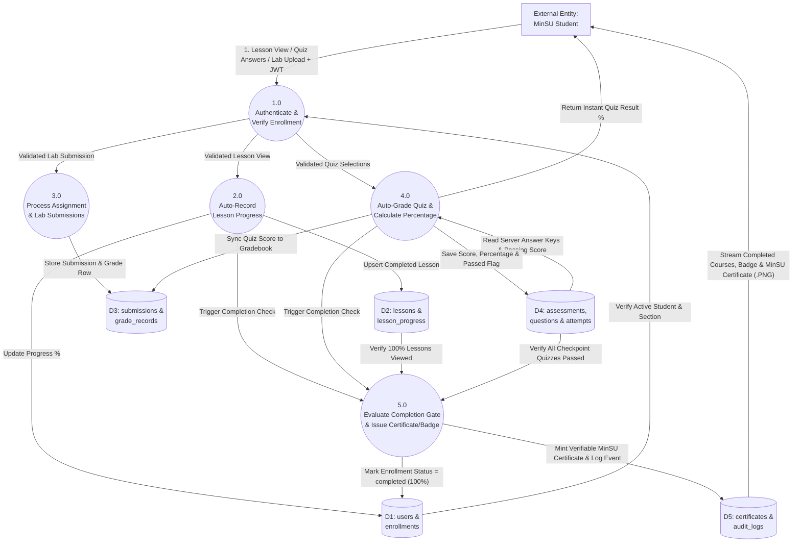

---

### B2. Use Case Diagram (MinSU Student Portal Scope)

#### Copy-Paste AI Prompt
```text
Create a UML Use Case Diagram for the "Student Role Workflow" in the "Mindoro State University (MinSU) E-Learn & Networking Academy LMS".

Actors:
- Primary Actor: MinSU Student
- Secondary Actors: Auto-Grading & Completion Engine, Credential & Canvas PNG Generator

Use Cases:
- UC1: View Dashboard, Academic Calendar & Deadlines
- UC2: Browse Course Catalog & Enroll in Sections
- UC3: View My Classes, Class Rosters & Timetable
- UC4: Study Lessons with Automatic Progress Tracking
- UC5: Submit Assignments, Labs & View Rubrics
- UC6: Take Selection-Based Checkpoint Quizzes & View % Score
- UC7: Track Gradebook, Analytics & Export CSV Transcript
- UC8: View Completed Courses, Badges & MinSU Certificates
- UC9: Download Skill Badge (.PNG) & MinSU Certificate (.PNG)
- UC10: Communicate via Messages, Discussions & Guardian Log
- UC11: Configure Course Settings, Profile & IT Help Tickets
```

#### Mermaid Diagram
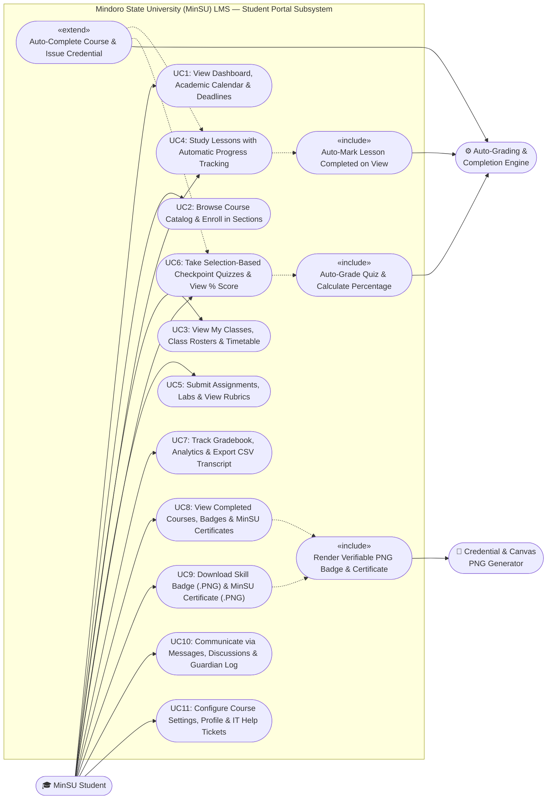

---

### B3. Activity Diagram (MinSU Student Learning, Checkpoint Quiz & Credential Workflow)

#### Copy-Paste AI Prompt
```text
Create a UML Activity Diagram mapping the complete Student Learning, Assessment, and Credential Workflow in the MinSU LMS.

Steps:
1. Start -> Student Logs into LMS -> View Student Dashboard (/student/dashboard).
2. Decision: Enrolled in Course Section? (If No -> Enroll via Course Catalog; If Yes -> Open Interactive Course Reader /student/courses).
3. Select & View Module Lesson -> System automatically marks lesson 'completed' in lesson_progress.
4. Decision: All Published Lessons Viewed? (If No -> View next lesson; If Yes -> Launch Course Completion Checkpoint Quiz).
5. Answer selection-based questions using Radio Buttons (Multiple Choice / True-False), Checkboxes (Multiple Select), and Dropdowns (Matching).
6. Submit Quiz -> Server auto-grades and displays Immediate Quiz Result Percentage (e.g., 85%).
7. Decision: Quiz Score >= Passing Score?
   - No -> Check Remaining Attempts -> Review Material & Retake Quiz.
   - Yes -> System automatically marks Course COMPLETED (100%), issues Official MinSU Certificate & Digital Skill Badge, and unlocks PNG downloads in /student/certificates.
8. End.
```

#### Mermaid Diagram
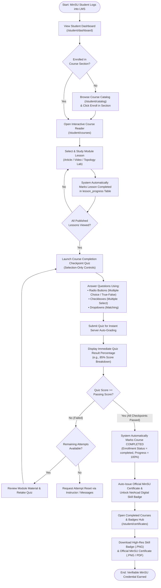

---

### B4. Sequence Diagram (Automatic Lesson Tracking, Checkpoint Quiz Auto-Grading & Credential Issuance)

#### Copy-Paste AI Prompt
```text
Create a UML Sequence Diagram for the "MinSU Student Automatic Lesson Progress, Checkpoint Quiz Auto-Grading, Percentage Display, and Automatic Course Completion with Badge & Certificate Issuance" workflow.

Participants:
1. MinSU Student
2. StudentPortalUI (React)
3. AuthMiddleware
4. AcademicController
5. AssessmentController
6. Relational Database

Trace Phase 1 (POST /api/progress on lesson view), Phase 2 (POST /api/assessments/:id/start and POST /api/assessments/attempts/:attemptId/submit with instant percentage calculation), and Phase 3 (evaluateAndCompleteEnrollment auto-completing enrollment and issuing the MinSU Certificate & Badge).
```

#### Mermaid Diagram
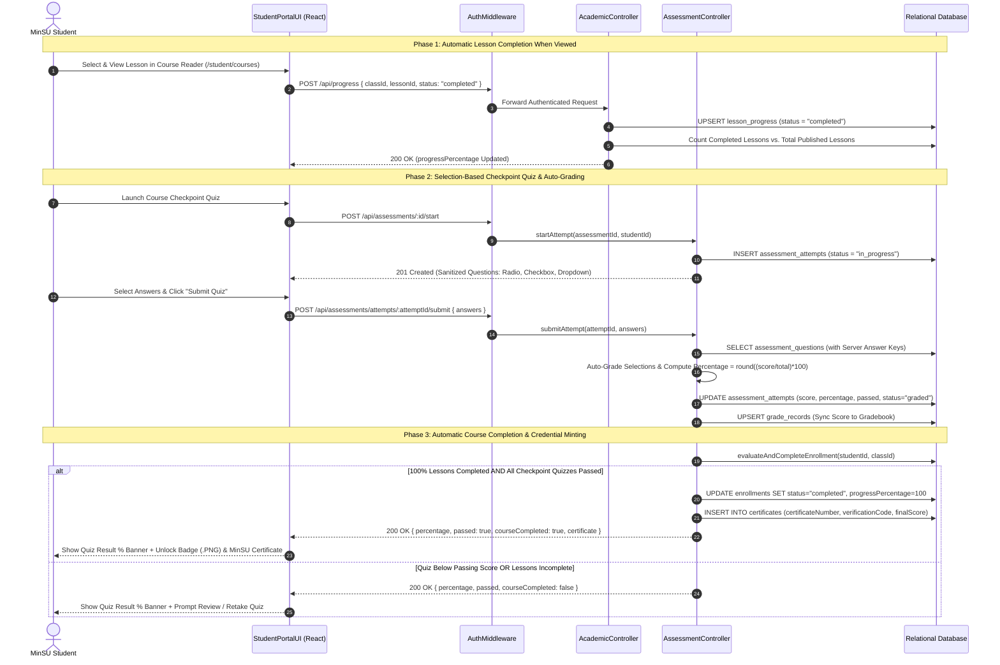

---

### B5. State Machine Diagram (MinSU Student Course & Credential Lifecycle States)

#### Copy-Paste AI Prompt
```text
Create a UML State Machine Diagram for the "MinSU Student Course Enrollment, Checkpoint Quiz, and Credential Lifecycle" in the LMS.

States:
- [*] Initial
- Enrolled_Active (status = 'active', progress = 0%)
- Lessons_In_Progress (Viewing lessons; auto-marking lesson_progress)
- Awaiting_Checkpoint_Quiz (100% lessons viewed; awaiting quiz pass)
- Quiz_Attempt_In_Progress (Answering selection-based quiz questions)
- Quiz_Failed_Retry (Score < passingScore; percentage displayed; retry allowed)
- Course_Completed (Score >= passingScore & 100% lessons viewed; status = 'completed', progress = 100%)
- Credential_Issued (Official MinSU Certificate & Skill Badge .PNG unlocked)
```

#### Mermaid Diagram
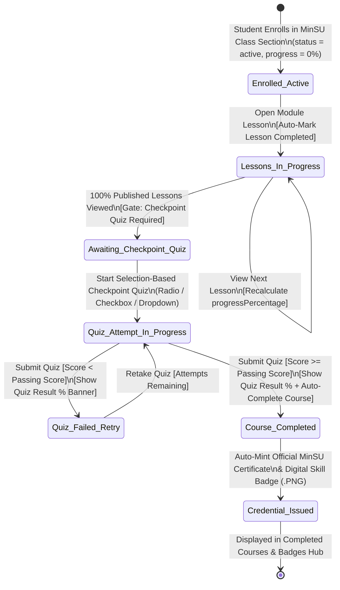

---

### B6. Communication Diagram (Object Collaboration During Quiz Submission & Auto-Completion)

#### Copy-Paste AI Prompt
```text
Create a UML Communication Diagram showing the collaborating objects and numbered messages when a MinSU Student submits a Course Completion Checkpoint Quiz.

Objects:
- :MinSUStudent (Actor)
- :QuizRunnerUI (React Component)
- :AssessmentController (Express Controller)
- :QuestionBankModel (assessment_questions)
- :GradebookModel (grade_records)
- :EnrollmentModel (enrollments)
- :CertificateModel (certificates)

Numbered Messages:
1: submitQuizSelections(attemptId, answers) -> :QuizRunnerUI
1.1: POST /api/assessments/attempts/:attemptId/submit -> :AssessmentController
1.2: fetchQuestionsWithAnswerKeys(assessmentId) -> :QuestionBankModel
1.3: upsertQuizGrade(studentId, score, percentage) -> :GradebookModel
1.4: evaluateAndCompleteEnrollment(studentId, classId) -> :EnrollmentModel
1.5: findOrCreateCertificate(studentId, courseId, finalScore) -> :CertificateModel
1.6: 200 OK { percentage, passed, courseCompleted, certificate } -> :QuizRunnerUI
```

#### Mermaid Diagram
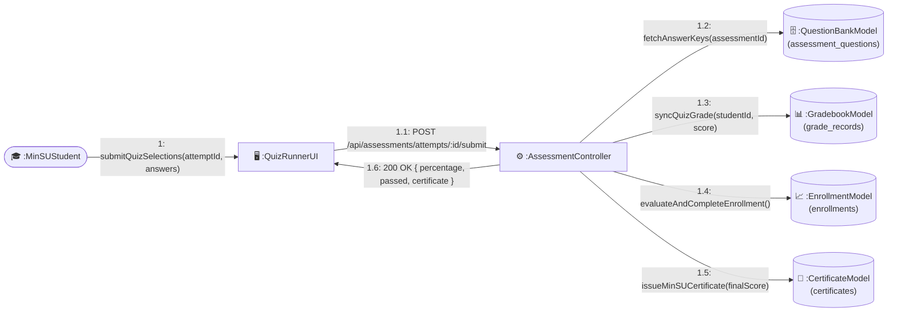

---

### B7. Interaction Overview Diagram (End-to-End Student Learning-to-Credential Journey)

#### Copy-Paste AI Prompt
```text
Create a UML Interaction Overview Diagram combining Activity flow nodes with inline Sequence interaction frames (`sd`) for the complete MinSU Student journey from Course Enrollment to Badge & Certificate Download.

Frames (`sd` blocks):
1. sd Enroll_And_Load_Curriculum (POST /api/enrollments & GET /api/courses/:id)
2. sd Auto_Track_Lesson_Views (Loop: Student views each lesson -> Auto POST /api/progress -> 100% lessons viewed)
3. sd Execute_Selection_Checkpoint_Quiz (POST /api/assessments/:id/start -> Select Radio/Checkbox/Dropdown answers -> POST /submit -> Auto-compute Percentage)
4. Decision: Passed All Course Checkpoint Quizzes?
   - No -> Loop back to sd Execute_Selection_Checkpoint_Quiz
   - Yes -> sd Auto_Complete_And_Download_Credentials (Enrollment marked 'completed' 100% -> Certificate minted -> Student downloads Badge .PNG & Certificate .PNG in /student/certificates)
```

#### Mermaid Diagram
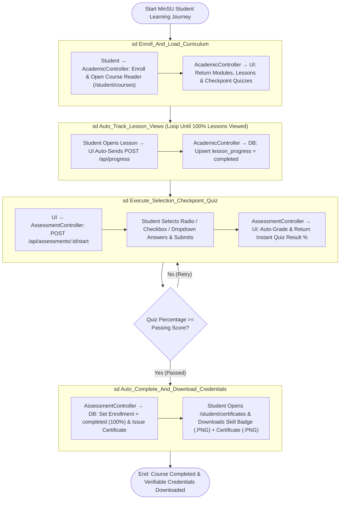

---

### B8. Timing Diagram (Server-Timed Checkpoint Quiz, Auto-Grading & Credential Unlock Timeline)

#### Copy-Paste AI Prompt
```text
Create a UML Timing Diagram exploring the exact timing constraints and phase changes during a MinSU Student's Server-Timed Checkpoint Quiz and Automatic Course Completion over an explicit timeline (t = 0m to t = 30m).

Lifelines & States over Time:
1. Lesson Progress State:
   - t = 0m to t = 15m: [Viewing_Lessons (0% -> 95%)] -> At t = 15m (last lesson viewed): Transitions to [All_Lessons_Viewed_100%].

2. Checkpoint Quiz Attempt State (30-Minute Server Timer):
   - t = 15m: Student clicks "Start Quiz" -> State transitions to [Attempt_In_Progress (Timer = 30:00)].
   - t = 15m to t = 27m: Student selects Radio, Checkbox, and Dropdown answers while countdown timer ticks.
   - t = 27m (or Auto-Submit at t = 45m if timer expires): Student clicks "Submit Quiz" -> Transitions to [Submitted_Evaluating].
   - t = 27m + 80ms: Server completes auto-grading -> Transitions to [Graded_Passed (Result = 90%)].

3. Enrollment & Credential State:
   - t = 0m to t = 27m: [Enrollment_Active].
   - t = 27m + 120ms (Triggered immediately by Graded_Passed + All_Lessons_Viewed): Transitions to [Course_Completed_100% & Certificate_Issued].
```

#### Mermaid Diagram
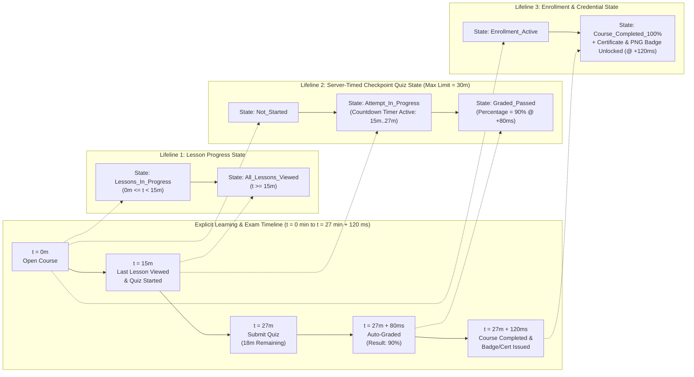

---

### B9. Requirement Diagram (SysML — MinSU Student Automatic Completion, Quiz & Credential Requirements)

#### Copy-Paste AI Prompt
```text
Create a SysML Requirement Diagram mapping the user requirements for the MinSU Student Portal to the system components that satisfy them and the automated tests that verify them.

Requirements:
- REQ-STU-01 (Automatic Course & Lesson Completion): "Viewing lessons must automatically record progress, and completing all lessons plus passing course checkpoint quizzes must automatically complete the course without manual instructor intervention."
- REQ-STU-02 (Selection-Only Quiz Controls): "Quizzes must use only selection-based controls (radio buttons for multiple choice and true/false, checkboxes for multiple select, and dropdowns for matching) with no identification or fill-in-the-blank text inputs."
- REQ-STU-03 (Immediate Quiz Result Percentage): "Upon submitting a quiz, the system must calculate and display the student's percentage score immediately."
- REQ-STU-04 (Downloadable Badge, Certificate & Completed Courses Hub): "Completing a course must issue a downloadable Digital Skill Badge (.PNG) and Official Certificate (.PNG / PDF), displayed in a dedicated Completed Courses & Badges page."

Relationships:
- <<satisfy>>: academic.controller.js & assessment.controller.js satisfy REQ-STU-01 & REQ-STU-03; StudentPages.jsx & seeders satisfy REQ-STU-02 & REQ-STU-04.
- <<verify>>: server/tests/lms.integration.test.js and client/src/App.test.jsx verify REQ-STU-01 through REQ-STU-04.
```

#### Mermaid Diagram
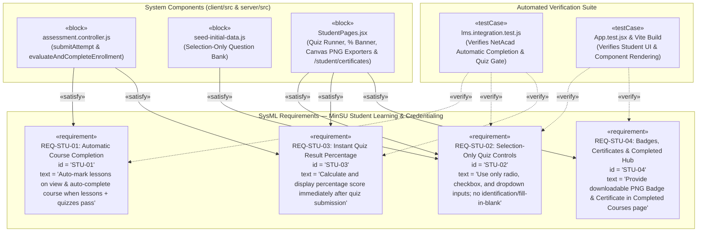
