# Mindoro State University (MinSU) LMS — SuperAdmin Account Workflow System Modeling & Complete Diagram Blueprint

## Objective
To apply system modeling concepts to the **Mindoro State University (MinSU) E-Learn & Networking Academy Learning Management System (LMS)** project proposal by identifying, selecting, and generating all **Structural Diagrams (The Static Blueprint)** and **Behavioral Diagrams (The System in Motion)** required to document the **SuperAdmin Account & Governance Workflow**.

---

## Part 1: Core Modeling Framework
Every proposed system must be viewed through two distinct lenses to ensure it can be successfully built:

### 1. Structural Diagrams (The Static Blueprint)
* **What it is:** These diagrams map out the static skeleton of the MinSU LMS project—what parts make up the system architecture, how they are organized, and where they will be hosted.
* **Key Rule:** These components and relationships do not change based on individual user actions. They represent the permanent infrastructure or codebase layout.
* **Core Examples:** System Architecture, Class, Component, and Deployment diagrams *(plus Object, Package, Composite Structure, and Profile diagrams)*.

### 2. Behavioral Diagrams (The System in Motion)
* **What it is:** These diagrams document the dynamic logic of the MinSU LMS project—how data moves, how components interact step-by-step, and how the system responds to users over time.
* **Key Rule:** These change dynamically based on triggers, inputs, time, or external events.
* **Core Examples:** Data Flow Diagrams (DFD), Use Case, Sequence, and Activity diagrams *(plus State Machine, Communication, Interaction Overview, Timing, and Requirement diagrams)*.

---

## Part 2: Diagram Reference Guide

### Section A: Structural Diagrams (Static Blueprint)
* **System Architecture Diagram:** High-level layout of MinSU servers, clients, cloud/container infrastructure, and databases.
* **Class Diagram:** Maps out data models (`User`, `Role`, `Permission`, `SystemSetting`, `AuditLog`), object classes, their attributes, and how they connect.
* **Component Diagram:** Shows how different software modules, libraries, or backend/frontend services depend on each other.
* **Deployment Diagram:** Outlines the physical hardware or containerized Docker infrastructure hosting the MinSU LMS application.
* **Object Diagram:** Captures a concrete runtime snapshot of instances of classes at a specific moment in time.
* **Package Diagram:** Groups classes, controllers, and UI components into higher-level folders (packages) to show codebase organization.
* **Composite Structure Diagram:** Breaks down the internal structure and ports of the complex `SuperAdminGovernanceEngine` classifier.
* **Profile Diagram:** Customizes UML elements with domain-specific stereotypes (`<<RBACGuard>>`, `<<ImmutableAudit>>`, `<<MinSUEntity>>`) for university governance.

### Section B: Behavioral Diagrams (The System in Motion)
* **Data Flow Diagram (DFD):** Tracks exactly how SuperAdmin input data enters the system, processes through validation/hashing nodes, and hits relational storage.
* **Use Case Diagram:** Defines project scope by mapping who the actors are (**MinSU SuperAdmin**, **Auth & RBAC Engine**, **Immutable Audit Logger**) and what actions they can take.
* **Activity Diagram:** A technical flowchart mapping out business logic, RBAC decision gates, self-lockout checks, and background audit processes.
* **Sequence Diagram:** Coordinates chronological, step-by-step messages between system entities for a single SuperAdmin feature.
* **State Machine Diagram:** Tracks the lifecycle stages a MinSU User Account goes through (`Pending` → `Active` → `Suspended` → `Inactive` → `Archived`) based on events.
* **Communication Diagram:** Focuses on the network structure and numbered message links between collaborating objects during RBAC permission updates.
* **Interaction Overview Diagram:** Combines a high-level Activity workflow with miniature Sequence interaction blocks across SuperAdmin login, provisioning, and auditing.
* **Timing Diagram:** Explores exact timing constraints and phase changes of SuperAdmin JWT sessions, rate limits, and token expiration over an explicit timeline.
* **Requirement Diagram (SysML):** Maps text-based MinSU security and governance requirements directly to backend/frontend components and integration test verifications.

---

## Part 3: Completed Blueprinting Exercise

### 1. Project Identification
* **Proposal Title:** **Mindoro State University (MinSU) E-Learn & Networking Academy: A Web-Based Role-Driven Learning Management System Inspired by Cisco NetAcad**
* **System Summary (2–3 Sentences):**
  The Mindoro State University (MinSU) E-Learn & Networking Academy LMS is a centralized, full-stack educational platform designed for MinSU campuses to streamline academic governance, IT/Networking curriculum delivery, automated assessments, and verifiable credentialing across five distinct institutional roles (Super Admin, Academic Admin, Instructor, Teaching Assistant, and Student). Within this ecosystem, the **SuperAdmin Account Workflow** governs university-wide platform security by provisioning faculty, staff, and student accounts, configuring the Role-Based Access Control (RBAC) permission matrix, managing global university portal settings, and monitoring immutable security audit logs. Every administrative action is validated on the server and persisted in a relational database to ensure strict institutional compliance and access control.

### 2. Structural Blueprinting
* **Selected Essential Structural Diagram:** **Class Diagram** *(supported below by all 8 Structural Diagrams)*
* **Why This Specific Layout Diagram Is Required:**
  A **Class Diagram** is the absolute baseline structural blueprint required to build the MinSU LMS SuperAdmin infrastructure because the entire security boundary of the university portal depends on strict relational mappings between `User`, `Role`, `Permission`, `UserRole`, `RolePermission`, `SystemSetting`, and `AuditLog` models (`server/src/models/index.js`). Without mapping these many-to-many join tables and foreign-key relationships upfront, backend developers cannot enforce granular server-side RBAC checks (`server/src/middleware/auth.middleware.js`) or guarantee that every SuperAdmin action leaves an immutable audit trail.

### 3. Behavioral Blueprinting
* **Selected Critical Behavioral Diagrams:** **Sequence Diagram** and **Activity Diagram** *(supported below by all 9 Behavioral Diagrams)*
* **Specific Scenarios Mapped:**
  1. **Sequence Diagram Scenario — *MinSU SuperAdmin User Provisioning, Role Assignment & Audit Logging*:**
     Maps the exact chronological handshake when a MinSU ICT SuperAdmin creates a university account in `UserManagementPage` (`client/src/pages/SuperAdminPages.jsx`), tracing the JWT verification and `users.manage` permission check in `auth.middleware.js`, password hashing with `bcryptjs`, transactional writes to `users` and `user_roles` via `admin.controller.js`, and automatic recording of the `USER_ACCOUNT_CREATED` event in `audit_logs`.
  2. **Activity Diagram Scenario — *MinSU SuperAdmin Account Lifecycle, RBAC Matrix Toggling & Security Governance*:**
     Maps the end-to-end operational workflow and decision gates when a MinSU SuperAdmin logs in, passes authentication and role verification, branches between User Account Lifecycle Management (Create, Activate, Suspend, Archive, Reset Password), Dynamic Role-Permission Matrix updates, or University System Configuration updates, enforces self-lockout protection guards, and triggers real-time security audit logging.

### 4. Data Blueprinting
* **How Data Flows from a SuperAdmin User Input to the System Database:**
  1. **Client Input & Serialization:** The MinSU SuperAdmin submits a form in the React frontend (`client/src/pages/SuperAdminPages.jsx`). The Axios client (`client/src/services/api.js`) serializes the JSON payload and attaches the `Authorization: Bearer <JWT>` token.
  2. **Authentication & RBAC Gatekeeper:** Express routes the request through `authenticate` and `requirePermissions('users.manage')` (`server/src/middleware/auth.middleware.js`), which decode the JWT, verify the SuperAdmin's `active` status, and confirm their role holds the required permission slug.
  3. **Validation & Cryptographic Transformation:** `admin.controller.js` (`server/src/controllers/admin.controller.js`) validates email uniqueness, role validity, and self-lockout rules, and hashes passwords via `bcrypt.hash()`.
  4. **Relational Persistence & Audit Trail Recording:** Sequelize ORM writes normalized records into `users`, `user_roles`, `role_permissions`, or `system_settings`, inserts an immutable event row into `audit_logs`, and returns a sanitized `200/201 JSON` response to update the React UI.

---

## Section 1: Structural Diagrams (The Static Blueprint) — All 8 Diagrams

These show what components exist in the MinSU LMS SuperAdmin architecture and how they are wired together. They do not change based on user actions.

| # | Diagram Name | Primary Purpose | Best Used For (MinSU SuperAdmin Context) |
| :--- | :--- | :--- | :--- |
| **A1** | **System Architecture Diagram** | Shows high-level layout of servers, clients, cloud infrastructure, and databases. | Explaining the 4-tier MinSU LMS layout to university stakeholders and developers. |
| **A2** | **Class Diagram** | Maps out object-oriented classes, their attributes, methods, and relationships. | The baseline blueprint for writing Sequelize models (`User`, `Role`, `Permission`, `AuditLog`). |
| **A3** | **Component Diagram** | Shows how software pieces (modules, libraries, services) are bundled and depend on each other. | Managing dependencies between React UI pages, Express controllers, RBAC middleware, and ORM models. |
| **A4** | **Deployment Diagram** | Maps software components to physical hardware or containerized infrastructure (Docker). | DevOps engineers configuring Nginx, Node.js API containers, and MySQL 8 volumes at MinSU. |
| **A5** | **Object Diagram** | Captures a snapshot of instances of classes at a specific moment in time. | Troubleshooting concrete runtime instances (e.g., `superAdminUser1` linked to `roleSuperAdmin` and `auditLog13`). |
| **A6** | **Package Diagram** | Groups classes or components into higher-level folders (packages) to show organization. | Managing the monorepo directory structure (`client/src/*` and `server/src/*`). |
| **A7** | **Composite Structure Diagram** | Breaks down the internal structure of a single complex classifier or class. | Designing the internal ports and connectors of the `SuperAdminGovernanceSubsystem`. |
| **A8** | **Profile Diagram** | Customizes existing UML elements for specific industries, domains, or platforms. | Defining MinSU & NetAcad security stereotypes (`<<RBACGuard>>`, `<<ImmutableAudit>>`, `<<SystemRole>>`). |

---

### A1. System Architecture Diagram (MinSU SuperAdmin Infrastructure)

#### Copy-Paste AI Prompt
```text
Create a 4-Tier System Architecture Diagram for the SuperAdmin Governance Infrastructure of the "Mindoro State University (MinSU) E-Learn & Networking Academy LMS".

Tier 1: MinSU Client Presentation Tier (React 18 + Vite SPA)
- SuperAdmin Dashboard UI (/admin/dashboard)
- User Lifecycle Manager UI (/admin/users)
- Role & Permission Matrix UI (/admin/roles)
- Global University Settings UI (/admin/settings)
- Security Audit Log Viewer (/admin/audit-logs)
- Axios HTTP Client (Attaches JWT Bearer Token & Retry Interceptor)

Tier 2: API Gateway & Security Middleware Tier (Node.js + Express)
- Express REST Router (/api/admin/*, /api/auth/*)
- JWT Authentication Middleware (Verifies token signature & active user session)
- RBAC Authorization Guard (Enforces 'super_admin' role & granular permissions: 'users.manage', 'roles.manage', 'settings.manage', 'audit.view')

Tier 3: Business Logic & Service Tier (Controllers & Utilities)
- Auth Controller (Login, Password Reset, Token Issuance)
- Admin Controller (User CRUD, Status Toggling, Role Matrix Sync, System Settings Update, System Backup Snapshot)
- Bcrypt Password Hashing Service
- Immutable Audit Logger Service (logAuditEvent)

Tier 4: Persistence & Storage Tier (Sequelize ORM + MySQL 8 / SQLite)
- Users & UserRoles Tables
- Roles & RolePermissions Tables
- SystemSettings Table
- AuditLogs Table (Append-only security ledger)

Connect Tier 1 -> Tier 2 -> Tier 3 -> Tier 4 with labeled directional arrows.
```

#### Mermaid Diagram
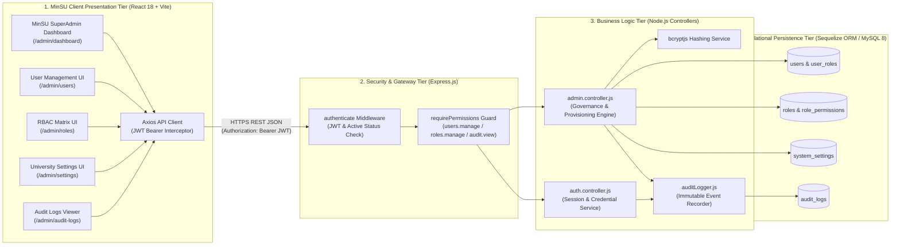

---

### A2. Class Diagram (MinSU SuperAdmin RBAC & Governance Schema)

#### Copy-Paste AI Prompt
```text
Generate a detailed UML Class Diagram for the "SuperAdmin Account & Governance Workflow" of the "Mindoro State University (MinSU) E-Learn & Networking Academy LMS".

Classes:
1. User (+id: INT PK, +studentIdNumber: STRING, +firstName: STRING, +lastName: STRING, +email: STRING, +passwordHash: STRING, +status: ENUM, +departmentId: INT FK, +lastLoginAt: DATETIME, +verifyPassword(), +hasPermission())
2. Role (+id: INT PK, +name: STRING, +slug: ENUM, +description: STRING, +isSystem: BOOLEAN, +assignPermissions())
3. Permission (+id: INT PK, +name: STRING, +slug: STRING, +module: STRING, +description: STRING)
4. UserRole (+id: INT PK, +userId: INT FK, +roleId: INT FK)
5. RolePermission (+id: INT PK, +roleId: INT FK, +permissionId: INT FK)
6. SystemSetting (+id: INT PK, +key: STRING, +value: TEXT, +category: STRING, +description: STRING, +updateSetting())
7. AuditLog (+id: INT PK, +actorId: INT FK, +action: STRING, +category: STRING, +severity: ENUM, +entityType: STRING, +entityId: INT, +ipAddress: STRING, +details: TEXT, +createdAt: DATETIME, +logAuditEvent())

Relationships:
- User "1" --> "0..*" UserRole
- Role "1" --> "0..*" UserRole
- Role "1" --> "0..*" RolePermission
- Permission "1" --> "0..*" RolePermission
- User "1" --> "0..*" AuditLog
- User "1" ..> "0..*" SystemSetting
```

#### Mermaid Diagram
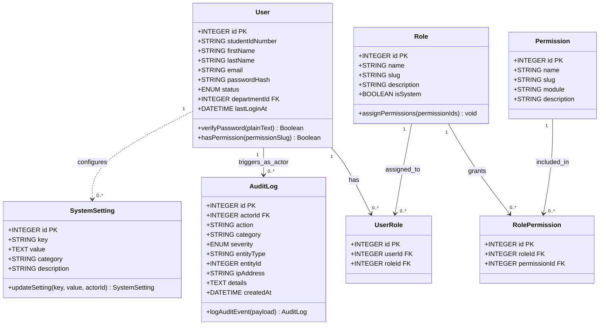

---

### A3. Component Diagram (MinSU SuperAdmin Software Module Dependencies)

#### Copy-Paste AI Prompt
```text
Create a UML Component Diagram showing how the frontend and backend software modules of the MinSU SuperAdmin subsystem depend on each other.

Frontend Components (client/src):
- [SuperAdminPages.jsx] (Contains SuperAdminDashboardPage, UserManagementPage, RolePermissionMatrixPage, SystemSettingsPage, AuditLogsPage)
- [AuthContext.jsx] (Provides user session state & role checks)
- [AppLayout.jsx] (Provides role-based navigation shell)
- [api.js] (Axios REST client with Bearer token & retry interceptors)

Backend Components (server/src):
- [admin.routes.js] & [auth.routes.js] (Express route definitions)
- [auth.middleware.js] (Provides authenticate and requirePermissions interfaces)
- [admin.controller.js] (Implements user CRUD, role matrix sync, settings & audit queries)
- [auditLogger.js] (Implements immutable security logging service)
- [models/index.js] (Sequelize ORM data access component)

Show dependency arrows from Frontend Components -> REST API Interface -> Backend Middleware -> Backend Controllers -> Sequelize Models.
```

#### Mermaid Diagram
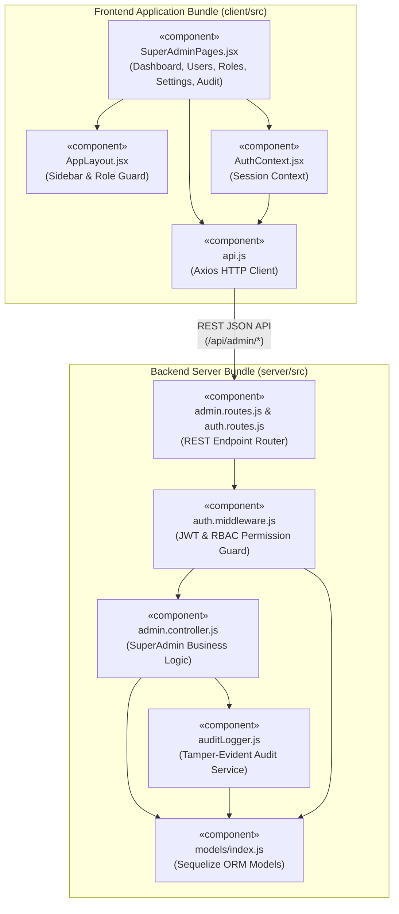

---

### A4. Deployment Diagram (MinSU Containerized & Campus Server Topology)

#### Copy-Paste AI Prompt
```text
Create a UML Deployment Diagram for the "Mindoro State University (MinSU) E-Learn & Networking Academy LMS" showing how the SuperAdmin application components are deployed across physical/cloud nodes and Docker containers.

Nodes:
1. Node: MinSU Administrator Workstation (Client Device)
   - Artifact: Modern Web Browser (Chrome / Edge)
   - Executes: React 18 SPA Bundle + Tailwind CSS

2. Node: MinSU Application Host / Cloud Server (Docker Engine)
   - Container 1: [lms-client (Nginx Alpine :8080)]
     * Serves static Vite production bundle & reverse-proxies /api/*
   - Container 2: [lms-server (Node.js 20 Alpine :5000)]
     * Runs Express REST API, JWT/RBAC Middleware, AdminController, and Sequelize ORM
   - Container 3: [lms-mysql (MySQL 8.0 Server :3306)]
     * Mounts persistent volume [mysql_lms_data] storing users, roles, permissions, system_settings, and audit_logs

Connect Workstation -> Nginx Container (HTTPS :443 / HTTP :8080) -> Node.js Container (TCP :5000) -> MySQL 8.0 Container (TCP :3306).
```

#### Mermaid Diagram
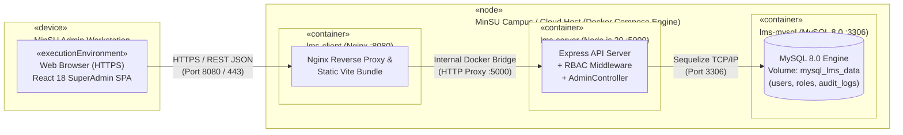

---

### A5. Object Diagram (Runtime Snapshot of SuperAdmin Provisioning & Audit State)

#### Copy-Paste AI Prompt
```text
Create a UML Object Diagram capturing a concrete runtime snapshot in the MinSU LMS immediately after the SuperAdmin provisions a new Instructor account.

Objects (Instances):
1. superAdmin1 : User
   - id = 1
   - firstName = "Victor"
   - lastName = "Aris"
   - email = "superadmin@academy.edu"
   - status = "active"

2. superAdminRole : Role
   - id = 1
   - name = "Super Administrator"
   - slug = "super_admin"
   - isSystem = true

3. permUsersManage : Permission
   - id = 1
   - slug = "users.manage"
   - module = "Users"

4. newInstructorUser : User
   - id = 10
   - firstName = "Elena"
   - lastName = "Vance"
   - email = "elena.vance@minsu.edu.ph"
   - status = "active"

5. instructorRole : Role
   - id = 3
   - name = "Instructor"
   - slug = "instructor"

6. auditEvent13 : AuditLog
   - id = 13
   - actorId = 1
   - action = "USER_ACCOUNT_CREATED"
   - category = "user"
   - severity = "info"
   - entityType = "User"
   - entityId = 10

Show links between superAdmin1 -> superAdminRole -> permUsersManage, superAdmin1 -> auditEvent13, and newInstructorUser -> instructorRole.
```

#### Mermaid Diagram
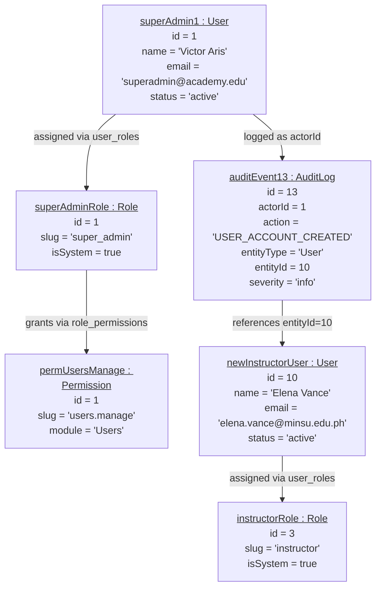

---

### A6. Package Diagram (MinSU LMS Codebase & Layer Organization)

#### Copy-Paste AI Prompt
```text
Create a UML Package Diagram illustrating how the MinSU LMS SuperAdmin codebase is organized into high-level packages across the client and server workspaces.

Packages:
1. Package: client.src
   - Subpackage: pages.SuperAdminPages (UI views for Dashboard, Users, Roles, Settings, Audit)
   - Subpackage: layouts.AppLayout (Role navigation & breadcrumbs)
   - Subpackage: context.AuthContext (Session & token provider)
   - Subpackage: services.api (Axios HTTP wrapper)
   - Subpackage: schemas.validation (Zod form validation schemas)

2. Package: server.src
   - Subpackage: routes (admin.routes, auth.routes, dashboard.routes)
   - Subpackage: middleware (auth.middleware, validate.middleware, error.middleware)
   - Subpackage: controllers (admin.controller, auth.controller, dashboard.controller)
   - Subpackage: models (User, Role, Permission, SystemSetting, AuditLog)
   - Subpackage: utils (auditLogger, seeders, migrations)

Show dashed package import/dependency arrows between packages.
```

#### Mermaid Diagram
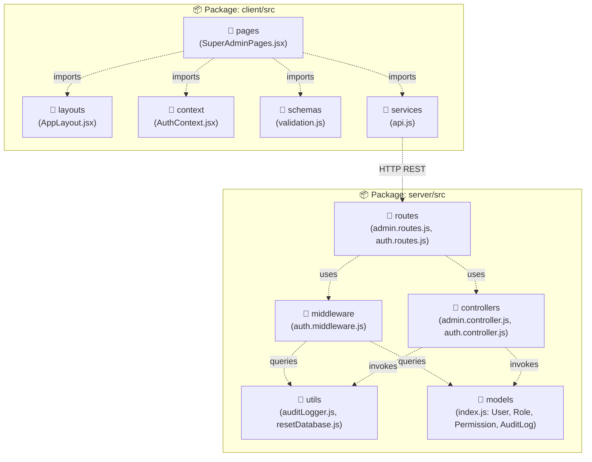

---

### A7. Composite Structure Diagram (Internal Structure of `SuperAdminGovernanceEngine`)

#### Copy-Paste AI Prompt
```text
Create a UML Composite Structure Diagram breaking down the internal parts, ports, and connectors inside the complex classifier "SuperAdminGovernanceEngine" in the MinSU LMS.

Internal Parts:
- [JWT & Session Verifier Part] (Port: AuthHeaderPort)
- [RBAC Permission Evaluator Part] (Checks 'users.manage', 'roles.manage', 'settings.manage', 'audit.view')
- [Self-Lockout Guard Part] (Prevents SuperAdmin from deleting/suspending own active ID or stripping core super_admin permissions)
- [Account & Role Provisioner Part] (Hashes passwords & syncs user_roles / role_permissions)
- [System Config & Backup Manager Part] (Upserts system_settings & builds JSON snapshot)
- [Immutable Audit Dispatcher Part] (Port: AuditPersistencePort -> writes to AuditLog table)

Show how incoming requests enter through AuthHeaderPort, pass through the internal parts and delegation connectors, and exit via DatabasePersistencePort and AuditPersistencePort.
```

#### Mermaid Diagram
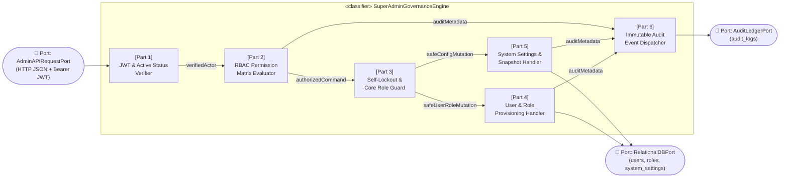

---

### A8. Profile Diagram (MinSU LMS Security & Governance UML Stereotypes)

#### Copy-Paste AI Prompt
```text
Create a UML Profile Diagram defining custom stereotypes and tagged values for the "Mindoro State University (MinSU) LMS Security & Governance Profile".

Metaclasses Extended:
1. Metaclass: Class
   - Stereotype: <<MinSUIdentityEntity>> (Tagged values: requiresUniqueEmail=true, passwordHashAlgorithm="bcrypt/argon2") -> Applied to User
   - Stereotype: <<SystemProtectedRole>> (Tagged values: isImmutableCoreRole=true, lockOutPrevention=true) -> Applied to Role ('super_admin')
   - Stereotype: <<AppendOnlyAuditLedger>> (Tagged values: allowUpdate=false, allowDelete=false, retentionYears=10) -> Applied to AuditLog

2. Metaclass: Operation / Middleware
   - Stereotype: <<RBACGuard>> (Tagged values: requiredPermissionSlug: String, logUnauthorizedAttempt=true) -> Applied to requirePermissions()
```

#### Mermaid Diagram
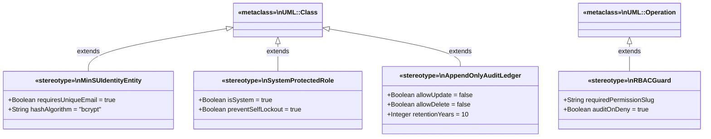

---

## Section 2: Behavioral Diagrams (The System in Motion) — All 9 Diagrams

These show how data moves, how components talk to each other, and how the MinSU LMS changes state over time in response to SuperAdmin triggers, inputs, time constraints, and security events.

| # | Diagram Name | Primary Purpose | Best Used For (MinSU SuperAdmin Context) |
| :--- | :--- | :--- | :--- |
| **B1** | **Data Flow Diagram (DFD)** | Traces how data enters a system, transforms through processes, and gets stored. | Mapping how SuperAdmin inputs pass through RBAC checks, password hashing, and audit logging into MySQL. |
| **B2** | **Use Case Diagram** | Highlights relationships between external actors and specific goals (use cases). | Scoping all 11 SuperAdmin governance capabilities and their security `<<include>>` rules. |
| **B3** | **Activity Diagram** | A flowchart showing operational workflows, logic gates, and parallel actions step-by-step. | Documenting SuperAdmin login, self-lockout checks, RBAC matrix updates, and audit log filtering. |
| **B4** | **Sequence Diagram** | Maps chronological interactions between system entities for a single task. | Debugging the exact API handshake for `POST /api/admin/users` (User Provisioning & Role Assignment). |
| **B5** | **State Machine Diagram** | Tracks the lifecycle stages an entity goes through based on events. | Tracking a MinSU User Account across `Pending` → `Active` → `Suspended` → `Inactive` → `Archived`. |
| **B6** | **Communication Diagram** | Focuses on the network structure of collaborating objects and numbered messages. | Understanding object collaboration during dynamic Role-Permission Matrix synchronization. |
| **B7** | **Interaction Overview Diagram** | Combines an Activity diagram with miniature Sequence interaction blocks. | Mapping the multi-stage SuperAdmin governance session from authentication to backup & audit export. |
| **B8** | **Timing Diagram** | Explores exact timing constraints and phase changes of objects over an explicit timeline. | Modeling JWT session lifecycle, rate-limiting windows (`15 min`), and token expiration/revocation. |
| **B9** | **Requirement Diagram (SysML)** | Maps text-based system rules and requirements directly to components and tests. | Proving that MinSU RBAC, self-lockout protection, and immutable audit rules are satisfied and tested. |

---

### B1. Data Flow Diagram / DFD Level 1 (MinSU SuperAdmin Input-to-Database Pipeline)

#### Copy-Paste AI Prompt
```text
Create a Level 1 Data Flow Diagram (DFD) illustrating how data moves from a MinSU SuperAdmin user input to the system database in the "Mindoro State University (MinSU) E-Learn & Networking Academy LMS".

External Entity:
- MinSU SuperAdmin (Source & Sink of governance payloads and dashboard telemetry)

Processes (1.0 to 5.0):
- Process 1.0: Authenticate & Enforce RBAC (Verifies Bearer JWT & permission slugs against D1 & D2)
- Process 2.0: Provision Users & Sync Role Matrix (Hashes passwords via bcrypt; writes to D1 users/user_roles and D2 roles/role_permissions)
- Process 3.0: Update System Settings & Backup (Upserts key-value JSON into D3 system_settings)
- Process 4.0: Record Immutable Audit Trail (Appends security/operational event rows into D4 audit_logs)
- Process 5.0: Aggregate KPIs & Audit Streams (Reads D1, D2, D3, D4 and returns sanitized JSON telemetry to MinSU SuperAdmin)

Data Stores:
- D1: users & user_roles
- D2: roles & role_permissions
- D3: system_settings
- D4: audit_logs
```

#### Mermaid Diagram
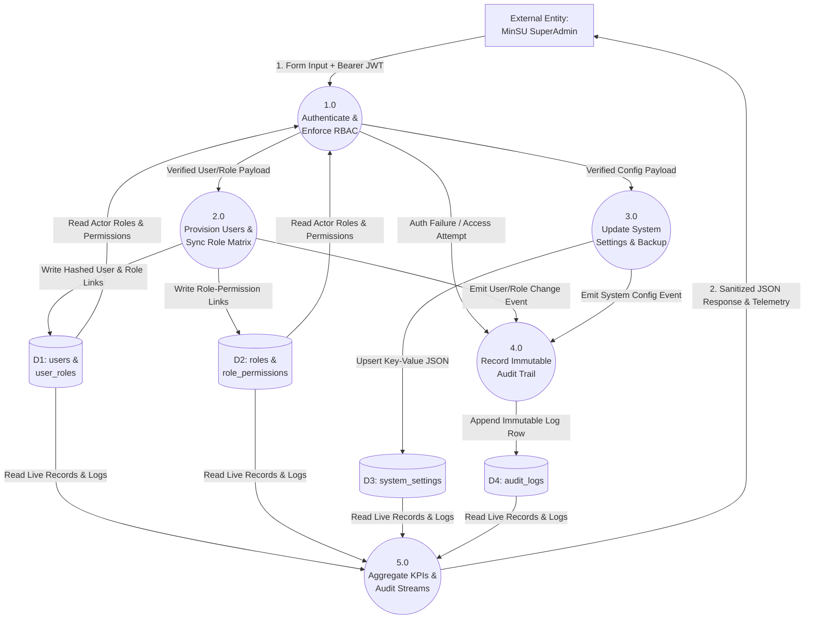

---

### B2. Use Case Diagram (MinSU SuperAdmin Governance Scope)

#### Copy-Paste AI Prompt
```text
Create a UML Use Case Diagram for the "SuperAdmin Account Workflow" in the "Mindoro State University (MinSU) E-Learn & Networking Academy LMS".

Actors:
- Primary Actor: MinSU Super Administrator
- Secondary Actors: Auth & RBAC Engine, Immutable Audit Logger

Use Cases:
- UC1: View Executive KPI & Telemetry Dashboard
- UC2: Provision New Institutional User Accounts
- UC3: Manage User Status (Activate / Suspend / Archive)
- UC4: Force Reset User Passwords
- UC5: Assign Multi-Role Memberships
- UC6: Configure Role-Permission Matrix (RBAC)
- UC7: Oversee MinSU Departments & Academic Config
- UC8: Update Global System & Security Settings
- UC9: Generate System Backup Snapshot
- UC10: Inspect & Filter Security Audit Logs
- UC11: Export Institutional Compliance Reports

Include <<include>> relationships to "Verify JWT & Role Permission" and "Write Immutable Audit Log", and <<extend>> "Block Self-Suspension / Lockout" on UC3.
```

#### Mermaid Diagram
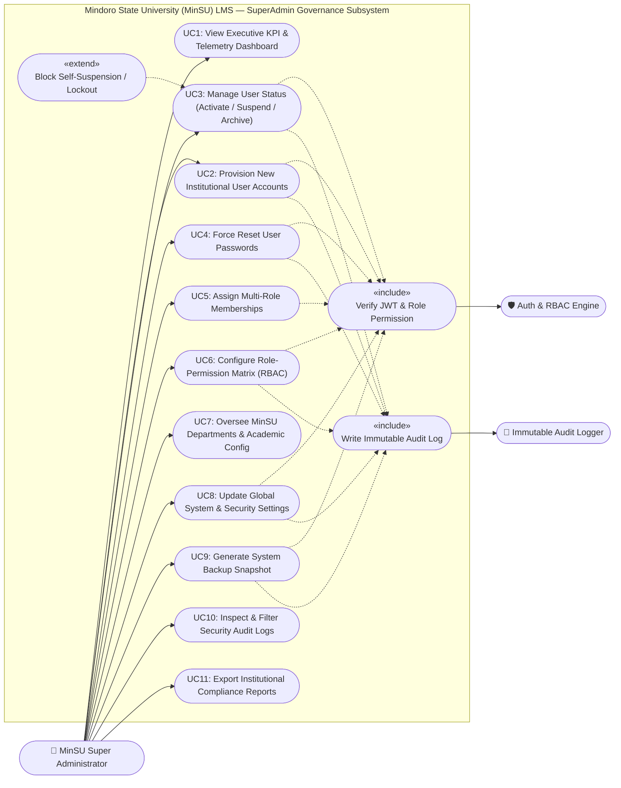

---

### B3. Activity Diagram (MinSU SuperAdmin Operational & Decision Workflow)

#### Copy-Paste AI Prompt
```text
Create a UML Activity Diagram showing the complete operational workflow and decision gates of a MinSU SuperAdmin in the LMS.

Steps:
1. Start -> Submit Login Credentials -> Decision: Valid & Active?
   - No -> Log AUTH_LOGIN_FAILED -> Show Error -> Return to Login.
   - Yes -> Issue JWT -> Log AUTH_LOGIN_SUCCESS -> Render SuperAdmin Dashboard (/admin/dashboard).
2. Select Governance Module:
   - Branch 1 (User Management): Create User (bcrypt hash -> save user & roles) OR Edit/Suspend/Archive (Check Self-Lockout Guard: Target == Current SuperAdmin? If Yes -> Reject 400; If No -> Update User) -> Write USER_ACCOUNT_* Audit Log.
   - Branch 2 (RBAC Matrix): Check if Target Role == super_admin (Enforce Core Permissions Guard) -> Sync role_permissions -> Write ROLE_PERMISSIONS_UPDATED Audit Log.
   - Branch 3 (System Settings & Backup): Upsert system_settings OR Generate JSON Backup Snapshot -> Write SYSTEM_* Audit Log.
   - Branch 4 (Security Audit Logs): Filter immutable audit_logs by category, severity, or actor.
3. Refresh React UI & Display Toast Confirmation -> End.
```

#### Mermaid Diagram
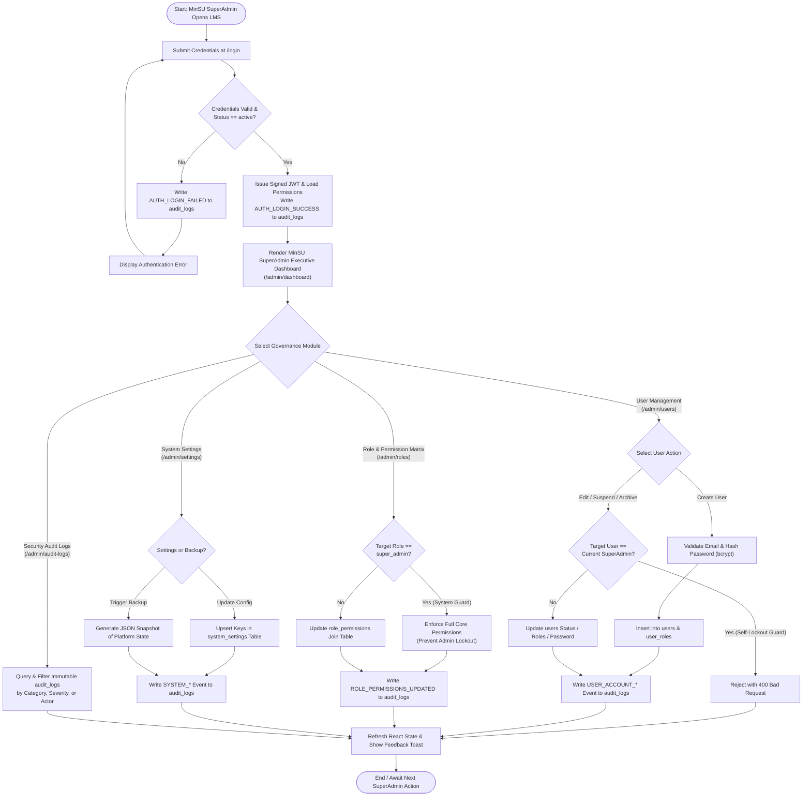

---

### B4. Sequence Diagram (MinSU SuperAdmin User Provisioning & Audit Handshake)

#### Copy-Paste AI Prompt
```text
Create a UML Sequence Diagram for the "SuperAdmin User Provisioning, Role Assignment, and Immutable Audit Logging" workflow in the MinSU LMS.

Participants:
1. MinSU SuperAdmin
2. UserManagementPage (React)
3. Auth & RBAC Middleware
4. AdminController (Express)
5. BcryptService
6. Relational Database (Sequelize)
7. AuditLogService

Show the chronological messages for POST /api/admin/users including the alt block for unauthorized access (403 + security audit log), alt block for duplicate email (409 Conflict), and happy path (bcrypt password hashing, user + user_roles insertion, USER_ACCOUNT_CREATED audit log, and 201 Created response).
```

#### Mermaid Diagram
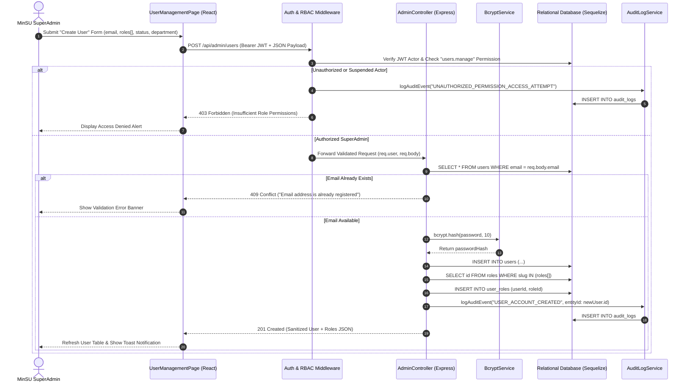

---

### B5. State Machine Diagram (MinSU Institutional User Account Lifecycle States)

#### Copy-Paste AI Prompt
```text
Create a UML State Machine Diagram for the "MinSU Institutional User Account Lifecycle" managed by the SuperAdmin in the LMS.

States:
- [*] Initial
- Pending (Awaiting activation)
- Active (Full role-based portal access)
- Suspended (Blocked due to policy violation; active JWT sessions rejected)
- Inactive (End-of-semester deactivation or leave of absence)
- Archived (Permanent historical record for transcripts & audit logs)

Show event transitions triggered by SuperAdmin actions (Create, Activate, Suspend, Restore, Deactivate, Archive).
```

#### Mermaid Diagram
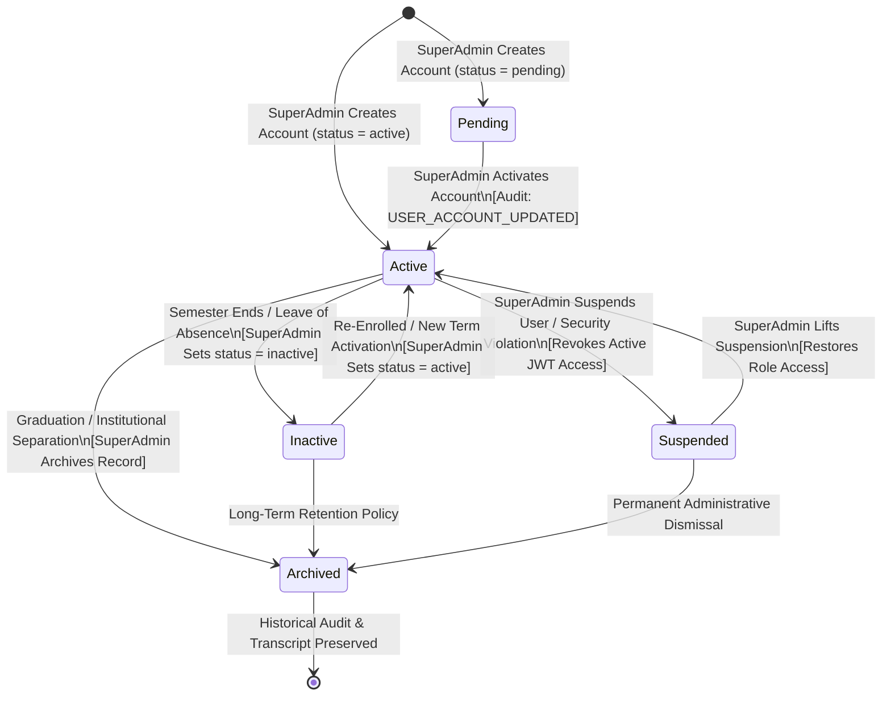

---

### B6. Communication Diagram (Object Collaboration During RBAC Matrix Update)

#### Copy-Paste AI Prompt
```text
Create a UML Communication Diagram showing the network of collaborating objects and numbered messages when a MinSU SuperAdmin updates a Role's permissions in the Role-Permission Matrix (/admin/roles).

Objects:
- :SuperAdmin (Actor)
- :RolePermissionMatrixPage (React UI)
- :AuthMiddleware (RBAC Guard)
- :AdminController (Express Controller)
- :RoleModel (Sequelize Role & RolePermission)
- :AuditLogger (Security Audit Service)

Numbered Messages:
1: togglePermissions(roleId, permissionIds[]) -> :RolePermissionMatrixPage
1.1: PUT /api/admin/roles/:id/permissions (JWT) -> :AuthMiddleware
1.2: verifyPermission('roles.manage') -> :RoleModel
1.3: updateRolePermissions(req, res) -> :AdminController
1.3.1: setPermissions(permissionIds[]) -> :RoleModel
1.3.2: logAuditEvent('ROLE_PERMISSIONS_UPDATED') -> :AuditLogger
1.4: 200 OK (Updated Role Matrix JSON) -> :RolePermissionMatrixPage
```

#### Mermaid Diagram
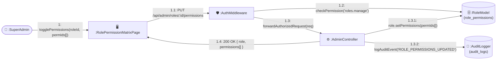

---

### B7. Interaction Overview Diagram (End-to-End SuperAdmin Governance Session)

#### Copy-Paste AI Prompt
```text
Create a UML Interaction Overview Diagram combining high-level Activity flow nodes with inline Sequence interaction frames (`sd`) for a complete MinSU SuperAdmin governance session.

Frames (`sd` blocks):
1. sd Authenticate_SuperAdmin: (Login POST /api/auth/login -> Verify bcrypt hash -> Issue JWT -> Write AUTH_LOGIN_SUCCESS)
2. Decision Node: Select Governance Task
   - Frame A: sd Provision_Institutional_User (POST /api/admin/users -> Validate -> Hash -> Save User & Roles -> Audit Log)
   - Frame B: sd Update_RBAC_Matrix (PUT /api/admin/roles/:id/permissions -> Guard super_admin -> Sync role_permissions -> Audit Log)
   - Frame C: sd Configure_And_Backup_System (PUT /api/admin/settings & POST /api/admin/backup -> Upsert Settings -> Snapshot JSON -> Audit Log)
3. Merge Node -> sd Inspect_Security_Audit_Logs (GET /api/admin/audit-logs -> Filter & Verify Trail) -> End Session.
```

#### Mermaid Diagram
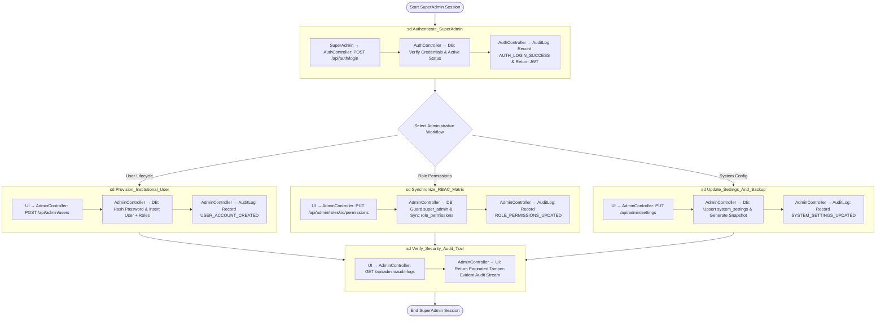

---

### B8. Timing Diagram (SuperAdmin JWT Session, Rate-Limiting & Token Expiration Timeline)

#### Copy-Paste AI Prompt
```text
Create a UML Timing Diagram showing the exact timing constraints and state changes of a MinSU SuperAdmin's Authentication Session, API Rate Limiter, and Audit Logger over an explicit timeline (t = 0m to t = 480m / 8 hours).

Lifelines & States over Time:
1. SuperAdmin Session Token (JWT):
   - t = 0m: Unauthenticated -> Login Success -> State transitions to [Valid_Active_JWT] (TTL = 8 hours / 480 mins).
   - t = 5m to 479m: [Valid_Active_JWT] (Authenticated requests permitted).
   - t = 480m (or upon Logout / Suspension): Transitions to [Expired_Or_Revoked] -> Requires re-authentication (401 Unauthorized).

2. Auth Rate Limiter Window (15-Minute Sliding Window):
   - t = 0m to 15m: [Window_Open (< 200 req / 15m)].
   - If burst exceeds threshold -> [Rate_Limited_429] until 15m window resets.

3. Audit Logger Stream:
   - Fires synchronous write pulses (< 50ms latency) at t = 0m (AUTH_LOGIN_SUCCESS), t = 10m (USER_ACCOUNT_CREATED), t = 25m (ROLE_PERMISSIONS_UPDATED), and t = 480m (AUTH_LOGOUT).
```

#### Mermaid Diagram
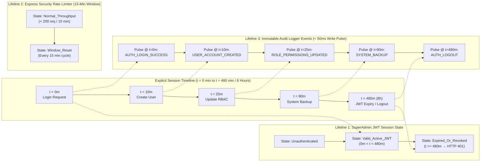

---

### B9. Requirement Diagram (SysML — MinSU SuperAdmin Governance & Security Requirements)

#### Copy-Paste AI Prompt
```text
Create a SysML Requirement Diagram mapping the formal security and governance requirements of the MinSU SuperAdmin subsystem to the code components that satisfy them and the automated tests that verify them.

Requirements:
- REQ-SA-01 (Server-Side RBAC Enforcement): "All /api/admin/* endpoints must verify JWT authentication and granular role permissions ('users.manage', 'roles.manage', 'settings.manage', 'audit.view') on the server."
- REQ-SA-02 (Self-Lockout Prevention): "A SuperAdmin must be blocked from suspending/deleting their own active account or removing core permissions from the 'super_admin' role."
- REQ-SA-03 (Secure Credential Hashing): "All provisioned or reset user passwords must be salted and hashed using bcrypt before database storage."
- REQ-SA-04 (Tamper-Evident Audit Trail): "Every authentication event, unauthorized access attempt, user lifecycle change, role update, and setting modification must be logged in audit_logs."

Relationships:
- <<satisfy>>: auth.middleware.js satisfies REQ-SA-01; admin.controller.js satisfies REQ-SA-02 & REQ-SA-03; auditLogger.js satisfies REQ-SA-04.
- <<verify>>: server/tests/lms.integration.test.js verifies REQ-SA-01, REQ-SA-02, REQ-SA-03, and REQ-SA-04.
```

#### Mermaid Diagram
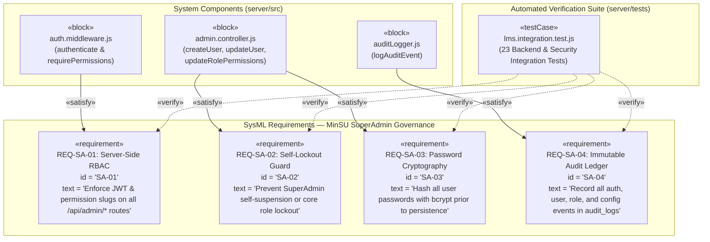
